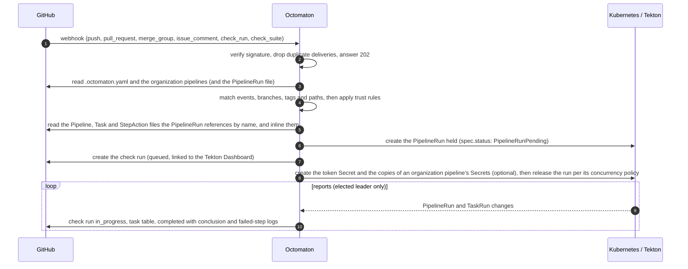

# Octomaton

Octomaton replaces GitHub Actions for the `arikkfir-org` organization. A GitHub App sends every webhook to
Octomaton (running in GKE); Octomaton reads the repository's root `.octomaton.yaml` and the organization pipelines its
owner declares in its organization repository, creates the Tekton `PipelineRun`s it maps the event to, and reports each
run back to GitHub as a check run.

Octomaton is **application-agnostic**: it knows nothing about what a repository builds, its language or layout. The
only repository files it reads are `.octomaton.yaml` (the repository's own, and the one in its owner's organization
repository, which a server setting names), the PipelineRun files they point to, and the Pipeline, Task and StepAction
files those reference by name beside them. PipelineRun files are plain Tekton YAML; Octomaton injects event context
only through `params` and an optional GitHub token workspace.

## How it works



1. Every webhook is verified (HMAC-SHA256) before anything else, then processed asynchronously on a bounded worker
   pool. A full queue answers 503, so GitHub records a failed delivery that can be redelivered.
2. The event is matched against each pipeline's triggers. A matching pipeline whose path filters do not match gets a
   check run concluded `skipped` (required checks do not block). Forks are ignored outright: see [Security](#security).
3. Runs are named `<repo>-<pipeline>-<sha7>-<attempt>`. A redelivery, or a second event for the same commit, pipeline and
   branch, finds the existing run. Each comment command, review request, pull request change (`edited`, `labeled`,
   `unlabeled`), ending (`closed`, `converted_to_draft`, a destroyed merge group) and resumption (`reopened`;
   `ready_for_review` for a pipeline with `drafts: false`) gets its own run, new commits on a pull
   request run every review request still pending on it again, and re-runs create the next attempt.
4. Runs are created held, then their check run, token Secret and the copies of an organization pipeline's Secrets
   are created, then they are released per their concurrency group. If anything fails in between, the run is cancelled and its check says why. A run held longer than
   five minutes is resumed by the leader (which also serves as the poll for queued runs).
5. The elected leader watches the runs and keeps their checks up to date, refreshes GitHub tokens of long runs, fires
   cron schedules and deletes PVCs of finished runs.
6. Every GitHub request is retried when it fails for a reason that may pass (a connection error or timeout, a 5xx but
   501, a 429, a secondary rate limit): up to 6 attempts, waits doubling from 1 s to 30 s or as `Retry-After` says, each
   retry logged as a warning (a `Retry-After` is followed up to a minute). An event whose requests still fail is
   reported, retried the same way and past the webhook job's deadline: a configuration that could not be read fails
   `octomaton` (the scheduled pipeline's check when a schedule fires; a reply when a comment command is declined), and a
   run whose check could not be opened fails its pipeline's check. Re-running a failed check tries again, and concludes
   `octomaton` successfully when the event evaluates. Only the periodic read of schedules just logs; a failure report
   that still fails is logged as an error ([design](docs/octomaton/designs/github-retries.md)).
   A replica drops a delivery it is handling or handled in the last hour, unless a failed call left part of its event
   undone: then its redelivery is handled again, until one copy succeeds.

## Hosting Octomaton

Octomaton runs in any Kubernetes cluster that runs Tekton Pipelines. [`deploy/`](deploy/) (Kustomize) is what every
installation applies as written: Namespace `octomaton` (the restricted Pod Security Standard enforced), ServiceAccount
`octomaton` and its [RBAC](#deployment), Deployment `octomaton` (two replicas, spread over nodes, a PodDisruptionBudget
of `maxUnavailable: 1`) and Service `octomaton` (port 80 → container 8080). [`deploy/logs/`](deploy/logs/) is the
[step logs server](#archived-step-logs-octomaton-logs), `octomaton-logs`, applied the same way by a host that wants
archived step logs in its Tekton Dashboard, and by no one else. Neither names a host: the images are untagged, and the
servers read their settings from objects the host writes, by name. A host provides, in this order:

| The host provides | How |
| --- | --- |
| A [GitHub App](#github-app), installed on the owners it serves, its webhook at `https://<host>/github/hooks` | Created by hand, once |
| Secret `octomaton-github` in namespace `octomaton`, keys `app-id`, `private-key` and `webhook-secret` | However the host makes Secrets: an ExternalSecret, a sealed Secret, `kubectl create secret` |
| ConfigMap `octomaton` in namespace `octomaton`: the [server's settings](#server-configuration) as environment variables; `OCTOMATON_GITHUB_ALLOWED_OWNERS` is required | Plain YAML in the host's repository |
| `deploy/` applied as written, at a release of its choosing (a version tag, or a commit of `main`), the image `me-west1-docker.pkg.dev/arikkfir/octomaton/octomaton` tagged with that version or that commit's short SHA ([releases](#releases)) | An Argo CD Application with `kustomize.images`, or `kustomize edit set image` and `kubectl apply -k` |
| A route from the webhook's URL to Service `octomaton`, port 80, path `/github/hooks` | An HTTPRoute, an Ingress; whatever fronts the cluster |
| Network admission to the pods labelled `app.kubernetes.io/name: octomaton`, port 8080, from the route's proxy, if the cluster has NetworkPolicies | A NetworkPolicy in namespace `octomaton` |
| RoleBinding `octomaton` of ClusterRole `octomaton-tenant` to ServiceAccount `octomaton/octomaton` in every namespace runs are created in ([RBAC](#deployment)) | With the tenant namespaces |
| Optionally `deploy/logs/`, applied the same way at the same commit, the image `…/octomaton-logs` tagged the same; ConfigMap `octomaton-logs` with the [step logs server's settings](#archived-step-logs-octomaton-logs); a cloud identity for ServiceAccount `octomaton/octomaton-logs` that reads the log view; admission from the Dashboard's pods to the pods labelled `app.kubernetes.io/name: octomaton-logs`, port 8080; and the Dashboard's external logs URL, `http://octomaton-logs.octomaton.svc.cluster.local/logs` | A second Application, a ConfigMap, a Workload Identity binding, a NetworkPolicy, a Dashboard setting |
| Additions to `deploy/`'s objects: labels on the Namespace, annotations on the ServiceAccounts (a Workload Identity binding), node selectors and tolerations on the Deployments | Kustomize patches, in the Application's `kustomize.patches` or an overlay |
| Validation of `deploy/` as the host renders it | The host's CI renders `deploy/` with its options; this repository's validates `deploy/` as written only |

Step by step, with the commands: [installing Octomaton](docs/octomaton/installation.md).

Both Deployments restart when their ConfigMap or Secret changes (Reloader's `reloader.stakater.com/auto`), where the
host runs Reloader. A missing ConfigMap or Secret holds the pod in `CreateContainerConfigError` until the host provides
it; an empty `OCTOMATON_GITHUB_ALLOWED_OWNERS` exits the server at startup. The hub's installation, as one worked
example: [hosting Octomaton](https://github.com/arikkfir-org/delivery/blob/main/docs/delivery/designs/octomaton.md) in
`arikkfir-org/delivery`; the design behind the split:
[host-agnostic Octomaton](docs/octomaton/designs/host-agnostic.md).

## Repository configuration (`.octomaton.yaml`)

The only file Octomaton reads from a repository, always at the root. It is parsed as YAML 1.2, so the `on` key needs
no quoting, and strictly: unknown fields, duplicate keys and type mismatches are errors. The organization repository's
copy may also declare organization pipelines, which every repository of the owner runs (below).

```yaml
apiVersion: octomaton.dev/v1
pipelines:
  - name: ci                           # identifies the pipeline and its runs; unique; [a-z0-9][a-z0-9-]*
    displayName: Continuous Integration  # optional: the check's name on GitHub (default: name); unique
    pipelineRun: .tekton/ci.yaml       # repository-relative file holding exactly one tekton.dev/v1 PipelineRun
    # pipelineRun:                     # or a file in another repository of the same owner, read at its default branch
    #   repository: tooling
    #   path: reviewer/pipelinerun.yaml
    on:
      pull_request:
        branches: [main]               # base-branch globs; omitted = all
        types: [opened, reopened, synchronize, ready_for_review]  # default; also closed, converted_to_draft, edited…
        drafts: true                   # default; false skips draft pull requests (not their endings)
        paths: ["**"]                  # optional globs; no match = check reported as skipped
        pathsIgnore: []                # optional
      merge_group:                     # merge queue; optional base-branch globs
        branches: [main]
        types: [checks_requested]      # default; or destroyed
      push:
        branches: [main]               # branch globs
        tags: ["v*"]                   # tag globs
        paths: []                      # optional
      comment:                         # pull request comment command, e.g. "/deploy staging"
        pattern: "^/deploy\\b"         # regexp on the comment's first line
        allow:                         # required: who may invoke it
          users: [arikkfir]            # GitHub logins, people and bots, case-insensitive
          teams: [maintainers]         # teams of the owner organization, by slug
        branches: [main]               # optional pull request base-branch globs
      review_request:                  # a review is requested from one of these users on a pull request
        reviewers: [arikkfir-reviewer] # GitHub logins, case-insensitive; required
        branches: [main]               # optional pull request base-branch globs
      schedule:                        # cron, 5 fields, UTC; runs at the default branch head
        - cron: "0 3 * * *"
    params:                            # set/override PipelineRun spec.params; values are Go templates
      repo-url: "{{ .Repository.CloneURL }}"
      revision: "{{ .Revision }}"
    githubToken:                       # optional installation token for this repository, refreshed while the run lives
      workspace: github-token          # bound as a Secret workspace (key: token)
      permissions: {contents: read}    # default
      # repositories: all              # optional: every repository the App is installed on in the owner, not just this
                                       # one; only when every trigger is comment, review_request or schedule, or in
                                       # an organization pipeline
    secrets: []                        # optional: Secrets it may mount, of the run's namespace (of the organization
                                       # repository's in an organization pipeline); only when every trigger is
                                       # comment, review_request or schedule, or in an organization pipeline
    timeout: 1h                        # optional, sets spec.timeouts.pipeline
    concurrency:                       # optional; default for pull_request (but its endings) and review_request:
                                       # group "pr-<number>", policy supersede
      group: "publish"                 # Go template, scoped to the repository
      policy: latest                   # supersede | queue | latest
    taskChecks: false                  # optional: also report each pipeline task as "<check> / <task>"
commands:                              # optional: Octomaton's built-in comment commands, each enabled by its allow-list
  rerun:                               # "/rerun [check...]" re-runs the failed checks, or the named ones
    allow: {users: [arikkfir], teams: [maintainers]}
organization:                          # only in the organization repository: pipelines for every repository
  pipelines: []                        # same fields as pipelines; read at its default branch
  commands: {}                         # same as commands, for every repository without a commands section of its own
```

### Triggers

| Trigger | Matches | Notes |
| --- | --- | --- |
| `pull_request` | the listed actions (`types`) on pull requests whose base branch matches `branches` | Default types: `opened`, `reopened`, `synchronize`, `ready_for_review`. `drafts: false` skips draft pull requests, but not their endings. `edited`, `labeled` and `unlabeled` change the pull request, not its commit: on an open pull request, each runs the pipeline again at the same commit, as the next attempt, which supersedes the one before; only its redelivery finds that run. `closed` (merged or not: `.PullRequest.Merged` tells) and `converted_to_draft` are endings: each runs the pipeline at the head commit as it was when the event fired, as a run of its own that only its redelivery finds, outside the default concurrency group (below), so by default no run supersedes it and it supersedes none. Closing a pull request does not cancel its other runs. `reopened`, and `ready_for_review` for a pipeline with `drafts: false`, resume a pull request after a time the pipeline did not run in (it was closed, or a draft the pipeline skipped): each runs it again at the same commit, as the next attempt, so that whatever an ending undid is done again. |
| `merge_group` | the listed actions (`types`) on merge groups whose base branch matches `branches` | Types: `checks_requested` (the default) and `destroyed`. Also accepts `paths`/`pathsIgnore`. A destroyed merge group cancels its `checks_requested` runs, then runs the pipelines that list `destroyed` at its head (the commit is read by its SHA: unless the group merged, no branch holds it any more), as a run of its own; `.MergeGroup.Reason` says why. An invalid configuration is reported on `checks_requested` only. |
| `push` | pushes of branches matching `branches` and tags matching `tags` | As in GitHub Actions: with neither set every push matches; with only `branches`, tag pushes are ignored; with only `tags`, branch pushes are ignored. Deleted refs and merge queue branches never match. |
| `comment` | a pull request comment whose first line matches `pattern` (which must start with `^/`) | Only new comments on open, non-draft pull requests into `branches`, by a commenter in `allow` ([Comment commands](#comment-commands)). A pattern that matches `/rerun`, the built-in command, is refused. |
| `review_request` | a review requested from one of `reviewers` (logins, case-insensitive) on an open pull request into `branches` | Drafts included; team requests are ignored. Requesting a review takes triage or write access. New commits (`synchronize`) while the review is still requested run it again at the new head and supersede the older commit's run: GitHub sends no new request while one is pending. `review_requested` is not a `pull_request` type. An invalid configuration is not reported on review requests: most are for people; one GitHub would not serve is. |
| `schedule` | each `cron` slot (5 fields, UTC) | Runs at the head of the default branch, once per slot, up to 10 minutes late. |

Globs use [doublestar](https://github.com/bmatcuk/doublestar) syntax: `*` stays within a path segment, `**` crosses
segments. **Path filters** (`paths`, `pathsIgnore`) apply to the files the event changes (pull request files; the
comparison `before...after` for pushes; `base...head` for merge groups). A file is relevant when it matches `paths`
(when set) and does not match `pathsIgnore`. With no relevant file the pipeline's check is concluded `skipped`. When the
changed files cannot be determined (a new branch or tag, an API error, more files than GitHub lists), the filters are
ignored and the pipeline runs.

**Where definitions are read:** pull requests, merge groups and pushes to branches read `.octomaton.yaml` and the
PipelineRun file at the commit under test. Tag pushes, comment commands, review requests and schedules read them from
the default branch (a tag's run and a comment command's still run against the tagged commit or the pull request's head
commit, so neither a tag nor a pull request can change what runs: a tag names any commit, reviewed or not). A `pipelineRun` in another repository is always read at that repository's default branch. The files a
PipelineRun references by name ([below](#pipeline-task-and-stepaction-files)) are read where it was.

**Organization pipelines:** the organization repository, which `OCTOMATON_ORGANIZATION_REPOSITORY` names (`tooling` in
the hub), may declare `organization.pipelines` in each owner, with the same fields as `pipelines`. Octomaton adds them
to the pipelines of every repository of that owner, the organization repository included, and always reads them at the
organization repository's default branch, even for its own pull requests. A plain `pipelineRun` path in them names a
file of the organization repository. Their runs belong to the repository: its namespace, checks, template context and
token. A repository pipeline with the name or check name of an organization pipeline is a configuration error of that
repository, so no repository can replace one. Organization pipelines can't use `schedule`. Since they are read at the
organization repository's default branch whatever triggers them, they may list `secrets` and ask for a token for every
repository on any trigger. Their Secrets live with their definition: `secrets` names Secrets of the organization
repository's namespace, which each run gets copies of ([Pipeline settings](#pipeline-settings)). `organization` in any other repository, or when the setting is unset, is a
configuration error. Without the setting, the file or the section, there are no organization pipelines. A repository
without its own `.octomaton.yaml` still runs them, and an unreadable or invalid organization repository configuration
stops every pipeline of the repository, reported on the `octomaton` check.

### Pipeline settings

| Field | Meaning |
| --- | --- |
| `name` | Identifies the pipeline: in run names, labels, concurrency groups and `{{ .Pipeline }}`. Unique, organization pipelines included; `[a-z0-9][a-z0-9-]*`, at most 63 characters. `octomaton` is reserved. |
| `displayName` | The name of the pipeline's check on GitHub, which required checks match (for example `Continuous Integration`); `name` when omitted. At most 100 characters, no control characters or surrounding spaces; unique among the pipelines' check names, organization pipelines included; `octomaton` is reserved. |
| `pipelineRun` | Repository-relative path of a file holding exactly one `tekton.dev/v1` `PipelineRun`, or `{repository, path}` for a file in another repository of the same owner (read at its default branch; the App must be installed there). Its `metadata.name`/`generateName` are replaced; a `metadata.namespace` other than the repository's namespace is refused. The PipelineRun holds its definitions, or references them by name in files beside it ([below](#pipeline-task-and-stepaction-files)); any other remote reference is refused (see [Security](#security)). |
| `params` | Sets `spec.params` entries by name (existing entries are overridden, new ones appended). Values are Go `text/template`s over the context below; a missing value fails the check with the rendering error. |
| `githubToken` | Mints an installation token restricted to this repository with `permissions` (default `contents: read`), stores it in Secret `<run>-github-token` (key `token`, owned by the run) and binds it to `workspace`. The token is refreshed while the run lives; read it from the file each time you need it. `repositories: all` mints it for every repository the App is installed on in the owner instead, with the same `permissions`; only an organization pipeline or a pipeline whose every trigger is `comment`, `review_request` or `schedule` may ask for it, as for `secrets`. |
| `secrets` | Names of Secrets its runs may mount, besides the token. In a repository pipeline they are Secrets of the run's namespace. In an organization pipeline they are Secrets of the organization repository's namespace (`ci-<organization repository>` with the default namespace template): at run creation each is read there (a missing one fails the check) and copied into the run's namespace as a Secret owned by the run, named `<run>-<name>-<nonce>` (a random nonce, recorded on the run, so that no other pipeline of the namespace can list the copy: a run's name is public, and a copy lives as long as its run), with the source's type and data, and every reference to it in the PipelineRun is rewritten to the copy. The copy is a point-in-time read and goes with the run. Only an organization pipeline, or a pipeline whose every trigger is `comment`, `review_request` or `schedule`, may list any: a `push` trigger may admit branches, and a branch's push, a pull request and a merge group run definitions read at the commit under test. |
| `timeout` | Go duration, sets `spec.timeouts.pipeline`. |
| `concurrency` | Limits runs sharing a group (below). |
| `taskChecks` | Also reports every task of the PipelineRun's own `spec.pipelineSpec` as a check named `<check> / <task>`, where `<check>` is the pipeline's check name. |

**Concurrency.** Groups are rendered from the `group` template and scoped to the repository, so two pipelines naming
the same group share it (include `{{ .Pipeline }}` to keep them apart).

| Policy | Behaviour |
| --- | --- |
| `supersede` | The newest commit wins: older live runs in the group are cancelled and their checks concluded `skipped` ("Superseded"); one that finishes first is left as it is. A run whose commit is no longer the head of its branch or pull request stands itself down. |
| `queue` (default) | One run at a time, oldest first. |
| `latest` | One run at a time; only the newest waiting run survives, older waiting runs are cancelled. |

Without `concurrency`, pull request and review request runs of the same pipeline and pull request share the group
`pr-<number>` (per pipeline) with policy `supersede`; other runs are unconstrained, and so are the runs of a pull
request's endings (`closed`, `converted_to_draft`). A pipeline that sets `concurrency` gets it for every run, endings
included: a teardown that names the group of the pipeline that deploys, with policy `latest`, waits for a deployment
in flight instead of racing it ([example](#examples)).

### Pipeline, Task and StepAction files

A PipelineRun may keep its pipeline, each task and each step in a Tekton file of its own, through Tekton's own
references by name. Octomaton resolves each name to a file in the PipelineRun file's directory, at the commit the
PipelineRun file was read at, and inlines it before it checks the run, so Tekton gets the same self-contained PipelineRun
it would with everything written inline, and every file is valid against Tekton's schemas (at the API version Tekton
serves the kind: `StepAction` has no `v1`):

| Reference | File | Becomes |
| --- | --- | --- |
| `spec.pipelineRef: {name: ci}` | `ci.pipeline.yaml`, one `tekton.dev/v1` `Pipeline` | `spec.pipelineSpec` |
| a task's `taskRef: {name: check}` | `check.task.yaml`, one `tekton.dev/v1` `Task` | the task's `taskSpec` (the Task's labels and annotations go in its `metadata`) |
| a step's `ref: {name: clone}` | `clone.step.yaml`, one `tekton.dev/v1beta1` (or `v1alpha1`) `StepAction` | the step's fields, with the StepAction's `$(params.<name>)` replaced by the step's `params` as given (a reference in one, such as the Task's `$(params.revision)`, is for Tekton) or else by the StepAction's defaults, in which references to other params are resolved; string params only; a param the StepAction does not declare, or declares without a default and the step does not pass, is refused |

A reference holds nothing but `name` (no `kind`, `apiVersion`, `resolver` or `bundle`), and a name is a file's name
(lower-case letters, digits, `-` and `.`). A Pipeline file's tasks reference Task files and a Task file's steps
StepAction files the same way; a step of an inline `taskSpec` may reference a StepAction file too. A file referenced
twice is read once, and one PipelineRun may reference at most 20 files. A file that does not exist, is not one object
of its kind, or references anything else refuses the run, like any other problem of the PipelineRun file.
`octomaton-lint -render` prints the run with the files inlined.

```yaml
# .tekton/ci.yaml
apiVersion: tekton.dev/v1
kind: PipelineRun
spec:
  params: [{name: revision, value: ""}]
  pipelineSpec:
    params: [{name: revision}]
    tasks:
      - name: check
        params: [{name: revision, value: $(params.revision)}]
        taskRef: {name: check}                 # .tekton/check.task.yaml
      - name: plan
        params: [{name: revision, value: $(params.revision)}, {name: root, value: gcp}]
        taskRef: {name: plan}                  # .tekton/plan.task.yaml
```

```yaml
# .tekton/check.task.yaml
apiVersion: tekton.dev/v1
kind: Task
spec:
  params: [{name: revision}]
  steps:
    - name: clone
      ref: {name: clone}                       # .tekton/clone.step.yaml
      params: [{name: revision, value: $(params.revision)}]
    - name: check
      image: golang:1.27
      script: go vet ./... && go test ./...
```

### Template context

`.Event` (`push`, `pull_request`, `merge_group`, `comment`, `review_request`, `schedule`), `.Action`, `.Repository`
(`Owner`, `Name`, `FullName`, `CloneURL`, `HTMLURL`, `DefaultBranch`, `Private`), `.Revision` (SHA under test), `.Ref`,
`.Branch`, `.Tag`, `.Sender`, `.Pipeline`, `.Push` (`Before`, `After`), `.PullRequest` (`Number`, `HeadRef`, `HeadSHA`,
`BaseRef`, `BaseSHA`, `Merged`), `.MergeGroup` (`HeadRef`, `HeadSHA`, `BaseRef`, `BaseSHA`, `PullRequestNumber`,
`Reason`), `.Comment` (`ID`, `Author`,
`Command`, `Arguments`), `.ReviewRequest` (`Reviewer`), `.Schedule` (`Cron`, `Slot`). Event-specific objects are nil for
other events; referencing a missing value fails the check with the rendering error. Guard optional objects with
`{{ if .PullRequest }}…{{ end }}`.

| Event | `.Revision` | `.Ref` | `.Branch` | Objects set |
| --- | --- | --- | --- | --- |
| `push` | pushed commit (the tagged commit for annotated tags) | `refs/heads/<b>` or `refs/tags/<t>` | pushed branch (`.Tag` for tags) | `.Push` |
| `pull_request` | head commit | `refs/pull/<n>/head` | head branch | `.PullRequest` (`Merged` is true on `closed` when the pull request was merged) |
| `merge_group` | merge group head | merge group ref | merge group branch | `.MergeGroup` (`HeadRef`/`BaseRef` are full refs; `PullRequestNumber` is the pull request whose queue entry the group is, from its branch's name, `0` when the name holds none; `Reason` is `merged`, `invalidated` or `dequeued` on `destroyed`, empty otherwise) |
| `comment` | pull request head commit | `refs/pull/<n>/head` | head branch | `.PullRequest`, `.Comment` (`Command` is the first word, `Arguments` the rest of the first line) |
| `review_request` | pull request head commit | `refs/pull/<n>/head` | head branch | `.PullRequest`, `.ReviewRequest` (`Reviewer` as GitHub sent it; `.Action` is `review_requested`) |
| `schedule` | head of the default branch | `refs/heads/<default>` | default branch | `.Schedule` (`Slot` is RFC 3339, UTC) |

Values such as `.Comment.Arguments`, branch names and `.Sender` come from users: pass params to scripts through
environment variables, never by interpolating `$(params.…)` into a script.

### Examples

```yaml
apiVersion: octomaton.dev/v1
pipelines:
  - name: ci                                 # required check on pull requests and in the merge queue
    pipelineRun: .tekton/ci.yaml
    on:
      pull_request: {branches: [main], pathsIgnore: ["docs/**", "**/*.md"]}
      merge_group: {}
    params:
      repo-url: "{{ .Repository.CloneURL }}"
      revision: "{{ .Revision }}"
  - name: publish                            # one publication at a time, only the newest waiting one
    pipelineRun: .tekton/publish.yaml
    on:
      push: {branches: [main]}
    params:
      revision: "{{ .Revision }}"
    githubToken: {workspace: github-token, permissions: {contents: read}}
    concurrency: {group: "publish", policy: latest}
  - name: deploy                             # "/deploy staging" on a pull request into main
    pipelineRun: .tekton/deploy.yaml
    on:
      comment: {pattern: "^/deploy\\b", allow: {teams: [deployers]}, branches: [main]}
    params:
      revision: "{{ .Revision }}"
      environment: "{{ .Comment.Arguments }}"
  - name: environment                        # an environment per pull request that is not a draft, and per queue entry
    pipelineRun: .tekton/environment.yaml
    on:
      pull_request: {drafts: false}          # runs again on reopened and ready_for_review, after a teardown
      merge_group: {}
    params:
      environment: '{{ with .PullRequest }}pr-{{ .Number }}{{ else }}pr-{{ .MergeGroup.PullRequestNumber }}-merge{{ end }}'
    concurrency:                             # one run at a time per environment; only the newest waiting one
      group: 'environment-{{ with .PullRequest }}pr-{{ .Number }}{{ else }}pr-{{ .MergeGroup.PullRequestNumber }}-merge{{ end }}'
      policy: latest
  - name: teardown                           # removes it when the pull request closes or becomes a draft, or the entry leaves the queue
    pipelineRun: .tekton/teardown.yaml
    on:
      pull_request: {types: [closed, converted_to_draft]}
      merge_group: {types: [destroyed]}
    params:
      environment: '{{ with .PullRequest }}pr-{{ .Number }}{{ else }}pr-{{ .MergeGroup.PullRequestNumber }}-merge{{ end }}'
      merged: '{{ with .PullRequest }}{{ .Merged }}{{ else }}{{ eq .MergeGroup.Reason "merged" }}{{ end }}'
    concurrency:                             # environment's group: waits for a deployment in flight, never cancelled while running
      group: 'environment-{{ with .PullRequest }}pr-{{ .Number }}{{ else }}pr-{{ .MergeGroup.PullRequestNumber }}-merge{{ end }}'
      policy: latest
  - name: nightly
    pipelineRun: .tekton/nightly.yaml
    on:
      schedule: [{cron: "0 3 * * *"}]
    params:
      slot: "{{ .Schedule.Slot }}"
  - name: review                             # a review requested from review-bot, run from another repository
    pipelineRun: {repository: shared-pipelines, path: review/pipelinerun.yaml}
    on:
      review_request: {reviewers: [review-bot]}
    params:
      number: "{{ .PullRequest.Number }}"
      revision: "{{ .Revision }}"
    secrets: [model-api-key]                 # every trigger is comment, review_request or schedule, so it may mount a Secret
```

In the organization repository (`OCTOMATON_ORGANIZATION_REPOSITORY`), a pipeline every repository runs:

```yaml
apiVersion: octomaton.dev/v1
pipelines: []
organization:
  pipelines:
    - name: review                           # a review requested from review-bot, in any repository
      pipelineRun: {repository: shared-pipelines, path: review/pipelinerun.yaml}
      on:
        review_request: {reviewers: [review-bot]}
      params:
        repository: "{{ .Repository.FullName }}"
        number: "{{ .PullRequest.Number }}"
      secrets: [model-api-key]               # a Secret of the organization repository's namespace, copied for each run
```

Validate a configuration and the PipelineRun files it references, with the files they reference, with
`octomaton-lint [-render] PATH...` (PATH is the file or its directory); it renders every param for every triggering
event with placeholder values, so a template that only works for one event is reported. Exit code 0 means clean, 1 problems, 2 usage.

## Check runs

- Each run reports on a check named after its pipeline (its `displayName`, or else its `name`): `queued` →
  `in_progress` → `completed`, linked to `<OCTOMATON_TEKTON_DASHBOARD_URL>/#/namespaces/<namespace>/pipelineruns/<name>` (no link when unset),
  with `external_id` `<namespace>/<name>`. A run reports on the commit it ran at: an ending's on the pull request's
  head, which stays readable once it is closed, or on a destroyed merge group's head, which for a merged group is the
  base branch's new commit, beside the group's other checks.
- While a run of two or more tasks runs, the title reads `<done> of <n> · <running task> · <elapsed>` and the summary
  holds a task table (✅ ❌ ⏳ ⬜); it is rewritten only when the table changes.
- Conclusions: `Succeeded=True` → `success`; superseded → `skipped` ("Superseded"); cancelled or stopped → `cancelled`;
  `PipelineRunTimeout` → `timed_out`; any other failure → `failure`, with the last 50 lines of each failed step's log
  (ANSI colour codes stripped: GitHub shows them as bytes; the Dashboard keeps them). A check without logs has no
  details section.
- Nothing from a run reaches GitHub with its secrets: failed steps' logs, `check-title`/`check-summary` and task
  failure messages lose every value of every Secret the PipelineRun references (its token Secret included), raw or
  base64-encoded, alone or inside a longer value, and anything shaped like a well-known credential (GitHub tokens,
  private keys, Google keys and tokens, `sk-` API keys, JWTs, AWS and Slack keys, `Authorization` headers, passwords
  in URLs). Values shorter than 8 characters are left to those patterns. When a Secret can't be read, the logs,
  results and task messages are withheld, and the check still concludes. A credential a step fetches itself in another
  format, or prints transformed (split, encrypted, partly), is not caught: never print secrets.
- A pipeline or task result named `check-title` or `check-summary` replaces the check's title or Markdown summary.
- Problems that prevent a run (an invalid `.octomaton.yaml`, a missing namespace or file, a template error, a
  refused Secret) are reported as failed checks: `octomaton` for configuration errors, the pipeline's check otherwise.
- Every check stores its trigger context in a hidden marker in its summary, so **Re-run** works even after the
  PipelineRun was pruned. Re-running a pipeline's check always runs it (path filters are not re-applied; the requester
  needs write access); re-running `octomaton` re-evaluates the whole event.
- Comment commands get a 👀 reaction when started, a 👎 and a reply when declined, and a reply with the result when done.

## Comment commands

A command is the first line of a new comment on a pull request, starting with `/`: a `comment` trigger's `pattern`
matches it, or it is a built-in command. The configuration is read from the default branch, so a pull request cannot
change what its own commands run or who may run them, and the pipeline runs at the pull request's head. Pull requests
from forks get no answer at all ([Security](#security)).

- **Who**: every command has an allow-list, `allow`, the only authority on who may invoke it: `users` are GitHub logins,
  people's and bots' alike, and `teams` are slugs of teams of the repository's owner organization, checked by active
  membership. A commenter outside it, write access or not, gets a 👎 and a reply saying so; one whose team
  membership could not be read is declined too (the reply says to see the logs). Checking teams needs the App's
  Members: read permission ([GitHub App](#github-app)).
- **Middle dots**: Octomaton drops U+00B7 (`·`) from the first line before matching, so `·/·r·erun docs` is
  `/rerun docs`. A proxy in front of some commenters' clients inserts them into slash commands; whether such a
  commenter may run a command is its allow-list's decision, not the proxy's. Nothing else in the comment is touched.
- **Built-in `/rerun [check...]`**: enabled by `commands.rerun.allow` in `.octomaton.yaml` (the organization
  repository's `organization.commands` applies to every repository without a `commands` section of its own). Without
  arguments it re-runs every check at the pull request's head that failed, timed out or was cancelled; with arguments
  the named checks (each a check's name, spaces included, or a pipeline's, case-insensitive, separated by spaces: `/rerun Continuous Integration docs`) whatever their state, as **Re-run** on the
  check would: the pipeline runs again as the next attempt with the check's stored trigger, and `octomaton`
  re-evaluates its event. The reply names what was wrong: the command is not enabled, the commenter is not allowed,
  the pull request is closed, nothing failed, or a name matches no check.

## Security

- Only webhooks with a valid signature are processed; only installations on `OCTOMATON_GITHUB_ALLOWED_OWNERS` are
  served.
- Octomaton never acts on forks. It ignores every event from a repository that is itself a fork, and every pull
  request whose head branch lives in another repository (or in one that no longer exists), whoever opened it: no check
  run, no run, no reaction or reply to comment commands on it, and no re-run of reports stored for it. Pull requests
  from the repository's own branches run automatically: pushing a branch there takes write access.
- A run may mount no Secret other than the token Octomaton binds and those its pipeline lists in `secrets` (volumes,
  workspaces, projected sources, `env` and `envFrom` are checked). Only an organization pipeline, or a pipeline whose
  every trigger is `comment`, `review_request` or `schedule`, may list any, so definitions at a pull request's head
  never reach a listed Secret. An organization pipeline that mounts one on pull requests runs automatically on every
  pull request of the owner, Dependabot's included: it must never run the pull request's code. An organization
  pipeline's Secrets are read from the organization repository's namespace, so a host needs them in no other
  namespace: once it keeps them there alone, no repository's own default-branch pipelines can mount them (the
  organization repository's own pipelines, which run in that namespace, still can). Each run gets copies owned by it,
  named with a random nonce so that no other pipeline can list them, which the guard allows in place of the names
  listed (and redaction covers, like every Secret the run references). Tokens are scoped to the
  event's repository with least permissions, unless the pipeline asks for every repository
  (`githubToken.repositories: all`), which follows the same rule as `secrets`.
- Remote Tekton references are refused (a `resolver` or `bundle` anywhere; a `pipelineRef`, `taskRef` or step `ref`
  that is not a plain name), because Octomaton can only check the definitions it can see. A reference by name is
  resolved to a file beside the PipelineRun file, in the same repository at the same commit, and inlined before the
  checks run ([Pipeline, Task and StepAction files](#pipeline-task-and-stepaction-files)), so the run Octomaton checks
  and Tekton gets holds its whole `spec.pipelineSpec`, with a `taskSpec` per task and no step `ref`.
- A comment command runs only for a commenter its allow-list names, as a user or through a team; repository
  permissions play no part, so a bot can be allowed and a collaborator left out. The list is read from the default
  branch, like the command's definitions. The middle dots Octomaton drops from a command line change who gets through
  a proxy, never who is allowed.
- A review request is only as trusted as whoever requested it: that takes triage or write access, and the pull request
  must come from the repository's own branches. Only new commits on such a branch, which take write access, run a
  pending request again.
- Organization pipelines are read at the organization repository's default branch, so no pull request, not even one on
  that repository, changes what they run, and no repository can replace one with a pipeline of the same name or check
  name. Their runs get the repository's namespace and token, like its own, and copies of the Secrets they list.
- A tag push runs the definitions of the default branch, never the tagged commit's: pushing a tag takes only write
  access and can name any commit, so a tag could otherwise run an unreviewed pipeline, with the identities the
  tenant's ServiceAccounts admit for tags.
- A ServiceAccount in a tenant namespace may carry the annotations `octomaton.dev/branches` and `octomaton.dev/tags`:
  comma-separated branch globs, as in `on.push.branches`, and tag globs, as in `on.push.tags`. A run that names it
  (`spec.taskRunTemplate.serviceAccountName` or `spec.taskRunSpecs[].serviceAccountName`) is refused unless its branch
  matches a branch glob or, for a tag push, its tag matches a tag glob. The run's branch is the branch whose code runs:
  the pushed branch, a pull request's head branch (also for comment commands and review requests), the merge group's
  branch, or the default branch for schedules; a tag push has none, so a ServiceAccount annotated with branches alone
  refuses every tag push, and one annotated with tags alone every branch's run. Without either annotation, every run
  may use the ServiceAccount; an empty or invalid one lets none. The check fails closed: a named ServiceAccount
  Octomaton can't read (other than one that doesn't exist, which Tekton fails) refuses the run too. A run that names no
  ServiceAccount runs as Tekton's default, which is never checked. These are the only settings outside
  `.octomaton.yaml`: they sit on the identity, where the repository can't change them.
- Namespaces, not pipelines, are the isolation boundary: pull requests can change their own pipeline files and thereby
  use their namespace's service accounts, except those restricted to other branches.

## Server configuration

The server takes no arguments: environment variables configure it, and it exits at startup listing every problem.

| Variable | Default | Meaning |
| --- | --- | --- |
| `OCTOMATON_GITHUB_APP_ID` | required | the GitHub App's ID |
| `OCTOMATON_GITHUB_PRIVATE_KEY` | required | the App's PEM private key (PKCS#1 or PKCS#8) |
| `OCTOMATON_GITHUB_WEBHOOK_SECRET` | required | the App's webhook secret |
| `OCTOMATON_GITHUB_ALLOWED_OWNERS` | required | users and organizations whose installations are served, comma-separated; installations on any other owner are ignored |
| `OCTOMATON_TEKTON_DASHBOARD_URL` | none | Tekton Dashboard base URL that check runs link to |
| `OCTOMATON_NAMESPACE_TEMPLATE` | `ci-{{ .Repository.Name }}` | namespace of a repository's runs, rendered then sanitized |
| `OCTOMATON_NAMESPACE_OVERRIDES` | none | `owner/name:namespace` pairs, comma-separated; they win over the template |
| `OCTOMATON_ORGANIZATION_REPOSITORY` | none | the repository, in each owner, whose `.octomaton.yaml` may declare organization pipelines; none disables them |
| `OCTOMATON_RELAY_URLS` | none | URLs that receive verified `push` and `ping` deliveries, comma-separated |
| `OCTOMATON_RETENTION_FREE_PVCS_AFTER` | `1h` | delay after which the PVCs of finished runs are deleted; runs and pods stay |
| `OCTOMATON_HTTP_ADDRESS` | `:8080` | address of `/github/hooks`, `/healthz` and `/readyz` |
| `OCTOMATON_WEBHOOK_WORKERS`, `OCTOMATON_WEBHOOK_QUEUE_SIZE` | `8`, `256` | webhook worker pool |
| `OCTOMATON_POD_NAME`, `OCTOMATON_POD_NAMESPACE` | host name, service account namespace | holder identity and namespace of the Lease `octomaton` |
| `OCTOMATON_LOG_LEVEL` | `info` | `debug`, `info`, `warn` or `error` |
| `OTEL_SERVICE_NAME`, `OTEL_RESOURCE_ATTRIBUTES` | `octomaton` | added to the resource of exported metrics and traces, e.g. `k8s.pod.name=…` |
| `KUBECONFIG` | in-cluster config | used when not running in a cluster |

- `OCTOMATON_NAMESPACE_TEMPLATE` is rendered over `.Repository`, then sanitized: lowercased, leading dots stripped,
  every run of characters outside `[a-z0-9-]` replaced by `-`, leading and trailing `-` trimmed, cut to 63 characters.
  Overrides (`owner/name`, case-insensitive) win. A namespace that does not exist fails the check with "repository not
  onboarded".
- `OCTOMATON_RELAY_URLS` receive the original body and GitHub headers (signatures included), asynchronously, with a
  10 s timeout.

Telemetry follows where the server runs. On GKE (a Kubernetes pod with a GCP metadata server), logs are JSON on stdout
with the fields Cloud Logging reads, including the links to traces, and metrics and traces go to Cloud Monitoring and
Cloud Trace through the Telemetry API (`telemetry.googleapis.com`). They are sent as the pod's Kubernetes
ServiceAccount, which needs `roles/telemetry.metricsWriter`, `roles/telemetry.tracesWriter` and
`roles/serviceusage.serviceUsageConsumer` (the project is the quota project). Anywhere else, logs are text and nothing
is exported.

## Archived step logs (`octomaton-logs`)

The Tekton Dashboard reads a step's log from its pod, which goes with its node: the cluster autoscaler deletes an empty
CI node about a minute after its last pod ends. GKE has shipped every container's output to Cloud Logging, so when the
Dashboard can't read a pod's log, its backend asks `octomaton-logs`, a second server built from this repository, which
reads the container's log from there ([design](docs/octomaton/designs/archived-step-logs.md)).

`GET /logs/<namespace>/<pod>/<container>?startTime=…&completionTime=…` (the TaskRun's times, RFC 3339, both optional)
answers `200`, `text/plain`: the container's lines, oldest first, from a minute before `startTime` (30 days back
without it) to five minutes after `completionTime` (no end without it), sent page by page. A text line loses its
trailing newline; a line GKE parsed as JSON comes back as compact JSON. A log that ends early ends with a line saying
so: after 50,000 lines, or when Cloud Logging fails once lines are sent. A namespace outside
`OCTOMATON_LOGS_NAMESPACE_PREFIX` answers 404, a malformed name or time 400, and a failed first read 502. `GET /healthz`
and `GET /readyz` answer `ok`. All on 8080.

| Variable | Default | Meaning |
| --- | --- | --- |
| `OCTOMATON_LOGS_VIEW` | required | the log view read, `projects/<project>/locations/<location>/buckets/<bucket>/views/<view>`; its project is the quota project of the reads |
| `OCTOMATON_LOGS_CLUSTER`, `OCTOMATON_LOGS_LOCATION` | required | the GKE cluster whose containers' logs are served, and its zone or region |
| `OCTOMATON_LOGS_NAMESPACE_PREFIX` | `ci-` | only namespaces whose names start with it are served; it can't be empty |
| `OCTOMATON_LOGS_ADDRESS` | `:8080` | address of `/logs`, `/healthz` and `/readyz` |
| `OCTOMATON_LOG_LEVEL` | `info` | `debug`, `info`, `warn` or `error` |
| `OTEL_SERVICE_NAME`, `OTEL_RESOURCE_ATTRIBUTES` | `octomaton-logs` | added to the resource of exported metrics and traces |

It calls Cloud Logging's `entries:list` with the Application Default Credentials, for the scope `logging.read`, and
bills the reads to the view's project (`X-Goog-User-Project`). On GKE, those are the identity its host binds to
ServiceAccount `octomaton/octomaton-logs`, which needs `roles/logging.viewAccessor` on the view and
`roles/serviceusage.serviceUsageConsumer` on the project. Its telemetry goes where the server's does, so it also needs
`roles/telemetry.metricsWriter` and `roles/telemetry.tracesWriter`.

## GitHub App

Octomaton acts as a GitHub App, which it identifies by its ID (`OCTOMATON_GITHUB_APP_ID`), never by its name. The App
needs:

- Repository permissions: Checks: read and write; Contents: read; Metadata: read; Pull requests: read and write; Merge
  queues: read.
- Organization permissions: Members: read, for the `teams` of comment commands' allow-lists. Without it every team
  check fails and the command is declined, unless the commenter is named as a user.
- Events: `push`, `pull_request`, `issue_comment`, `check_suite`, `check_run`, `merge_group`. Octomaton answers any
  other event `202` and ignores it.
- Webhook URL: the server's `/github/hooks`, signed with the App's webhook secret.

An App may send more events than these (`pull_request_review`, say); Octomaton answers them `202` and ignores them.
Octomaton serves only the installations of the owners `OCTOMATON_GITHUB_ALLOWED_OWNERS` lists.

## Deployment

[`deploy/`](deploy/) and [`deploy/logs/`](deploy/logs/) are what a host applies ([hosting Octomaton](#hosting-octomaton));
`make manifests` (and CI) renders both as written and validates them
([design](docs/octomaton/designs/deployment.md)). Deployment/ServiceAccount/Service `octomaton` (Service port 80 →
container 8080) read ConfigMap `octomaton` (the non-secret variables, through `envFrom`) and Secret `octomaton-github`
(keys `app-id`, `private-key` and `webhook-secret`, as `OCTOMATON_GITHUB_APP_ID`, `OCTOMATON_GITHUB_PRIVATE_KEY` and
`OCTOMATON_GITHUB_WEBHOOK_SECRET`). Every replica serves webhooks; the replica holding the Lease `octomaton` in its
namespace reports runs, fires schedules, refreshes tokens and deletes PVCs of finished runs. Two replicas, spread over
nodes when there are several, with a PodDisruptionBudget of `maxUnavailable: 1`, so a node drain never takes both.
Deployment/ServiceAccount/Service `octomaton-logs` (`deploy/logs/`) serve
[archived step logs](#archived-step-logs-octomaton-logs): one replica (while it restarts, only the logs of pods already
gone fail to show), Service port 80 → container 8080, ConfigMap `octomaton-logs` through `envFrom`, and no
ServiceAccount token in its pod.

Endpoints (all on 8080): `POST /github/hooks`; `GET /healthz` (process up); `GET /readyz` (Kubernetes API reachable and, on
the leader, the PipelineRun informer synced).

**RBAC** ([`deploy/rbac.yaml`](deploy/rbac.yaml)):

| Scope | Permissions |
| --- | --- |
| Tenant namespaces (ClusterRole `octomaton-tenant`, RoleBinding `octomaton` in each `ci-<repository>`) | PipelineRuns: create, get, list, watch, patch, update, delete; TaskRuns: get, list, watch; Secrets: create, get, patch, update, delete (`get` also reads an organization pipeline's Secrets in the organization repository's namespace, a tenant like the others); Pods: get, list; `pods/log`: get; PersistentVolumeClaims: get, list, delete; ServiceAccounts: get |
| Cluster (ClusterRole and ClusterRoleBinding `octomaton`) | PipelineRuns and TaskRuns: get, list, watch (the leader watches PipelineRuns in every namespace, for reports, token refresh and retention); Namespaces: get (optional; without it a missing namespace surfaces as the creation error) |
| `octomaton` namespace (Role and RoleBinding `octomaton`) | Leases: get, list, watch, create, update, patch (leader election) |

**Metrics** (in Cloud Monitoring under `prometheus.googleapis.com/`): counters `octomaton.webhooks.received{event}`,
`octomaton.webhooks.rejected{event,reason}`, `octomaton.runs.created{result}` (`created`, `existing`, `skipped`,
`failed`, `error`) and `octomaton.github.checkrun.errors{operation}`; histogram
`octomaton.reconcile.duration{result}` (seconds); gauges `octomaton.webhook.queue.depth` and `octomaton.leader`; and
OpenTelemetry's HTTP server metrics for `/github/hooks` (`http.server.request.duration`, …). **Traces:** a span per
webhook request.

**Bookkeeping:** objects Octomaton creates carry the label `app.kubernetes.io/managed-by: octomaton` and labels and
annotations under `octomaton.dev/` (`pipeline`, `event`, `repository-id`, `sha`, `concurrency-group`, `done`,
`repository`, `check-run-id`, `installation-id`, `delivery-id`, `context`, `reported`, …). They are never read as
configuration.

## Development

The module path is `octomaton.dev`: `https://octomaton.dev` answers `go get` with a `go-import` tag pointing at this
repository (served by `delivery`'s `go-import`, which answers for every hub module domain), so the linter installs with:

```bash
go install octomaton.dev/cmd/octomaton-lint@latest
```

Requirements: Go 1.27. `make image` runs [ko](https://ko.build) v0.19.1 through `go run`; pipeline `main` runs the
same version's release binary, which keeps ko's modules out of its Go caches ([CI caches](docs/octomaton/designs/ci-caches.md)).

```bash
make test      # go vet ./... && go test -race ./...
make lint      # octomaton-lint . (this repository's own .octomaton.yaml)
make manifests # deploy/ and deploy/logs/ as written, validated (Docker)
make build     # bin/octomaton, bin/octomaton-logs and bin/octomaton-lint
```

Run locally against a cluster (the current `KUBECONFIG` context):

```bash
export OCTOMATON_GITHUB_APP_ID=123456 OCTOMATON_GITHUB_PRIVATE_KEY="$(cat app.pem)" OCTOMATON_GITHUB_WEBHOOK_SECRET=… \
  OCTOMATON_GITHUB_ALLOWED_OWNERS=arikkfir-org
go run ./cmd/octomaton
```

Run the step logs server locally, as your Application Default Credentials (`gcloud auth application-default login`):

```bash
export OCTOMATON_LOGS_VIEW=projects/arikkfir/locations/global/buckets/_Default/views/_Default \
  OCTOMATON_LOGS_CLUSTER=hub OCTOMATON_LOGS_LOCATION=me-west1-a
go run ./cmd/octomaton-logs
```

### Architecture

The code has three layers, wired together by `cmd/octomaton` and `cmd/octomaton-logs`; dependencies point inward
([design](docs/octomaton/designs/architecture.md)):

- **Services** (`internal/services`) hold the CI logic, in Octomaton's own terms. `ci` defines the vocabulary
  (repository, trigger, event, run, report) and the ports the other layers implement: `CodeHost` (GitHub) and `Runner`
  (Tekton).
- **Adapters** (`internal/adapters`) implement the ports over GitHub, Tekton, Kubernetes and HTTP, and serve step logs
  from Cloud Logging.
- **System** (`internal/system`) configures the process: configuration, telemetry, metrics, the version.

| Package | Role |
| --- | --- |
| `cmd/octomaton` | The server: signals, telemetry, configuration, wiring, shutdown |
| `cmd/octomaton-logs` | The step logs server: signals, telemetry, configuration, wiring, shutdown |
| `cmd/octomaton-lint` | The linter's launcher |
| `internal/services/ci` | Vocabulary and ports; standard library only (`citest`: in-memory `CodeHost` and `Runner`) |
| `internal/services/pipelines` | `.octomaton.yaml`: schema, event matching, templates |
| `internal/services/runs` | Events to runs: evaluation, trust, path filters, start, concurrency, re-runs, comment commands |
| `internal/services/reports` | Runs to reports: progress, task tables, conclusions, failure logs, task checks |
| `internal/services/schedules` | Cron triggers to runs |
| `internal/services/upkeep` | Token refresh; freeing finished runs' resources |
| `internal/services/lint` | Validating a repository's configuration as Octomaton would run it |
| `internal/adapters/github` | `CodeHost`: App authentication, REST calls, check runs and their trigger marker, webhook payloads to events (`githubtest`: fake GitHub API) |
| `internal/adapters/tekton` | `Runner`: PipelineRun rendering, bookkeeping labels and annotations, status to runs, the watch |
| `internal/adapters/http` | HTTP server, readiness, the webhook endpoint (signature, deduplication, worker pool) |
| `internal/adapters/kube`, `leader`, `relay` | Kubernetes clients, Lease election, forwarding deliveries |
| `internal/adapters/logs` | `octomaton-logs`: its endpoint and probes, reading a container's log from Cloud Logging |
| `internal/system/config`, `telemetry`, `metrics`, `buildinfo` | Environment configuration, logs and OpenTelemetry, metric recorders, version |

Services are tested against the in-memory `citest` fakes. Adapters are tested against the fake GitHub API, a fake of
Cloud Logging's API and client-go's fake clients. `internal/e2e` drives signed webhooks through the real adapters and
services. The layering itself is tested by `internal/architecture`, which fails on any import that points outward.

## Releases

Octomaton is released two ways, both from `main` and both by Octomaton itself
([design](docs/octomaton/designs/releases.md)). `.octomaton.yaml` runs `ci` (lint, `deploy/` rendered and validated,
vet, race tests, build) on pull requests and in the merge queue, `main` on pushes to `main` and `tag` on version tags.
`main` publishes the images `octomaton` and `octomaton-logs` to `me-west1-docker.pkg.dev/arikkfir/octomaton/`, a
public repository of Octomaton's own
([Artifact Registry](https://docs.dev.kfirs.com/infra/terraform/gcp.md#artifact-registry)), so any installation pulls
a release without a grant. Which release an installation runs is the host's choice
([installing Octomaton](docs/octomaton/installation.md)).

| Release | Trigger | Pipeline | Image tags |
| --- | --- | --- | --- |
| Every commit on `main` | A push to `main` | `main` builds and pushes the images | The commit's short SHA (for example `afa6953`), also the version the binaries report |
| A version, `1.2.3` | The tag `v1.2.3`, which publishing the [GitHub release](https://github.com/arikkfir-org/octomaton/releases) `1.2.3` creates | `tag` adds the tag to the tagged commit's images; nothing is rebuilt | `v1.2.3`, on the same images as the commit's short SHA |

A version is a [GitHub release](https://github.com/arikkfir-org/octomaton/releases): tag `v<version>` on a commit of
`main`, titled `<version>`, with GitHub's generated release notes (the pull requests since the previous version) and a
link to [installing Octomaton](docs/octomaton/installation.md) at that tag. GitHub creates the tag when the release is published, not when
it is drafted, so a draft release does nothing; publishing it pushes the tag, and `tag` waits for the commit's images
(`main` may still be building them) and tags them with the version. A version is therefore the very image `main`
ran, and the binaries keep reporting the commit's short SHA (`service.version` in their telemetry): the version is a
name in the registry and on GitHub. `tag` refuses a tag that is not a version (`vX.Y.Z` exactly) or whose commit is
not on `main`. Both pipelines run as `ci-octomaton-release`, which only `main` and `v*` tags may use
(`octomaton.dev/branches`, `octomaton.dev/tags`).

The first images have to come from a workstation, before Octomaton runs, and from the commit the host deploys: check
it out first. `make image` builds and pushes the images of `HEAD` the way `main` would, and refuses uncommitted
changes:

```bash
gcloud auth configure-docker me-west1-docker.pkg.dev
git clone https://github.com/arikkfir-org/octomaton && cd octomaton
make image
```
