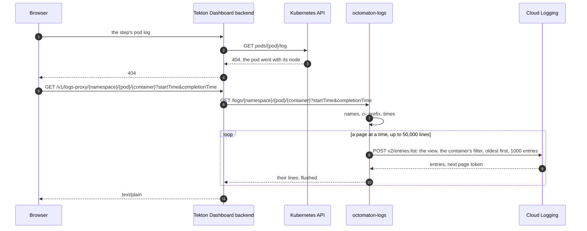

# Step logs after their pods are gone

**Decision**: When the Tekton Dashboard can't read a step's log from its pod, its backend asks `octomaton-logs`, a second server built from [arikkfir-org/octomaton](https://github.com/arikkfir-org/octomaton), which reads that container's log from Cloud Logging, where GKE ships every container's output, and answers it as plain text. It runs in namespace `octomaton` as its own ServiceAccount, whose Workload Identity principal alone holds `roles/logging.viewAccessor` on the `_Default` log view. It serves only `ci-` namespaces, and only the Dashboard's pods reach it. Names and identities: [reference](../../hub/reference.md#octomaton).

## Context

- The cluster's [autoscaling profile](../../infra/designs/node-autoscaling.md) removes an empty CI node about a minute after its last pod ends, and the node's pods go with it. The TaskRun stays, so the Dashboard still shows the run, but each step's log reads "Unable to fetch log": the Dashboard reads logs from pods.
- GKE's logging agent has already shipped every line each container wrote to Cloud Logging, whose `_Default` bucket keeps it 30 days.
- The Dashboard has a fallback for this. With an external logs URL set, when it can't read a pod's log, its backend fetches `<url>/<namespace>/<pod>/<container>?startTime=…&completionTime=…` (the TaskRun's times, each left out when empty) and shows a `text/plain` answer as the step's log.

Goal: a step's log stays readable in the Dashboard, where every check links, for as long as Cloud Logging keeps it.

## Design

| Part | Behaviour |
| --- | --- |
| Request | `GET /logs/<namespace>/<pod>/<container>`, with `startTime` and `completionTime` (RFC 3339) when the TaskRun has them. The namespace and the container must be DNS labels and the pod a DNS subdomain, which also keeps them inside the filter's quotes: anything else, or a time that doesn't parse, is a 400. A namespace that doesn't start with `ci-` is a 404, as if it didn't exist |
| Window | From a minute before `startTime`, or 30 days back without it, to five minutes after `completionTime`, or no end without it: a TaskRun's times are its controller's clock and a line's timestamp its node's, and sidecars stop after the TaskRun completes |
| Read | `entries:list` through the view, filtered to the `k8s_container` entries of the hub cluster's namespace, pod and container in the window, oldest first, 1000 a page, following the page tokens. Billed to the view's project (`X-Goog-User-Project`), which a federated principal needs |
| Answer | `200`, `text/plain`: a line per entry, its `textPayload` without the trailing newline, or its `jsonPayload` (GKE parses a JSON line into it) as compact JSON; an entry with neither is skipped. Each page is written and flushed as it arrives, so a long log never sits in memory. No entries: an empty body |
| Limits | 50,000 lines, then a last line saying the log was cut there: 50 pages, within the 60 `entries:list` requests a minute Cloud Logging allows a project. Two minutes to read one log |
| Failures | A read that fails before any line is sent answers 502, logged with the request's trace. One that fails later ends the log with a line saying the rest could not be read: the status is already sent, and the Dashboard's proxy would end the response as if it were whole. A client that leaves cancels the read |
| Deployment | `deploy/`: ServiceAccount, Deployment (one replica), Service (port 80 → 8080) and NetworkPolicy `octomaton-logs`, image `images/octomaton-logs`, which `release` publishes with `octomaton`'s and Argo CD tags the same way ([deployment](../../hub/designs/octomaton-deployment.md)). Configuration: [README](https://github.com/arikkfir-org/octomaton/blob/main/README.md#archived-step-logs-octomaton-logs) |

## Decisions

| Decision | Why | Rejected |
| --- | --- | --- |
| Read Cloud Logging, which GKE already fills | Every line of every container is there for 30 days, shipped within seconds, with nothing new to store or run in CI | Reading the pod: it's gone. Archiving each step's log to a bucket when its TaskRun ends: it races the node's deletion a minute later, and needs a bucket, its retention, an archiver watching runs and grants for both. Keeping CI nodes up longer: the idle vCPU-hours the autoscaling profile removed, and the logs still go with the node |
| In the Dashboard, through its external logs | Every check links there, behind the hub's sign-in, and the Dashboard needs only a URL | The Cloud Console's Logs Explorer: a Google Cloud role for each reader, away from the run |
| A server of its own | Only it holds the logging grant, and it serves only inside the cluster | A proxy inside `octomaton`: the webhook server, on the public gateway, would get a grant it doesn't need. Tekton Results: a database, an API server and a watcher, to keep what Cloud Logging already keeps |
| `roles/logging.viewAccessor` on the `_Default` view | Reads only what the view shows, and writes nothing | `roles/logging.viewer` on the project: the project's other logs too, the `_Required` bucket's audit logs included |
| Plain text, a page at a time | The Dashboard shows a `text/plain` answer as the log, and the pod's memory stays flat whatever the log's length | Buffering the log: a long one would sit in a 128 MiB pod |
| One replica, no PodDisruptionBudget | It serves only logs whose pods are gone, to people reading them: a restart is seconds of "Unable to fetch log" | Two replicas and a budget, which the hub keeps for services others depend on |
| A namespace outside `ci-` is a 404 | It reads like no namespace at all | 403, which tells it apart from one that doesn't exist |

## Security

| Concern | Handling |
| --- | --- |
| Who reaches it | Only pods labelled `app.kubernetes.io/name: dashboard` in namespace `tekton-pipelines` (NetworkPolicy `octomaton-logs`); it has no route on any gateway. People reach the Dashboard through the hub's sign-in and Middleware `admins` ([admins only](../../delivery/designs/admins-only.md)), and read what they read in the pod's log before its node went |
| What it reads | The view's grant covers every log the `_Default` bucket holds, not only CI's. The code narrows it: only namespaces starting with `ci-` (`OCTOMATON_LOGS_NAMESPACE_PREFIX`, which can't be empty), only the hub cluster's `k8s_container` entries, one container at a time. Names are validated before they reach the filter, so no request widens it |
| Writes | None: the view's grant only reads. `roles/serviceusage.serviceUsageConsumer` bills the reads to the project |
| Credentials | Workload Identity: no key, no Secret. The pod mounts no Kubernetes token and calls no Kubernetes API |
| Its own logs | Name the container read and the error, never a log's lines |

## Failure modes

| Failure | Effect |
| --- | --- |
| The newest lines | Cloud Logging takes a few seconds to ingest a line: a step read the moment its pod went may lack its last lines. Reloading shows them |
| JSON lines | A line GKE parsed as JSON comes back re-marshalled: compact, keys in Cloud Logging's order, without the fields Cloud Logging moves into the entry (`severity`, `time`, `logging.googleapis.com/…`) |
| 30-day retention | An older step's log reads as empty: the `_Default` bucket has dropped it |
| Long logs, many readers | 50,000 lines at most. Past 60 `entries:list` requests a minute in the project, reads fail: a 502, or a last line saying the rest is missing. A minute later, reading again works |
| Cloud Logging down, or the grant missing | 502; the Dashboard shows "Unable to fetch log", and `octomaton-logs` logs the API's message with the request's trace |
| `octomaton-logs` down | Only the logs of pods already gone fail to show: the Dashboard reads live pods' logs itself |
| A line the node never shipped | GKE's agent ships within seconds and the node lives a minute past its last pod; a line still in its buffer when the node goes is lost |

## Rollout

1. `docs`: the [reference](../../hub/reference.md#octomaton) gains `octomaton-logs`: its Deployment, ServiceAccount, Service, NetworkPolicy and image, its principal's roles, and the Dashboard's external logs URL.
2. `infra`: grant `octomaton/octomaton-logs` `roles/logging.viewAccessor` on view `_Default` of bucket `_Default`, and `roles/serviceusage.serviceUsageConsumer`, `roles/telemetry.metricsWriter` and `roles/telemetry.tracesWriter` on the project.
3. `delivery`: Application `octomaton` tags `images/octomaton-logs` with `${ARGOCD_APP_REVISION_SHORT}`, and TektonConfig sets the Dashboard's external logs to `http://octomaton-logs.octomaton.svc.cluster.local/logs`. Until the next step, the Dashboard's fallback fails as reading the pod does.
4. `octomaton`: this change merges. `release` publishes both images, and Argo CD deploys `octomaton-logs` with the commit's tag.

To roll back, unset the Dashboard's external logs URL in `delivery`: logs of pods that are gone read "Unable to fetch log" again.

## Open questions

- A log view of `k8s_container` entries only would narrow the grant to containers' logs. A view can't select namespaces (its filter takes only the source, the resource type and the log ID), so the `ci-` check stays in the code either way.
- The Dashboard asks pods for timestamped lines and can show the timestamps; starting each line with its entry's timestamp would bring them to archived logs too.
