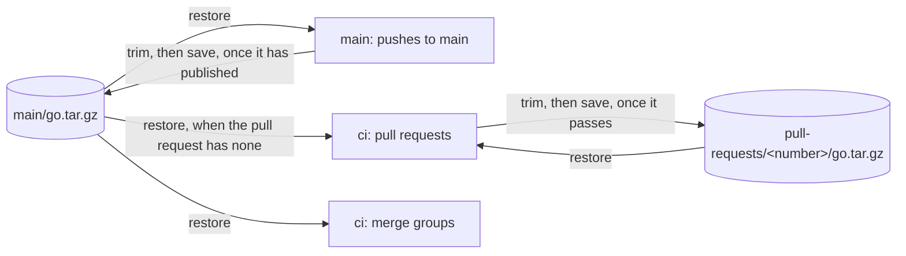

# CI caches

**Decision**: Octomaton's own pipelines keep Go's module and build caches in bucket `arikkfir-octomaton-ci-cache`, one
archive per cache. `main`, on every push to `main`, restores `main`'s cache, builds and publishes the images with it,
builds what `ci` compiles, then saves `main`'s cache. `ci` restores its pull request's cache, or `main`'s while the
pull request has none, and saves the pull request's own, under `pull-requests/<number>/`; a merge group's run restores
`main`'s and saves nothing. Only `main` writes `main`'s cache, so no branch can change what `main` builds the images
from, and a pull request's next run starts from what its last one compiled. Tracked in
[ENG-184](https://linear.app/arikkfir/issue/ENG-184). Fin's CI cache works the same way, except that its pull requests
save nothing ([Fin's CI cache](../../fin/designs/ci-caches.md)).

## Design

| Concern | How |
| --- | --- |
| What's cached | `/go-cache`, Go's build cache (`GOCACHE=/go-cache/build`) and module cache (`GOMODCACHE=/go-cache/mod`), as one gzipped tar: `main/go.tar.gz` or `pull-requests/<number>/go.tar.gz` |
| Restore | Each run's step after the clone, `restore`, streams the first archive of its list that exists into `/go-cache`: a pull request's `pull-requests/<number>` then `main`; a merge group's and `main`'s, `main`. A missing or unreadable archive is logged, and the run downloads and compiles what it lacks |
| Save | The task's last step, `save`, trims the caches, then replaces the run's archive with what it restored and added to. A run that fails saves nothing (Tekton skips the steps after a failing one); a trim or save that fails is logged and passes. `ci` saves to `pull-requests/<number>`, its param `cache`, which `.octomaton.yaml` sets only for a pull request's run, so a merge group's saves nothing |
| Trim | The caches keep only what Octomaton builds with. `restore` dates every build-cache entry two hours back; Go marks an entry it uses by its modification time, at most once an hour, so each entry the run uses shows it, and `save` deletes the rest. `save` also deletes the module zips, which Go doesn't read once a module is unpacked, the unpacked modules' test data, and each module `go.sum` doesn't name. From trimmed caches, with downloads off, `ci`'s lint, vet, race-built tests and build compile nothing |
| Warm-up | `main`'s step `warm`, after the images and before `save`, builds what `ci` builds, as `ci` builds it: `go run ./cmd/octomaton-lint`, `go vet ./...`, the tests with `-race` (linked, never run) and `CGO_ENABLED=0 go build -trimpath ./cmd/...`, ko's flags. `GOFLAGS=-mod=readonly` in both, since Go keys each package it compiles on its flags. A warm-up that fails is logged, and the run goes on |
| ko | `main` runs ko's release binary, at the Makefile's version, checked against its pinned SHA-256: built with `go run`, its modules and packages would fill the caches, and the trim by `go.sum` would delete its modules on every run. ko builds with the run's `GOCACHE`, so the images compile only what the commit changed |
| Size | Unpacked, the caches hold about 3.9 GB of builds (the images', vet's and the race-built tests' variants of every package, Kubernetes' and Google Cloud's clients included) and 200 MB of modules: about 940 MiB as an archive. Restoring one took 33 s and saving one 64 s in a simulation, against about four minutes of downloads and compiling without one |
| Expiry | The bucket deletes an object 14 days after it was written ([buckets](../../infra/terraform/gcp.md#buckets)): a pull request's archive after its last push, `main`'s after a fortnight without a push to `main`. The next run then builds from `main`'s, or from scratch |
| Tests | They run every time (`go test -count=1`), whatever the cache holds: Go would otherwise reuse a passing result it finds there |

## Identities

`ci` runs as `ci-octomaton-ci` instead of the tenant's `pipeline`, which must hold no Google Cloud role since any run
can name it; `main` keeps `ci-octomaton-release`. The ServiceAccounts are `delivery`'s
([CI tenants](../../delivery/platform.md#ci-tenants)), the bucket and grants `infra`'s
([buckets](../../infra/terraform/gcp.md#buckets), [IAM](../../infra/terraform/gcp.md#iam)).

| ServiceAccount | Branches | Bucket `arikkfir-octomaton-ci-cache` |
| --- | --- | --- |
| `ci-octomaton-release` | `main` (and `v*` tags, for `tag`, which doesn't touch the cache) | reads and writes every object |
| `ci-octomaton-ci` | every | reads every object; writes only under `pull-requests/` (an IAM condition) |

The pods reach Cloud Storage's JSON API with the token their Workload Identity gives them, from the metadata server,
through `curlimages/curl`; no key and no Secret.

## Decisions

| Decision | Why | Rejected |
| --- | --- | --- |
| Pull requests save their own cache | A pull request's later pushes reuse what its earlier runs compiled, the code it changes included, which `main`'s cache never holds | Pull requests only read `main`'s, as Fin's do: each push compiles everything the pull request changed again |
| A pull request restores its own cache, or `main`'s when it has none | One archive per run. Its own already holds what it uses of `main`'s, as of its last push | Both, `main`'s under its own: twice the download for every run |
| `ci-octomaton-ci` writes only under `pull-requests/` | Any branch may run as it, so it must not change what `main` builds the images from | A grant per pull request's prefix: every run of `ci` is the same principal, so IAM can't tell pull requests apart |
| `main` builds what `ci` compiles | A pull request then compiles only what it changes, even on its first run | A pipeline of its own that builds the cache: a second definition of the builds to keep in step |
| One archive with both caches | Every run that restores builds with both | One per cache, as Fin's tasks need several |
| gzip at level 1 | `curlimages/curl` holds busybox's tar and gzip only, and level 1 is the fastest | zstd: another image, or a download in every run |
| The archive in a bucket | Any node restores it, and runs never wait for each other | A persistent volume: a zonal disk mounts on one node at a time |

## Trust

A pull request's run can write any pull request's archive, its own and others', since one principal runs them all, and
a build output planted there could change what another pull request's `ci` runs. What it writes reaches only pull
requests' runs, never a merge group's, which restores `main`'s: the check that admits a change to `main` builds from
`main`'s cache. `main` and the images it publishes read only `main`'s archive, which only `ci-octomaton-release`, on
`main`, writes. `ci` runs every test (`-count=1`), so no archive holds a passing result it
reuses. The caches hold nothing secret: Go's
build outputs and the modules `go.sum` names, which Go checks against `go.sum` when it unpacks them.

## Rollout

1. `infra`: the bucket, with its lifecycle, and its grants. Applied on merge. Until then, restore and save log that
   they can't reach it, and the runs pass.
2. `delivery`: ServiceAccount `ci-octomaton-ci` in tenant `ci-octomaton`. Until Argo CD syncs it, Octomaton can't
   create a run that names it.
3. `octomaton`: this design, `ci` as `ci-octomaton-ci` with `restore` and `save`, `main` with `restore`, ko's binary,
   `warm` and `save`. Its own `ci` needs step 2 first. `main`'s first run after the merge saves `main`'s cache.
