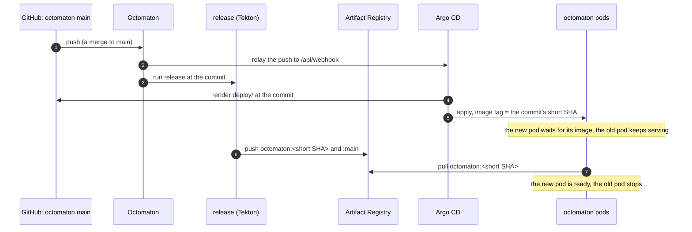
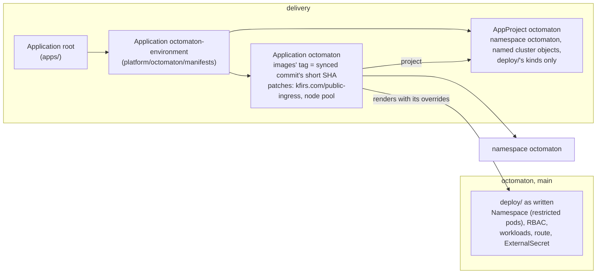

# Octomaton deployment

**Decision**: Octomaton's Kubernetes manifests live with its code, in `deploy/` of
[arikkfir-org/octomaton](https://github.com/arikkfir-org/octomaton): the hub's deployment as written, its Namespace
included. `delivery` holds what wraps it, as it does for
[Fin](https://github.com/arikkfir-org/fin/blob/main/docs/fin/designs/environments.md): the Argo CD Application
`octomaton`, which follows that repository's `main` and overrides what `delivery` decides (the images' tag, the
namespace's admission to the public gateway, the node pool), and the AppProject `octomaton`, which holds it to its
namespace and kinds. Every merge to `main` deploys itself. Its objects, configuration and endpoints:
[below](#objects); the GitHub App: [octomaton.dev](octomaton-dev.md#github-app). Pull requests:
[octomaton#8](https://github.com/arikkfir-org/octomaton/pull/8),
[delivery#10](https://github.com/arikkfir-org/delivery/pull/10) (manifests with the code);
[delivery#33](https://github.com/arikkfir-org/delivery/pull/33),
[octomaton#24](https://github.com/arikkfir-org/octomaton/pull/24) (project, Namespace and overrides).

## Context

Every push to Octomaton's `main` publishes an image tagged with the commit's short SHA. The manifests lived in
`delivery`, which pinned one of those tags: each Octomaton change needed a second pull request there to reach the
cluster, and a change to both code and configuration (a new variable, a new permission) was split across repositories.

## Design

| Piece | Where | What |
| --- | --- | --- |
| Manifests | `octomaton`: `deploy/` (Kustomize) | Namespace `octomaton` (the latest restricted Pod Security Standard enforced; `Delete=false,Prune=false`), everything in it, the ClusterRoles `octomaton` and `octomaton-tenant`, and the ClusterRoleBinding `octomaton` ([objects](#objects)). The Deployments' images have no tag |
| Application | `delivery`: `platform/octomaton/manifests`, synced by Application `octomaton-environment` (`apps/`, wave 4) | Application `octomaton` in namespace `argocd`, project `octomaton`: source `https://github.com/arikkfir-org/octomaton` at `main`, path `deploy`. Its `kustomize` options: `images` tags `me-west1-docker.pkg.dev/arikkfir/octomaton/octomaton` and `…/octomaton-logs` with `${ARGOCD_APP_REVISION_SHORT}`; `patches` label Namespace `octomaton` `kfirs.com/public-ingress: "true"` and put every Deployment on node pool `system` (node selector `kfirs.com/pool: system`, a toleration of `components.gke.io/gke-managed-components=true:NoSchedule`; [node pools](../../delivery/designs/node-pools.md)). Automated sync with prune and self-heal, retries, `SkipDryRunOnMissingResource=true`. No finalizer: deleting it leaves Octomaton running. No `CreateNamespace`: `deploy/` holds the Namespace |
| Project | `delivery`: `platform/octomaton/manifests` (wave -1) | AppProject `octomaton`: source `https://github.com/arikkfir-org/octomaton` only; destination namespace `octomaton` in this cluster; cluster-scoped, by name, only Namespace `octomaton`, ClusterRoles `octomaton` and `octomaton-tenant` and ClusterRoleBinding `octomaton`; namespaced, only the kinds `deploy/` holds: `ServiceAccount`, `Role`, `RoleBinding`, `ConfigMap`, `ExternalSecret` (`external-secrets.io`), `Deployment`, `PodDisruptionBudget`, `Service`, `HTTPRoute` (`gateway.networking.k8s.io`) and `NetworkPolicy`. No admission policies |
| Images | `octomaton`: `release` | Runs on every push to `main`, with no path filter, and retries twice when it loses its node. Publishes `octomaton` and `octomaton-logs` to `me-west1-docker.pkg.dev/arikkfir/octomaton/`, the public repository `infra` provisions for Octomaton's releases, tagged with the commit's first 7 characters, as many as `ARGOCD_APP_REVISION_SHORT` has, and `main` |
| Validation | `octomaton`: `ci` (check `Continuous Integration`) | `deploy/manifests.sh` (`make manifests`) renders `deploy/` as written and with the `kustomize` options of every Application in `delivery`'s `main` that deploys it, as Argo CD applies them, and checks both with kubeconform. A patch whose target matches nothing fails it too, so a change on either side that breaks the other fails a check |
| What stays | `delivery` | The Applications and the project; the tenant namespaces (`ci-tenants`), with their RoleBinding `octomaton` to ClusterRole `octomaton-tenant`; the `octomaton-dev` certificate and Gateway listener; Argo CD's NetworkPolicy admitting Octomaton's relay; the TektonConfig that points the Dashboard's external logs at `octomaton-logs` |

Argo CD substitutes `${ARGOCD_APP_REVISION_SHORT}` with the revision of the source it renders, and only in the
Application's spec. That is why the manifests come from the octomaton repository: rendered from `delivery`, the variable
would hold `delivery`'s commit.

## Objects

What `deploy/` holds, as Argo CD applies it:

| Object | What |
| --- | --- |
| Namespace `octomaton` | Labels `pod-security.kubernetes.io/enforce: restricted` and `pod-security.kubernetes.io/enforce-version: latest`, and `kfirs.com/public-ingress: "true"` from `delivery`'s patch; annotation `argocd.argoproj.io/sync-options: Delete=false,Prune=false` |
| Deployment `octomaton` | Two replicas, spread over nodes (`whenUnsatisfiable: ScheduleAnyway`), rolling out by surging (`maxSurge: 1`, `maxUnavailable: 0`); PodDisruptionBudget `octomaton`, `maxUnavailable: 1`. Image `me-west1-docker.pkg.dev/arikkfir/octomaton/octomaton`, container port 8080. Reloader restarts it when its ConfigMap or Secret changes |
| ServiceAccount `octomaton` | The server's identity, for Kubernetes ([RBAC](#rbac)) and, through Workload Identity, for its telemetry |
| Service `octomaton` | Port 80 → container 8080 |
| HTTPRoute `octomaton` | `octomaton.dev`, path `/github/hooks` (exact) → Service `octomaton`, on Gateway `traefik/public`, listener `octomaton-dev`. Every other path is `delivery`'s `go-import` ([traffic](octomaton-dev.md#traffic)) |
| NetworkPolicy `octomaton` | Admits only namespace `traefik`, on 8080 |
| ConfigMap `octomaton` | The server's settings ([configuration](#configuration)) |
| ExternalSecret `octomaton-github` | Secret `octomaton-github` (keys `app-id`, `private-key` and `webhook-secret`), refreshed hourly on ClusterSecretStore `gcp-secret-manager` from the three `octomaton-github-*` secrets in Secret Manager ([`infra`](../../infra/terraform/gcp.md#secret-manager)) |
| Deployment `octomaton-logs` | One replica, rolling out by surging; PodDisruptionBudget `octomaton-logs`, `maxUnavailable: 1` and `unhealthyPodEvictionPolicy: AlwaysAllow`. Image `me-west1-docker.pkg.dev/arikkfir/octomaton/octomaton-logs`, container port 8080 |
| ServiceAccount `octomaton-logs` | Mounts no token: `octomaton-logs` calls no Kubernetes API, and Workload Identity needs none. Its principal reads the log view ([archived step logs](archived-step-logs.md)) |
| Service `octomaton-logs` | Port 80 → container 8080 |
| NetworkPolicy `octomaton-logs` | Admits only the Tekton Dashboard's pods (namespace `tekton-pipelines`, label `app.kubernetes.io/name: dashboard`), on 8080 |

### RBAC

What each grant is for: the README's [deployment](https://github.com/arikkfir-org/octomaton#deployment).

| Object | Grants |
| --- | --- |
| ClusterRole `octomaton`, bound to ServiceAccount `octomaton/octomaton` by ClusterRoleBinding `octomaton` | PipelineRuns and TaskRuns: get, list, watch; Namespaces: get |
| Role `octomaton`, bound by RoleBinding `octomaton`, in namespace `octomaton` | Leases: get, list, watch, create, update, patch (Lease `octomaton`, the leader's) |
| ClusterRole `octomaton-tenant`, bound to `octomaton/octomaton` in each tenant namespace by `delivery`'s RoleBinding `octomaton` | PipelineRuns: create, get, list, watch, patch, update, delete; TaskRuns: get, list, watch; Secrets: create, get, patch, update, delete; Pods: get, list; `pods/log`: get; PersistentVolumeClaims: get, list, delete; ServiceAccounts: get |

## Configuration

Both servers read environment variables only. What each variable means, and the defaults of those left unset: the
README's [server configuration](https://github.com/arikkfir-org/octomaton#server-configuration) and
[step logs server](https://github.com/arikkfir-org/octomaton#archived-step-logs-octomaton-logs).

| Source | `octomaton` | `octomaton-logs` |
| --- | --- | --- |
| ConfigMap | `octomaton`, through `envFrom` | none |
| Downward API | `OCTOMATON_POD_NAME` and `OCTOMATON_POD_NAMESPACE`: the Lease's holder and namespace | none |
| The Deployment's `env` | none | `OCTOMATON_LOGS_VIEW`, `OCTOMATON_LOGS_CLUSTER` and `OCTOMATON_LOGS_LOCATION` |
| Secret `octomaton-github` | `app-id`, `private-key` and `webhook-secret` as `OCTOMATON_GITHUB_APP_ID`, `OCTOMATON_GITHUB_PRIVATE_KEY` and `OCTOMATON_GITHUB_WEBHOOK_SECRET` | none |
| `OTEL_RESOURCE_ATTRIBUTES` | `k8s.pod.name` and `k8s.namespace.name` from the downward API, `k8s.container.name=octomaton` | the same, `k8s.container.name=octomaton-logs` |
| `enableServiceLinks` | `false`: no `<SERVICE>_PORT` variables from the namespace's Services | `false` |

ConfigMap `octomaton`:

| Variable | Value |
| --- | --- |
| `OCTOMATON_GITHUB_ALLOWED_OWNERS` | `arikkfir-org` |
| `OCTOMATON_TEKTON_DASHBOARD_URL` | `https://tekton.dev.kfirs.com` |
| `OCTOMATON_NAMESPACE_TEMPLATE` | `ci-{{ .Repository.Name }}` |
| `OCTOMATON_ORGANIZATION_REPOSITORY` | `tooling` |
| `OCTOMATON_RELAY_URLS` | `http://argocd-server.argocd.svc.cluster.local/api/webhook`: Argo CD refreshes on pushes |
| `OCTOMATON_RETENTION_FREE_PVCS_AFTER` | `1h` |

Deployment `octomaton-logs`:

| Variable | Value |
| --- | --- |
| `OCTOMATON_LOGS_VIEW` | `projects/arikkfir/locations/global/buckets/_Default/views/_Default` |
| `OCTOMATON_LOGS_CLUSTER` | `hub` |
| `OCTOMATON_LOGS_LOCATION` | `me-west1-a` |

## Endpoints and telemetry

| Item | Value |
| --- | --- |
| `octomaton` | `POST /github/hooks`, public at `https://octomaton.dev/github/hooks` through the route; `GET /healthz` and `GET /readyz`, the probes. All on 8080 |
| `octomaton-logs` | `GET /logs/<namespace>/<pod>/<container>?startTime=…&completionTime=…`, which the Tekton Dashboard calls at `http://octomaton-logs.octomaton.svc.cluster.local/logs` (`delivery`'s TektonConfig); `GET /healthz` and `GET /readyz`, the probes. All on 8080 |
| Check links | `https://tekton.dev.kfirs.com/#/namespaces/<namespace>/pipelineruns/<name>` |
| Telemetry | JSON logs on stdout to Cloud Logging; metrics to Cloud Monitoring and traces to Cloud Trace through the Telemetry API (`telemetry.googleapis.com`), as the Workload Identity principals of `octomaton/octomaton` and `octomaton/octomaton-logs` |
| Their roles | Both: `roles/telemetry.metricsWriter`, `roles/telemetry.tracesWriter` and `roles/serviceusage.serviceUsageConsumer` on the project. `octomaton-logs` also: `roles/logging.viewAccessor` on the `_Default` log view. `infra` grants them ([IAM](../../infra/terraform/gcp.md#iam)) |

## Decisions

| Decision | Why | Rejected |
| --- | --- | --- |
| Manifests in the octomaton repository, deployed from `main` | One pull request changes code and deployment together, and nothing is pinned by hand | Pinning the tag in `delivery`, one pull request per release |
| The tag is `${ARGOCD_APP_REVISION_SHORT}` | Argo CD knows the commit it deploys, and `release` tags every commit with the same 7 characters | An ApplicationSet reading `main`'s SHA from GitHub (a token, polling); Argo CD Image Updater (another component, with write access to Git); `release` opening the pin pull request (write access to `delivery`) |
| The Application stays in `delivery` | `delivery` still decides what runs in the cluster and where; the octomaton repository decides how | Moving it too: the root Application reads only `delivery` |
| Plain Kustomize, not a Helm chart | The hub is the only installation, and Argo CD's image override works on Kustomize | A chart |
| `deploy/` holds the Namespace, with the restricted Pod Security Standard | Octomaton's pods meet it, and the deployment states it with the code, as Fin's does | `CreateNamespace` with `managedNamespaceMetadata` in `delivery` |
| `delivery` adds `kfirs.com/public-ingress` with a patch in the Application's `kustomize` options | Admission to the public gateway, which has no sign-in, is the hub's decision, and a patch reaches the Namespace that `deploy/` holds (a Namespace in the source overwrites `managedNamespaceMetadata`) | The label in `deploy/` |
| AppProject `octomaton` | `delivery` decides where Octomaton runs and what it may create; a merge to octomaton's `main` can't reach another namespace or cluster-scoped object | Project `default`, which admits anything anywhere |
| No admission policies | Only reviewed commits on `main` deploy, under the same ruleset as `delivery`; Fin's policies hold what pull requests' code says. Octomaton's ClusterRoles are its own, so a policy couldn't keep them from growing anyway | Fin's policies, adapted |
| Wrapper Application `octomaton-environment` | The project must exist before the Application that names it, and both belong together in `platform/octomaton`; the deployment keeps the name `octomaton`, so Argo CD keeps tracking its objects | The project in `platform/argocd`; renaming the deployment's Application |

## Security and failure modes

- A merge to octomaton's `main` changes the cluster, as a merge to `delivery`'s does. Both repositories have the same
  ruleset (pull request, the `Continuous Integration` check, merge queue; organization admins may bypass). Project
  `octomaton` keeps such a merge in namespace `octomaton` and in Octomaton's own ClusterRoles and ClusterRoleBinding,
  which it can still widen: it needs RBAC across the tenants.
- A new kind, or a new cluster-scoped object, in `deploy/` fails to sync until `delivery` admits it to the project:
  merge that first.
- If `deploy/` renamed its Namespace, `delivery`'s patch would match nothing and the route would lose the public
  gateway. `ci` fails any patch of `delivery`'s whose target matches nothing in `deploy/`. The Namespace is
  `Prune=false`: removing it from `deploy/` leaves it in the cluster.
- Argo CD hears of a commit (Octomaton relays the push) minutes before `release` has published its images. The new
  pod waits in `ImagePullBackOff` while the old ones keep serving: the rollout surges (`maxSurge: 1`,
  `maxUnavailable: 0`), so it starts a new pod before it stops an old one. The Application shows `Progressing`, and
  `Degraded` once the Deployment's 10-minute progress deadline passes, until the images arrive.
- If `release` fails, the new pod keeps waiting and the old ones keep serving until a later commit publishes an image.
  Re-run `release`, or merge a fix. Until arikkfir-org/infra#20, CI ran on Spot VMs and preemption was the usual
  cause, hence the two retries.
- A commit that breaks Octomaton breaks CI for every repository, its own fix included. Merge the revert with the admin
  bypass; Argo CD deploys it like any other commit.

## Rollout

1. Merge octomaton#8, which adds `deploy/`. Nothing in the cluster changes.
2. Merge delivery#10, which points the Application at `deploy/` and removes `platform/octomaton/`. Argo CD keeps the
   same objects (same Application, same names) and changes only the image tag, to that of `main`'s newest commit.
3. Check that the Deployment runs the short SHA of octomaton's `main`:
   `kubectl -n octomaton get deploy octomaton -o jsonpath='{.spec.template.spec.containers[0].image}'`

If delivery#10 merges first, Argo CD reports the missing path and changes nothing until it exists.

The project, Namespace and overrides follow, `delivery` first:

1. Merge delivery#33. The root Application prunes Application `octomaton` from `apps/` (no finalizer: its objects stay)
   and `octomaton-environment` creates project `octomaton` and Application `octomaton` again, which adopts them. The
   existing namespace keeps its labels; the patch matches nothing yet.
2. Merge octomaton#24. Until it merges, other octomaton pull requests fail `ci`: their `deploy/` has no Namespace
   for `delivery`'s patch. Argo CD adopts the Namespace from `deploy/`, with `kfirs.com/public-ingress` from the patch
   and the restricted Pod Security Standard.
3. Check that `kubectl get ns octomaton --show-labels` lists both labels.

Merged the other way round, the Namespace from `deploy/` would overwrite `managedNamespaceMetadata` and drop
`kfirs.com/public-ingress`, detaching the webhook's route until `delivery` merges.

Roll back in the reverse order: revert octomaton#24 (with the admin bypass: its `ci` fails on `delivery`'s patch, which
then matches nothing; the Namespace stays, `Prune=false`), then delivery#33, and delete the AppProject `octomaton` it
leaves behind. Reverting `delivery` first would drop the label while `deploy/` still holds the Namespace.

## Open questions

- The wait for the image could go away: `release` could move a branch (say `deployed`) once the image is published,
  and Argo CD would follow that branch. `release` would then need write access to the repository.

- Superseded in part by [host-agnostic Octomaton](host-agnostic.md): the route, the ExternalSecret, the
  NetworkPolicies and the servers' settings leave `deploy/` for the host's repository, and the as-deployed render
  leaves `ci` for `delivery`'s.
