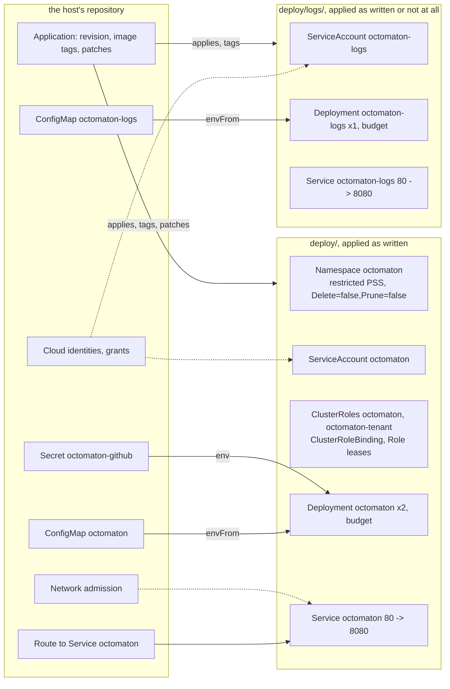

# Octomaton deployment

**Decision**: Octomaton's Kubernetes manifests live with its code, in `deploy/` of
[arikkfir-org/octomaton](https://github.com/arikkfir-org/octomaton), as a base any host applies as written: the
Namespace, the server's identity and RBAC, the server and its Service, and in `deploy/logs/` the step logs server for a
host that wants it. Nothing in either names a host. The images are untagged, for the host to tag with the commit it
deploys, and the servers read their settings from ConfigMaps and a Secret the host writes, by name. What a host
provides, and how: the README's [Hosting Octomaton](https://github.com/arikkfir-org/octomaton#hosting-octomaton); why
the base is cut where it is: [host-agnostic Octomaton](host-agnostic.md). The hub's installation is `delivery`'s
([hosting Octomaton](../../delivery/designs/octomaton.md)). Pull requests:
[octomaton#8](https://github.com/arikkfir-org/octomaton/pull/8),
[delivery#10](https://github.com/arikkfir-org/delivery/pull/10) (manifests with the code);
[delivery#33](https://github.com/arikkfir-org/delivery/pull/33),
[octomaton#24](https://github.com/arikkfir-org/octomaton/pull/24) (project, Namespace and overrides);
[octomaton#39](https://github.com/arikkfir-org/octomaton/pull/39) and the slices after it (the host-agnostic base).

## Context

Every push to Octomaton's `main` publishes an image tagged with the commit's short SHA. The manifests first lived in
`delivery`, which pinned one of those tags: each Octomaton change needed a second pull request there to reach the
cluster, and a change to both code and configuration (a new variable, a new permission) was split across repositories.
Moved beside the code, they then held the hub: its gateway, its secret store, its settings, its namespaces. A second
host had to patch every one of them, and a rename on either side broke the other silently.

## Design

| Object | In | Why it is in the base |
| --- | --- | --- |
| Namespace `octomaton` | `deploy/` | Every installation needs it, and the pods meet the restricted Pod Security Standard wherever they run (labels `pod-security.kubernetes.io/enforce: restricted`, `enforce-version: latest`). `argocd.argoproj.io/sync-options: Delete=false,Prune=false`: Octomaton runs every repository's CI, the fix for its own included. A host adds its labels with a patch |
| ServiceAccount `octomaton` | `deploy/` | The identity the RBAC and the host's cloud grants name; a host adds annotations (a Workload Identity binding) with a patch |
| ClusterRoles `octomaton` and `octomaton-tenant`, ClusterRoleBinding `octomaton`, Role and RoleBinding `octomaton` | `deploy/` | What the server does in any cluster, in Kubernetes' terms ([RBAC](#rbac)). The RoleBinding of `octomaton-tenant` in each tenant namespace is the host's, with the namespaces |
| Deployment `octomaton`, PodDisruptionBudget `octomaton` | `deploy/` | Two replicas, spread over nodes (`whenUnsatisfiable: ScheduleAnyway`), rolling out by surging (`maxSurge: 1`, `maxUnavailable: 0`), `maxUnavailable: 1`. Image `me-west1-docker.pkg.dev/arikkfir/octomaton/octomaton`, untagged; container port 8080; `reloader.stakater.com/auto`, so a host that runs Reloader gets a restart on a ConfigMap or Secret change |
| Service `octomaton` | `deploy/` | Port 80 → 8080: the name the host's route points at |
| ServiceAccount `octomaton-logs` | `deploy/logs/` | Mounts no token: `octomaton-logs` calls no Kubernetes API, and a cloud identity needs none. The host binds the identity that reads its log view ([archived step logs](archived-step-logs.md)) |
| Deployment `octomaton-logs`, PodDisruptionBudget `octomaton-logs` | `deploy/logs/` | One replica, surging; `maxUnavailable: 1` and `unhealthyPodEvictionPolicy: AlwaysAllow`, so a drain evicts it ready or not. Image `…/octomaton-logs`, untagged; container port 8080 |
| Service `octomaton-logs` | `deploy/logs/` | Port 80 → 8080, which the host's Dashboard calls at `http://octomaton-logs.octomaton.svc.cluster.local/logs` |

`deploy/logs/` is its own kustomization rather than part of the base because `octomaton-logs` is its own workload on
purpose: only it holds a log-reading grant, it serves only inside the cluster, and a host decides whether to run it at
all. A second Application at the same revision applies it with the same image override as the first.

### RBAC

What each grant is for: the README's [deployment](https://github.com/arikkfir-org/octomaton#deployment).

| Object | Grants |
| --- | --- |
| ClusterRole `octomaton`, bound to ServiceAccount `octomaton/octomaton` by ClusterRoleBinding `octomaton` | PipelineRuns and TaskRuns: get, list, watch; Namespaces: get |
| Role `octomaton`, bound by RoleBinding `octomaton`, in namespace `octomaton` | Leases: get, list, watch, create, update, patch (Lease `octomaton`, the leader's) |
| ClusterRole `octomaton-tenant`, bound to `octomaton/octomaton` in each tenant namespace by the host's RoleBinding `octomaton` | PipelineRuns: create, get, list, watch, patch, update, delete; TaskRuns: get, list, watch; Secrets: create, get, patch, update, delete; Pods: get, list; `pods/log`: get; PersistentVolumeClaims: get, list, delete; ServiceAccounts: get |

## Configuration

Both servers read environment variables only. What each variable means, and the defaults of those left unset: the
README's [server configuration](https://github.com/arikkfir-org/octomaton#server-configuration) and
[step logs server](https://github.com/arikkfir-org/octomaton#archived-step-logs-octomaton-logs). The values are the
host's ([the hub's](../../delivery/designs/octomaton.md#settings)).

| Source | `octomaton` | `octomaton-logs` |
| --- | --- | --- |
| ConfigMap, through `envFrom` | `octomaton`: the settings; `OCTOMATON_GITHUB_ALLOWED_OWNERS` required | `octomaton-logs`: `OCTOMATON_LOGS_VIEW`, `OCTOMATON_LOGS_CLUSTER` and `OCTOMATON_LOGS_LOCATION` |
| Secret `octomaton-github` | `app-id`, `private-key` and `webhook-secret` as `OCTOMATON_GITHUB_APP_ID`, `OCTOMATON_GITHUB_PRIVATE_KEY` and `OCTOMATON_GITHUB_WEBHOOK_SECRET` | none |
| Downward API | `OCTOMATON_POD_NAME` and `OCTOMATON_POD_NAMESPACE`: the Lease's holder and namespace | none |
| `OTEL_RESOURCE_ATTRIBUTES` | `k8s.pod.name` and `k8s.namespace.name` from the downward API, `k8s.container.name=octomaton` | the same, `k8s.container.name=octomaton-logs` |
| `enableServiceLinks` | `false`: no `<SERVICE>_PORT` variables from the namespace's Services | `false` |

A missing ConfigMap or Secret holds the pod in `CreateContainerConfigError` until the host provides it, which is the
failure a host sees for a forgotten object, rather than a server running on defaults.

## Endpoints and telemetry

| Item | Value |
| --- | --- |
| `octomaton` | `POST /github/hooks`, which the host's route exposes at the App's webhook URL; `GET /healthz` and `GET /readyz`, the probes. All on 8080 |
| `octomaton-logs` | `GET /logs/<namespace>/<pod>/<container>?startTime=…&completionTime=…`, which the host's Tekton Dashboard calls; `GET /healthz` and `GET /readyz`, the probes. All on 8080 |
| Check links | `<OCTOMATON_TEKTON_DASHBOARD_URL>/#/namespaces/<namespace>/pipelineruns/<name>`; none when unset |
| Telemetry | JSON logs on stdout; metrics and traces through the Google Telemetry API when a GCP metadata server answers, as the identity the host binds to each ServiceAccount, else nothing. The roles the hub grants: [hosting Octomaton](../../delivery/designs/octomaton.md) |

## Decisions

| Decision | Why | Rejected |
| --- | --- | --- |
| Manifests in the octomaton repository | One pull request changes code and deployment together, and nothing is pinned by hand where the host follows `main` | Manifests in the host's repository, one pull request per release |
| The images are untagged; the host tags them | The host knows the commit it deploys (Argo CD's `${ARGOCD_APP_REVISION_SHORT}` when it follows a branch, the pin when it pins), and `main` tags every commit with the same 7 characters | A tag in `deploy/` that a release bumps; Argo CD Image Updater; `main` opening the host's pull request |
| The host writes the ConfigMaps and the Secret; `deploy/` ships none | Every value in them is the host's; a ConfigMap of defaults is one the host patches ([host-agnostic](host-agnostic.md#decisions)) | Defaults in `deploy/`; a Helm chart with values |
| The route, the Secret's source and the network admission are the host's | They name the host's gateway, store and namespaces; Octomaton needs a Secret and a route, not a way of making them | Parametrizing them in `deploy/` |
| `octomaton-logs` is `deploy/logs/` | Its own workload on purpose, which a host may not want; a second Application needs no overlay | Part of the base, scaled to zero; a Kustomize component |
| Plain Kustomize, not a Helm chart | Argo CD's image override and patches reach a Kustomization directly, and a host without Argo CD has `kustomize edit set image` | A chart |
| `deploy/` holds the Namespace, with the restricted Pod Security Standard | Octomaton's pods meet it, and the deployment states it with the code; a host adds labels with a patch | `CreateNamespace` with `managedNamespaceMetadata` in the host (a Namespace in the source overwrites it) |
| The hub's Application stays in `delivery`, with a project of its own | The host decides what runs in its cluster and where; the octomaton repository decides how. The hub's project keeps the version it pins in namespace `octomaton` and Octomaton's own cluster objects | Moving the Application here; project `default` |

## Security and failure modes

- Where a host follows `main`, a merge here changes its cluster, bounded by this repository's ruleset (pull request,
  the `Continuous Integration` check, merge queue) and the host's AppProject; a host that pins a version or a commit,
  as the hub does, reviews the bump.
  Octomaton's ClusterRoles are its own, and a merge can still widen them: it needs RBAC across the tenants.
- A new kind or cluster-scoped object in `deploy/` fails to sync in a host whose project doesn't admit it: the host
  changes first.
- A rename in `deploy/` of an object a host patches or reads by name (the Namespace, a ServiceAccount, a Deployment,
  Service `octomaton`) breaks that host silently where kustomize skips the patch, or loudly where the host's CI renders
  `deploy/` with its options ([the hub's](../../delivery/designs/octomaton.md#ci)). It is a breaking change for every
  host and says so in its pull request.
- A host that follows `main` hears of a commit before `main` has published its images. The new pod waits in
  `ImagePullBackOff` while the old ones keep serving: the rollout surges, so it starts a new pod before it stops an old
  one. The Application shows `Progressing`, and `Degraded` once the Deployment's 10-minute progress deadline passes,
  until the images arrive. If `main` fails, re-run it or merge a fix.
- A version that breaks Octomaton breaks CI for every repository its host serves, its own fix included. The hub
  reverts its bump in `delivery` with the admin bypass, and Argo CD rolls back to the previous version.

## Rollout

The history of how `deploy/` reached this shape, oldest first: octomaton#8 and delivery#10 moved the manifests here
and pointed the hub's Application at `deploy/`; delivery#33 and octomaton#24 added the project, the Namespace in the
base and the hub's overrides (merged `delivery` first, since a Namespace in the source overwrites
`managedNamespaceMetadata`); octomaton#39 and the slices after it took the hub out of `deploy/`, in the order
[host-agnostic Octomaton](host-agnostic.md#plan) gives.

## Open questions

- The wait for the image could go away: `main` could move a branch (say `deployed`) once the image is published,
  and a host that follows `main` would follow that branch instead. `main` would then need write access to the
  repository.
