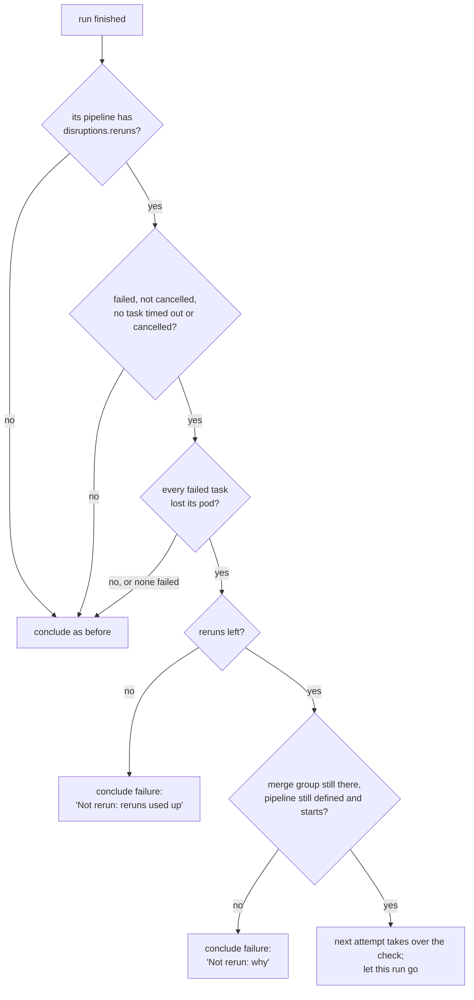
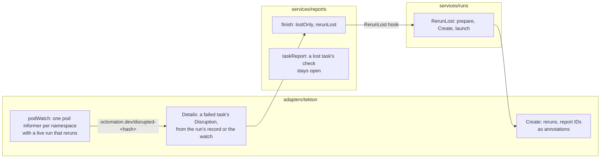

# Reruns after disruptions

A run whose tasks lost their pods because the cluster took them away (a machine shut down or reclaimed, an eviction,
a preemption) runs again, up to a number of times its pipeline sets, while its check stays in progress. A run that
failed by itself never does. Before this, such a run failed its check like any other: a merge queue entry left the
queue, and a person pressed Re-run. Linear: [ENG-210](https://linear.app/arikkfir/issue/ENG-210); pull request:
[#61](https://github.com/arikkfir-org/octomaton/pull/61).

## Context

- Tekton records that a task failed, not why. A task whose machine went away fails in one of several forms, each of
  which a task that failed by itself can take too:

  | Tekton's reason | What it shows | Why it can't tell |
  | --- | --- | --- |
  | `Failed` | "Pod was terminated in response to imminent node shutdown." | The reason is any failure's; only free text, the kubelet's to change, says more |
  | `StepFailed` | a step exited with 143 | A step sent SIGTERM for another reason, or exiting 143 itself |
  | `StepFailed` | a step exited with 255 | A step exiting 255 itself |
  | `InitContainerFailed` | an init container exited with 143 | As for a step |
  | `SidecarFailed` | a sidecar exited with 1 | A sidecar failing by itself |

- Kubernetes says why: before it takes a pod away, it sets the pod's `DisruptionTarget` condition, with a reason. The
  kubelet writes it before it stops the pod's containers, and the controllers before they delete a pod whose node is
  gone. The pod, though, often goes soon after, and its condition with it.
- Tekton's `retries` on a pipeline task reruns every failure, real ones included.

## Design

```mermaid
sequenceDiagram
  participant N as Node (kubelet)
  participant K as Kubernetes API
  participant W as Leader: pod watch (adapters/tekton)
  participant R as Leader: reports (services/reports)
  participant U as runs (services/runs)
  participant G as GitHub (check "ci")
  Note over N: the machine is shutting down
  N->>K: pod build-pod: DisruptionTarget=True, TerminationByKubelet
  K-->>W: pod changed
  W->>W: remember it (memory)
  W->>K: merge-patch the run: octomaton.dev/disrupted-<hash of build-pod>
  N->>K: containers stopped (143); TaskRun build failed
  K-->>R: run finished: Failed
  R->>R: Details: build failed, lost its pod; nothing else failed
  R->>U: RerunLost(run, lost)
  U->>K: create attempt 2, held, on check "ci" (reruns left - 1)
  U->>G: check "ci": in_progress, now attempt 2's, summary lists attempt 1's lost tasks
  U->>K: release attempt 2 per the pipeline's concurrency
  R->>K: let attempt 1 go (done)
  Note over G: never concluded in between: a merge queue entry stays in the queue
```

When a run finishes, the leader decides:



Where each part lives:



- **The opt-in.** `disruptions: {reruns: N}`, 1 to 5, on a pipeline. A run records `octomaton.dev/reruns`
  (`ci.Reruns`: reruns left, the run it reruns, the attempts lost so far). Without it, nothing is watched and nothing
  changes.
- **The watch.** When the leader first sees a live run with reruns in a namespace, it starts an informer on that
  namespace's pods that carry Tekton's `tekton.dev/pipelineRun` label, keeping only their labels, node and conditions.
  On every change of a pod with `DisruptionTarget=True`, whose run is live and has reruns, it remembers the pod (24
  hours) and records it on the run as `octomaton.dev/disrupted-<hash>`, where `<hash>` is the first 16 hex digits of
  the SHA-256 of the pod's name: pod, task, node, reason and message, as JSON. A key of its own per pod is
  merge-patched without reading the others, and the record outlives the pod and the leader. The watch stops when the
  leader's `Watch` ends, without holding its lock, since handlers still running take it.
- **The verdict.** `Details` marks a failed task with its pod's disruption: from the run's record, then from what the
  leader remembers or its informer still holds. When the run ends, `lostOnly` reruns it only when it failed, was not
  cancelled, no task timed out or was cancelled, and every task that failed lost its pod.
- **The rerun.** `RerunLost` reads the configuration again (as Re-run does), prepares the next attempt from the stored
  trigger, and creates it held with one rerun less, the lost attempts appended, the run's check ID, and the IDs of its
  task checks still open. Then it starts it the way every run starts: report, task reports, token, Secrets, release per
  the pipeline's concurrency. The check moves to the new attempt (`external_id`, link) and stays `in_progress`; its
  summary lists the earlier attempts and their lost tasks. A call that finds the attempt already created returns it,
  so a retry never creates two.
- **The task checks.** While its run may still rerun it, a task that lost its pod keeps its check open. The next
  attempt takes over those checks; a task check that concluded (a task that passed) gets a new one. When the run is not
  rerun, the lost task's check concludes `failure`, saying where its pod went.
- **The end.** When the run is not rerun, its check concludes as before, with the lost tasks and why it was not rerun:
  its reruns are used up, its merge group is gone, or its pipeline is gone or would not start.

## Decisions

| Decision | Why | Rejected |
| --- | --- | --- |
| The pod's `DisruptionTarget` condition | The one record Kubernetes keeps of why a pod went, set before its containers stop; every form in the table above is told apart | Tekton's reasons, exit codes and messages: each also comes from a task that failed by itself. Kubernetes events: best effort, and gone after an hour |
| Record each disrupted pod on its run as it happens | The pod is often deleted before its run ends; the record survives that and a new leader | Reading the pods when the run ends: they may be gone |
| One annotation per pod | Pods change concurrently; a key of its own needs no read before its write, so no write loses another | One JSON annotation of every pod: read, merge, write, with conflicts |
| Keyed by a hash of the pod's name, under `octomaton.dev/` | Octomaton's bookkeeping stays under one prefix, and an annotation's name holds 63 characters, which a pod's name may take whole; the value names the pod | The pod's name under a prefix of its own (`disrupted.octomaton.dev/<pod>`): a second prefix for one record |
| One informer per namespace, started with its first run that reruns, pods with Tekton's label only, slimmed | Only tenants that ask pay; memory holds labels, node and conditions | A cluster-wide pod watch: a cluster role on every pod, and every pod in memory |
| The whole run again, as a new attempt | Tekton can't resume a PipelineRun, and a lost task's workspace may have gone with its machine; the same path as Re-run, concurrency included | Rerunning only the lost tasks. Tekton's `retries`: reruns real failures too |
| Only when every failed task lost its pod | A task that failed by itself fails the run, even beside a lost one: the rerun would hide it | Rerunning when any task lost its pod |
| The check stays `in_progress`, on the new attempt | Never concluded, nothing reads it as failed: a merge queue keeps the entry, and a required check stays pending | Concluding it and opening a new one: the queue drops the entry on the first failure |
| A lost task's check held open | A required task check that concluded `failure` fails the queue entry the same way | Concluding it and reopening it |
| Opt-in, 1 to 5 | Each rerun costs a whole run; a cluster that keeps losing machines must not loop | Always on, or no cap |
| `disruptions: {reruns: N}` | Kubernetes' own word for every way a pod is taken away, cloud-neutral, and room for more settings | A field named after one cloud's term for reclaiming a machine |
| Every `DisruptionTarget` reason | A node shutdown, a node gone, an eviction, a preemption and node pressure are all the cluster's doing, not the task's | Node shutdown alone |
| The budget follows the first attempt's | One number bounds the chain, whatever the configuration says by then | Reading it again for each attempt |
| A merge group's rerun only while its branch exists | A destroyed group has no one waiting for its checks | Rerunning it anyway |

## Risks

- **A pod lost while no leader watched.** A leader change takes seconds; a pod disrupted and deleted meanwhile is not
  seen, and its run fails as before: the safe side.
- **Node pressure.** The kubelet marks a pod it evicts for node pressure `TerminationByKubelet` too, so a task that
  fills its node's memory can be rerun; the cap bounds it. A pod evicted for exceeding its own limits carries no
  condition and fails the run.
- **Merge queue timeouts.** A rerun lengthens the wait for the entry's checks; a queue's timeout for them can still
  fail it.
- **Memory.** A namespace's informer stays until the leader changes; it holds that namespace's CI pods, slimmed.
- **Permissions.** The leader needs `watch` on pods in tenant namespaces (ClusterRole `octomaton-tenant`). Without it,
  nothing is recorded, a warning is logged, and runs fail as before.

## Rollout and testing

- A release, then a host's pin to it; `deploy/`'s tenant ClusterRole grants `watch` on pods with it. A pipeline opts
  in with `disruptions`.
- Unit tests cover the five forms (recorded, not recorded, and on a run without reruns), a mixed failure, the cap,
  concurrency, refusals and the watch itself.
- Live: in a pipeline with `disruptions: {reruns: 1}`, drain or stop the node under a running task. The check stays
  `in_progress`, attempt 2 starts, and its summary names the lost task and node.

The contract is the README's [pipeline settings](https://github.com/arikkfir-org/octomaton#pipeline-settings) and
[check runs](https://github.com/arikkfir-org/octomaton#check-runs).
