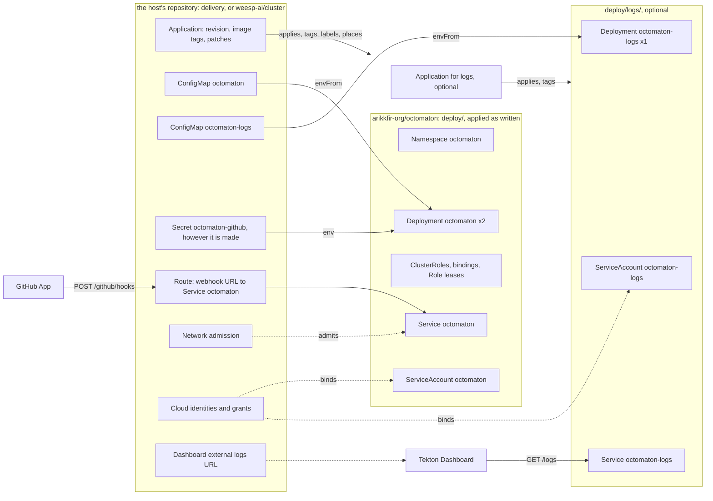

# Host-agnostic Octomaton

**Decision**: Octomaton is a product that any cluster hosts, and its repository holds only what every installation
needs: the servers, their images, and `deploy/`, the Kubernetes objects of an installation, which name nothing of any
host. What a host decides, the host provides in its own repository, under the contract the README states: the GitHub
App and its credentials, the servers' settings, how the webhook reaches `octomaton`, which pods may talk to either
server, where the pods run, the cloud identities and grants, and the Tekton Dashboard's external logs. The hub's
provision is `delivery`'s (its deployment of Octomaton) and `tooling`'s (the reviewer's image); Bracket's is
`weesp-ai/cluster`'s. Octomaton's CI validates `deploy/` as written and nothing of any host; each host validates its
own rendering. Context and the pieces that move: [below](#context); the slices: [plan](#plan).

## Context

The code is already host-agnostic: it names no owner, repository or namespace (the organization repository and the
allowed owners are settings), reads only environment variables, publishes its images to a public repository
([octomaton#37](https://github.com/arikkfir-org/octomaton/pull/37)), and exports telemetry only where it finds a GCP
metadata server. The repository around the code is not. Today it carries the hub:

| Where | What is the hub's |
| --- | --- |
| `deploy/config-map.yaml` | `OCTOMATON_GITHUB_ALLOWED_OWNERS: arikkfir-org`, the hub's Dashboard URL, Argo CD's webhook as the relay URL, `tooling` as the organization repository |
| `deploy/octomaton-logs.yaml` | The hub's log view, cluster `hub` and zone `me-west1-a`, as the Deployment's `env` |
| `deploy/external-secret.yaml` | An ExternalSecret on the hub's `ClusterSecretStore` `gcp-secret-manager`, naming the hub's three secrets |
| `deploy/http-route.yaml` | An HTTPRoute on the hub's gateway `traefik/public`, listener `octomaton-dev`, host `octomaton.dev` |
| `deploy/network-policy.yaml`, `deploy/octomaton-logs.yaml` | NetworkPolicies admitting the hub's namespaces `traefik` and `tekton-pipelines` |
| `deploy/manifests.sh`, `ci` | CI clones `delivery`'s `main` and renders `deploy/` with every Application there that deploys it, failing a patch that matches nothing, and failing when no Application is found |
| `images/reviewer/`, pipelines `reviewer-image` and `reviewer-image-check` | The hub's pull request reviewer's image, which `tooling`'s reviewer runs, built and published from here to the hub's `images` repository |
| README, `docs/octomaton/designs/` | The README's GitHub App, Deployment and Releases sections and the designs [deployment](deployment.md), [octomaton.dev](octomaton-dev.md) and [archived step logs](archived-step-logs.md) describe the hub's installation: its App, domain, Application, project, node pool, IAM, rollout history |

The second installation shows what that costs. Bracket's cluster
([weesp-ai/cluster#331](https://github.com/weesp-ai/cluster/pull/331)) deploys `deploy/` at a pinned commit and
rewrites it through its Application's kustomize patches: the ConfigMap's values, the ExternalSecret's store, the
HTTPRoute's parent and host, both ServiceAccounts' annotations, and the `octomaton-logs` Deployment's `env`. Every
object of the hub's in `deploy/` is one the next host patches, and a rename of either side breaks the other silently:
kustomize skips a patch whose target matches nothing, which is why `manifests.sh` exists. A host should add to
`deploy/` (a tag, a label, a node pool), never correct it.

Already decided the other way, and kept: the namespace's admission to the public gateway, `kfirs.com/public-ingress`,
is a label `delivery` adds with a patch and `deploy/` never carries ([deployment](deployment.md#decisions)). That is
the pattern for everything below: the host's decisions live with the host.

## Design



### `deploy/` after the split

`deploy/` stays a Kustomization that Argo CD (or `kustomize build`) applies as written, and holds the objects every
installation has, identically:

| Object | Stays, because |
| --- | --- |
| Namespace `octomaton`, restricted Pod Security Standard, `Delete=false,Prune=false` | Every installation needs it, and the pods meet the standard wherever they run; a host adds labels with a patch |
| ServiceAccount `octomaton` | The identity the RBAC and the host's cloud grants name; a host adds annotations (a Workload Identity binding) with a patch. `octomaton-logs`'s goes to `deploy/logs/` with its workload |
| ClusterRoles `octomaton` and `octomaton-tenant`, ClusterRoleBinding `octomaton`, Role and RoleBinding `octomaton` (leases) | What the servers do in any cluster, in Kubernetes' terms ([RBAC](deployment.md#rbac)) |
| Deployment `octomaton` (two replicas, spread) and its PodDisruptionBudget | The server; its image named in Octomaton's public repository, untagged, for the host to tag |
| Service `octomaton`, port 80 → 8080 | The name the host's route points at |

`octomaton-logs` leaves the base for a second kustomization, `deploy/logs/`: its ServiceAccount, Deployment, budget
and Service, the image untagged like the server's. A host that wants archived logs deploys it with a second
Application at the same revision and tag; a host that doesn't never deploys it. The base is then free of anything
that assumes a cloud.

Both Deployments read their settings from a ConfigMap through `envFrom`, `octomaton` from ConfigMap `octomaton` (as
today) and `octomaton-logs` from ConfigMap `octomaton-logs` (today the three `OCTOMATON_LOGS_*` entries of its `env`;
the downward API entries and `OTEL_RESOURCE_ATTRIBUTES` stay in `env`, they are the pod's, not the host's), and
neither ConfigMap is in `deploy/`. The host writes them. A missing one holds the pod in `CreateContainerConfigError`, as the
missing Secret `octomaton-github` does today, until the host provides it.

Everything else leaves `deploy/` for the host's repository, unchanged in content for the hub:

| Leaves | Hub (`delivery`, `platform/octomaton/manifests`) | Bracket (`weesp-ai/cluster`, `manifests/octomaton`) |
| --- | --- | --- |
| ConfigMap `octomaton` | The hub's values, today's | The values cluster#331 patches in |
| ConfigMap `octomaton-logs` | `OCTOMATON_LOGS_VIEW`, `_CLUSTER`, `_LOCATION`, today's | Its view, cluster and location |
| ExternalSecret `octomaton-github` | On `gcp-secret-manager`, today's; the target Secret keeps its name and keys | On `gcp-secret-store`, the containers of infrastructure's `0048_octomaton.tf` |
| HTTPRoute `octomaton` | Gateway `traefik/public`, listener `octomaton-dev`, `octomaton.dev`, `/github/hooks` | The shared Gateway's `https` listener, `octomaton.dev.getbracket.io` |
| NetworkPolicies `octomaton` and `octomaton-logs` | Ingress from `traefik`, and from the Dashboard's pods in `tekton-pipelines` | Its own, or none |

### The host contract

What an installation provides, in the order a new host meets it. This is the README's new second section,
[Hosting Octomaton](#readme-and-docs).

| The host provides | How the hub does it | How Bracket does it |
| --- | --- | --- |
| A GitHub App with the [permissions and events the README lists](https://github.com/arikkfir-org/octomaton#github-app), installed where Octomaton serves, its webhook at `https://<host>/github/hooks` | App `octomaton-dev`, created by hand ([the hub's installation](../../delivery/designs/octomaton.md#the-github-app)) | App `bracket-octomaton` |
| Secret `octomaton-github` in namespace `octomaton`, keys `app-id`, `private-key`, `webhook-secret` | An ExternalSecret on `gcp-secret-manager`, values in Secret Manager | An ExternalSecret on `gcp-secret-store`, values in Secret Manager |
| ConfigMap `octomaton`: the [server's settings](https://github.com/arikkfir-org/octomaton#server-configuration); `OCTOMATON_GITHUB_ALLOWED_OWNERS` required | `arikkfir-org`, `https://tekton.dev.kfirs.com`, Argo CD's webhook, `tooling` | `weesp-ai`, `https://tekton.dev.getbracket.io`, Argo CD's webhook, `tooling` |
| `deploy/` applied as written, at a commit of its choosing, the image tagged | Application `octomaton`, `targetRevision: main`, tag `${ARGOCD_APP_REVISION_SHORT}` | Application `octomaton`, a pinned commit, the same tag expression |
| Optionally `deploy/logs/` the same way, with ConfigMap `octomaton-logs`: the [step logs server's settings](https://github.com/arikkfir-org/octomaton#archived-step-logs-octomaton-logs) | Application `octomaton-logs`; view `_Default` of project `arikkfir`, cluster `hub`, `me-west1-a` | Application `octomaton-logs`; its view, `primary-v2`, its region |
| Additions through kustomize options: labels, annotations, node placement | `kfirs.com/public-ingress`, node pool `system` | ServiceAccount annotations, node selectors |
| A route from the webhook's URL to Service `octomaton` port 80, `POST /github/hooks` only | HTTPRoute on `traefik/public`, listener `octomaton-dev` | HTTPRoute on the shared Gateway |
| Network admission: who reaches each Service | NetworkPolicies `octomaton` and `octomaton-logs` | Its own |
| Cloud identity for each ServiceAccount, with the roles the README names (telemetry for both; the log view for `octomaton-logs`) | `infra`'s Workload Identity principals and grants | `infrastructure`'s `0048_octomaton.tf` |
| The Dashboard's external logs URL, when `octomaton-logs` runs | `delivery`'s TektonConfig: `http://octomaton-logs.octomaton.svc.cluster.local/logs` | `cluster`'s Tekton configuration |
| An admission boundary for what `deploy/` may create, if the host wants one | AppProject `octomaton` | AppProject `octomaton`, pinned commit |
| Validation of `deploy/` as the host renders it | `delivery`'s `ci` renders Application `octomaton`'s source with its kustomize options ([CI](#ci)) | `cluster`'s `Validate` |

Nothing in the contract names a gateway implementation, a secret store, a network policy engine, a node pool or a
cloud. The two cloud-specific pieces, telemetry and `octomaton-logs`, already degrade: without a metadata server
nothing is exported, and without `octomaton-logs` the Dashboard shows "Unable to fetch log" for pods that are gone.

### Server changes

| Setting | Today | After |
| --- | --- | --- |
| `OCTOMATON_GITHUB_ALLOWED_OWNERS` | Empty serves every installation of the App | Required and non-empty; the server exits at startup listing it among the problems, as it does for the App's ID. A host that forgot it would otherwise run the pipelines of anyone who installs the App, in its cluster, with its tenants' Secrets within reach of nothing but RBAC |
| `OCTOMATON_TEKTON_DASHBOARD_URL` | Optional; unset, check runs carry no details link | Unchanged: already the graceful fallback |
| `OCTOMATON_LOGS_*` | `VIEW`, `CLUSTER`, `LOCATION` required | Unchanged; they come from ConfigMap `octomaton-logs` instead of three entries of the Deployment's `env` |
| Telemetry | Exported to the Google Telemetry API when a GCP metadata server answers, else nothing | Unchanged: it follows where the server runs, and names no host |
| Test fixtures | Name `arikkfir-org` and `arikkfir` | Unchanged: fixtures |

### CI

`deploy/manifests.sh` keeps its first half: `kustomize build` of `deploy/` and `deploy/logs/`, then kubeconform with
the default schemas. It loses the clone of `delivery`, the search for Applications, the patch probing and the "no
Application found" failure. `make manifests` and `ci`'s `manifests` step call it the same way; `DELIVERY=` goes. The
CRDs catalog goes with them: once the ExternalSecret and the HTTPRoute leave, `deploy/` and `deploy/logs/` hold only
built-in kinds, which the default schemas cover.

The as-deployed check moves to the host that owns the options. `delivery`'s `ci` gains a step that reads each
Application whose source is Octomaton's `deploy/`, fetches that repository at the revision the Application names,
and renders it with the Application's kustomize options the way Argo CD does, failing a targeted patch that matches
nothing (the probing `manifests.sh` does today, moved there). That check guards the right thing from the right
place: a rename in Octomaton's `deploy/` fails `delivery`'s next pull request and the hub's bump, not Octomaton's
every pull request. Bracket's `cluster` does the same in its `Validate` when it bumps its pin.

### The reviewer's image

`images/reviewer/` and the pipelines `reviewer-image` and `reviewer-image-check` move to `tooling`, whose
`reviewer/pipelinerun.yaml` is the only thing that runs the image. The image keeps its name and `main` tag in the hub's
`images` repository, so nothing in `tooling`'s reviewer changes but the repository that publishes it. `tooling`'s
`publish` tenant, `ci-tooling-publish` (`octomaton.dev/branches: main`), gets `roles/artifactregistry.writer` on
`images` in `infra`, beside `ci-octomaton-release`'s, which then only `octomaton`'s own repository needs. The
reviewer design here becomes [review requests](review-requests.md): Octomaton's part (the trigger, organization
pipelines, `secrets`, `githubToken.repositories: all`) without the hub's reviewer, whose use of them, like the image,
`tooling`'s design describes.

### README and docs

The README is the product's manual and reads in this order: what Octomaton is and how it works; **Hosting Octomaton**,
the contract above, with `deploy/`, the images and the GitHub App an installation creates; then, as today, repository
configuration, check runs, security, server configuration, archived step logs, development, architecture, releases.
The hub's App, domain, Application, project, node pool, IAM and the "every merge to `main` rolls out" sentence leave
it: they describe one installation.

| Page | After |
| --- | --- |
| [deployment](deployment.md) | The design of `deploy/` as a base any host applies: what it holds and why, the untagged images and the tag override, the Namespace in the base, the ConfigMaps and Secret the host writes. Its hub tables (objects' hub values, configuration values, endpoints at `kfirs.com`, roles, rollout history) move to `delivery`'s `docs/delivery/designs/octomaton.md`, the hub's installation |
| [octomaton.dev](octomaton-dev.md) | Keeps the product's identity: `octomaton.dev` as the Go module path, the labels' and configuration's API group. The hub's App, its webhook, the traffic through the hub's gateway and the Go import page move to `delivery`'s page; the [rename runbook](../../delivery/runbooks/octomaton-rename.md), the hub's one-off migration, goes with them |
| [archived step logs](archived-step-logs.md) | Keeps the design of the server. The hub's view, grants, NetworkPolicy and Dashboard setting move to `delivery`'s page |
| [review requests](review-requests.md), formerly `pr-reviewer.md` | Keeps Octomaton's settings for a review bot, naming no reviewer or repository; the image and the hub's reviewer go to `tooling`'s [reviewer design](../../tooling/designs/pr-reviewer.md) |
| [architecture](architecture.md), [principles](phase-2-octomaton.md), [retries](github-retries.md), [redaction](check-run-redaction.md), [Linear check](linear-check.md) | Unchanged: they describe the product |

`delivery`'s new page is where the hub's values live, and other hub pages (`infra`'s IAM, `tooling`'s reviewer) link
it instead of Octomaton's.

## Decisions

| Decision | Why | Rejected |
| --- | --- | --- |
| The host writes the ConfigMaps; `deploy/` ships none | Every value in them is the host's; a ConfigMap of defaults is one the host patches, which is the coupling this removes | Defaults in `deploy/` for a host to patch (today); a Helm chart with values, which the hub's Argo CD overrides less directly than a Kustomize image and the second host would still fill in by hand |
| The route, the ExternalSecret and the NetworkPolicies leave | They name the host's gateway, store and namespaces, and no two hosts share them; Octomaton needs a Secret and a route, not a way of making them | Parametrizing them (a `sectionName` to patch, a store name to patch): still the host rewriting Octomaton's objects |
| `octomaton-logs` is its own kustomization, `deploy/logs/` | Its own workload on purpose (only it holds a log-reading grant, and it serves only inside the cluster), and a host decides whether to run it at all; a second Application needs no overlay, and takes the same revision and image override as the first | Part of the base, scaled to zero by hosts that don't want it; a Kustomize component, which needs the host to write an overlay |
| `OCTOMATON_GITHUB_ALLOWED_OWNERS` is required | An unset allow-list is a cluster that runs strangers' pipelines; both installations set it already | Keeping "empty serves everyone" for a public multi-tenant deployment nobody runs |
| Objects move between Applications by name, under `Prune=false` first | Argo CD adopts an object its source names; the host's Application takes the objects over when Octomaton's stops naming them, and `Prune=false` guarantees that the hand-over can't delete them whichever Application synced last | Renaming the moved objects (two ExternalSecrets owning one Secret conflict; a second route competes with the first); removing before adding (minutes without the webhook's route and with the Secret gone) |
| The as-deployed check moves to `delivery` | The options are `delivery`'s, so a mismatch is `delivery`'s to find; Octomaton's CI stops cloning a repository it has no business knowing | Keeping it in Octomaton with the host's repository as a parameter: still one host's check in the product's CI |
| The reviewer's image moves to `tooling` | `tooling` owns the reviewer, runs the image and is the only consumer; Octomaton built it only for the pipelines it took to publish from `main`, which `tooling` runs on `main` too | A repository of its own for one Dockerfile |
| The README leads with the contract | A host reads the README first, and today learns the hub's installation instead of what to provide | A separate `HOSTING.md`, one more page to keep in step |

## Security and failure modes

- Bracket's AppProject already bounds what a pinned `deploy/` may create; the hub's does the same for `main`. After
  the split, both admit fewer kinds: no ConfigMap, ExternalSecret, HTTPRoute or NetworkPolicy from Octomaton's source.
  The host's own objects never go through that project: in the hub they are `platform/octomaton/manifests`, which
  the wrapper Application `octomaton-environment` deploys under project `default`, as it deploys the AppProject
  itself. AppProject `octomaton` is never widened; it narrows, once `deploy/` stops naming the kinds.
- Moving the Secret's ExternalSecret: `creationPolicy: Owner` means the Secret is deleted with its ExternalSecret. The
  hand-over by name, under `Prune=false`, never deletes it; the slice order below holds that.
- A host that forgets ConfigMap `octomaton` sees `CreateContainerConfigError` on its pods, not a server that starts
  with no allow-list.
- `ci` here no longer fails when `delivery` renames something; `delivery`'s does. The bump in `cluster` is checked by
  `cluster`'s `Validate`. A rename in `deploy/` is therefore a breaking change for hosts and says so in its pull
  request.
- Until `tooling` publishes the reviewer's image, Octomaton's `reviewer-image` keeps moving `main`; the two publish the
  same Dockerfile for the slice or two they overlap.

The hand-over of one of the moving objects, the route, across slices 2 to 5:

```mermaid
sequenceDiagram
  autonumber
  participant O as octomaton deploy/
  participant A as Application octomaton
  participant R as HTTPRoute octomaton
  participant E as Application octomaton-environment
  participant D as delivery platform/octomaton
  Note over O,R: slice 2
  O->>A: the route carries Prune=false
  A->>R: sync: annotated, otherwise as before
  Note over E,D: slice 3
  D->>E: the same route, by name and content
  E->>R: sync: adopted; Argo CD warns that two Applications share it
  Note over O,R: slice 4
  O->>A: deploy/ no longer names the route
  A-->>R: not pruned: Prune=false, and E now tracks it
  Note over E,D: slice 5
  D->>E: the route without Prune=false; AppProject octomaton no longer admits HTTPRoute
```

## Plan

Each slice is one pull request, deployable on its own, and leaves every installation working. The arrows are the
only ordering constraints; slices on different arrows are independent.

| # | Repository | Slice | Depends on | Done when |
| --- | --- | --- | --- | --- |
| 1 | octomaton | This pull request: the design, and `OCTOMATON_GITHUB_ALLOWED_OWNERS` required (config, its tests, the README's table) | none | The server refuses to start without it; the hub's and Bracket's ConfigMaps already set it, so nothing restarts differently |
| 2 | octomaton | The moving objects (ConfigMap `octomaton`, ExternalSecret `octomaton-github`, HTTPRoute `octomaton`, NetworkPolicies `octomaton` and `octomaton-logs`, and `octomaton-logs`'s ServiceAccount, Deployment, budget and Service) get `argocd.argoproj.io/sync-options: Prune=false`; `octomaton-logs` reads ConfigMap `octomaton-logs` through `envFrom` with `optional: true` beside its `env`, so the ConfigMap can arrive first | none | Argo CD shows the annotation; nothing else changes |
| 3 | delivery | `platform/octomaton/manifests` gains the five objects with today's content, `Prune=false` included (Argo CD reads the annotation from the live object, so a copy without it would drop the protection), plus ConfigMap `octomaton-logs`, deployed by the wrapper `octomaton-environment` under project `default` as the AppProject is; `ci` gains the as-deployed render of Octomaton's `deploy/`; `docs/delivery/designs/octomaton.md` is written with the hub's values | 2 | Both Applications name the objects (Argo CD's shared-resource warning, with identical content); the new ConfigMap exists; `delivery`'s `ci` renders `deploy/` with the Application's options |
| 4 | octomaton | `deploy/` drops the five objects; `octomaton-logs` moves to `deploy/logs/`, without the three `OCTOMATON_LOGS_*` entries of its `env` (its `envFrom` becomes required), keeping `Prune=false` until slice 5 hands it to Application `octomaton-logs`, after which a follow-up here removes it; `manifests.sh`, `Makefile` and `ci` validate `deploy/` and `deploy/logs/` as written only, with the default schemas; the README gets **Hosting Octomaton** and loses the hub; the designs are rewritten and the hub's parts moved per the table above; `arikkfir-org/docs` repoints its two links to the rename runbook (`README.md`, `hub/designs/docs-ownership.md`) at `delivery/runbooks/octomaton-rename.md` once slice 3 has published it | 3 | Argo CD's `octomaton` Application no longer lists the objects and `octomaton-environment` owns them; the webhook, the Secret and the Dashboard's archived logs keep working through the merge; `ci` passes without cloning `delivery` |
| 5 | delivery | Application `octomaton-logs` at `deploy/logs/`, same revision and tag override, in project `octomaton`, adopting the objects slice 4 left; the `Prune=false` annotation comes off the host's copies, the hand-over being over; AppProject `octomaton` drops ConfigMap, ExternalSecret, HTTPRoute and NetworkPolicy from its namespace whitelist | 4 | `octomaton-logs` is tracked by its own Application; the objects are prunable by their new owner again; a `deploy/` that named a dropped kind again would fail to sync |
| 6 | infra | `ci-tooling-publish` gets `roles/artifactregistry.writer` on repository `images` | none | Applied on merge; `ci-octomaton-release` keeps its grant until slice 8 |
| 7 | tooling | `reviewer/image/` (the Dockerfile as is) and pipelines `reviewer-image` and `reviewer-image-check` in its `.octomaton.yaml` and `.tekton/`; its reviewer design gains the image | 6 | A push to `tooling`'s `main` touching the image publishes `images/reviewer:main` |
| 8 | octomaton | `images/reviewer/`, the two pipelines and their `.tekton/` files go; the reviewer design drops the image; `infra` drops `ci-octomaton-release`'s grant on `images` in the same step or the next | 7 | The next review pulls an image `tooling` published |
| 9 | weesp-ai/cluster | `manifests/octomaton` gains ConfigMaps `octomaton` and `octomaton-logs`, an ExternalSecret on `gcp-secret-store`, an HTTPRoute on the shared Gateway and its NetworkPolicies; `apps/octomaton.yaml` drops the patches that rewrote them and bumps the pin past slice 4; it adds Application `octomaton-logs` at `deploy/logs/` and its AppProject narrows like slice 5 ([DEV-1605](https://linear.app/weesp-ai/issue/DEV-1605)) | 4 | Bracket's installation adds to `deploy/` and rewrites nothing in it |

Each slice's pull request also updates this page: it flips its row below to delivered, with the pull request's
number, so the page says at any time what is in and what is not.

| Slice | Status |
| --- | --- |
| 1 | delivered: [octomaton#39](https://github.com/arikkfir-org/octomaton/pull/39) |
| 2 | delivered: [octomaton#40](https://github.com/arikkfir-org/octomaton/pull/40) |
| 3 | delivered: [delivery#76](https://github.com/arikkfir-org/delivery/pull/76) |
| 4 | delivered: [octomaton#42](https://github.com/arikkfir-org/octomaton/pull/42) |
| 5 | delivered: [delivery#77](https://github.com/arikkfir-org/delivery/pull/77); [octomaton#43](https://github.com/arikkfir-org/octomaton/pull/43) takes `Prune=false` off `deploy/logs/`, the adoption being over |
| 6 | delivered: [infra#83](https://github.com/arikkfir-org/infra/pull/83) |
| 7 | delivered: [tooling#51](https://github.com/arikkfir-org/tooling/pull/51), with [delivery#78](https://github.com/arikkfir-org/delivery/pull/78) and [docs#67](https://github.com/arikkfir-org/docs/pull/67) |
| 8 | delivered: [octomaton#44](https://github.com/arikkfir-org/octomaton/pull/44); [infra#84](https://github.com/arikkfir-org/infra/pull/84) drops `ci-octomaton-release`'s grant on `images`, and [delivery#79](https://github.com/arikkfir-org/delivery/pull/79) its tenant's docs |
| 9 | pending |

Rollback is per slice and in reverse: 5 first, then 4 reverts to a `deploy/` that names the objects again, which
Argo CD adopts back; 3 then removes `delivery`'s copies; 8 and 7 revert independently of 1 to 5.

## Open questions

- Does the Namespace belong in the base? Both hosts take it with a patch for their labels, and Argo CD's
  `CreateNamespace` with `managedNamespaceMetadata` is the alternative the hub rejected once
  ([deployment](deployment.md#decisions)); a third host may want its own name.
