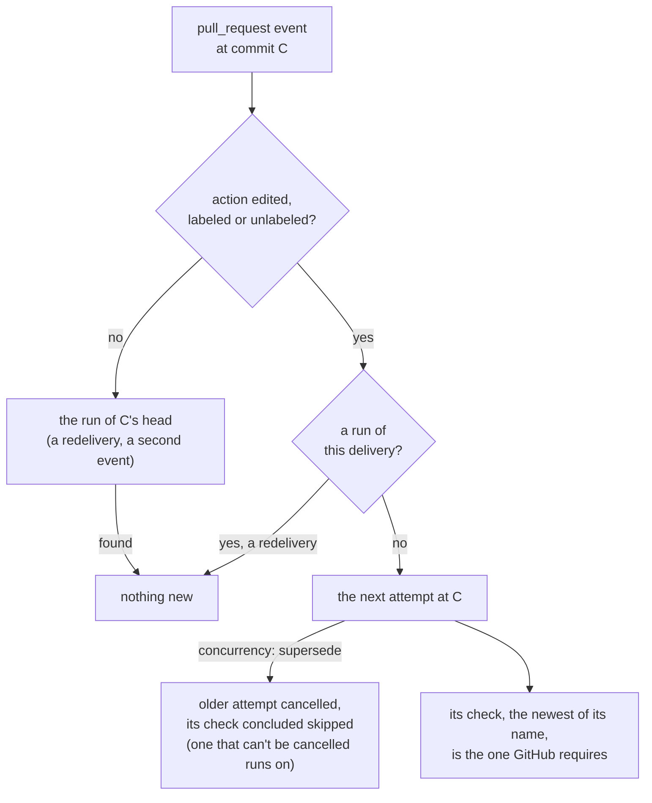

# The Linear check: Octomaton's part

Check `Linear`, tooling's organization pipeline `linear`, decides from the pull request itself (its labels, and whether Linear links an issue to it), not from its code. Octomaton gives it two things it lacked. An organization pipeline may mount Secrets and ask for a token for every repository whatever triggers it, since Octomaton never reads one at a pull request's head. And a pull request's `edited`, `labeled` and `unlabeled` run the pipelines that list them again at the same commit. Linear: [ENG-128](https://linear.app/arikkfir/issue/ENG-128).

## Context

- Octomaton refused `secrets` on every pipeline triggered by pull requests, merge groups or pushes, organization pipelines included. The rule keeps a pull request's own definitions from reaching a Secret, and an organization pipeline is read at the organization repository's default branch, so for organization pipelines the refusal guarded nothing. Check `Linear` needs Linear's API key on every pull request.
- A run was found by repository, pipeline, commit and branch. A label added after `Linear` failed found that run and started nothing, so the check stayed red until the next push.

## Design

| Rule | Before | Now |
| --- | --- | --- |
| `secrets` and `githubToken.repositories: all` | Only on a pipeline whose every trigger is `comment`, `review_request` or `schedule` | Also on an organization pipeline, whatever its triggers |
| A repository's own pipeline on pull requests, merge groups or pushes | Refused both | Still refused both: its definitions come from the commit under test |
| A pull request's `edited`, `labeled`, `unlabeled` | Found the commit's run | On an open pull request, a run of its own, keyed by its delivery: the next attempt at the commit, which supersedes the one before under the pipeline's concurrency. On a closed one, nothing |
| Other pull request actions, pushes, merge groups | Find the commit's run | Unchanged; since then, endings and resumptions are runs of their own too ([pull request endings](pull-request-endings.md)) |

Code: `Pipeline.validate` in `internal/services/pipelines/config.go` learns whether it checks an organization pipeline; `sameRun` in `internal/services/runs/start.go` keys a pull request change by its delivery (`Trigger.ChangesPullRequest`), as it does a review request; and the GitHub adapter drops a change to a pull request that isn't open. The contract is the README's [`.octomaton.yaml`](https://github.com/arikkfir-org/octomaton#repository-configuration-octomatonyaml).

## Decisions

| Decision | Why | Rejected |
| --- | --- | --- |
| Organization pipelines may mount Secrets on any trigger | The rule exists so that a pull request's own definitions never reach a Secret, and Octomaton never reads an organization pipeline at a pull request's head | A ServiceAccount that reads Secret Manager at run time, which any pull request's own pipeline in that namespace could name; a per-pipeline exemption |
| One rule for Secrets and for a token for every repository | Both rest on where definitions are read | Widening Secrets alone, which leaves two rules for one reason |
| A pull request change is its own run, keyed by its delivery | What a pipeline that lists the action reads has changed, though the commit hasn't; a redelivery still finds its run. Review requests work the same way | A setting per pipeline; asking people to press Re-run after labelling |
| Only `edited`, `labeled` and `unlabeled` | They change what a pull request says. `reopened` and `ready_for_review` change nothing a check reads at a commit that already ran; they run again only to redo what an ending undid ([pull request endings](pull-request-endings.md)) | Every action, which would run `ci` again on events that change nothing it reads |

## Security

- An organization pipeline comes from the organization repository's default branch, through its review. One that mounts a Secret on pull requests runs on every pull request of the owner, Dependabot's included, so it must never run the pull request's code: tooling's `linear` reads the pull request's labels from GitHub and its link from Linear, and nothing else.
- A pull request change starts runs as a push does, only for pipelines that list its action in `types`. Forks stay ignored.

## Rollout

- This change ships before tooling adds pipeline `linear`. Until it is live, Octomaton refuses that pipeline, and a refused organization pipeline stops every pipeline of every repository.
- No configuration changes: a pipeline that doesn't list `edited`, `labeled` or `unlabeled`, which is every pipeline before `linear`, runs as before.
