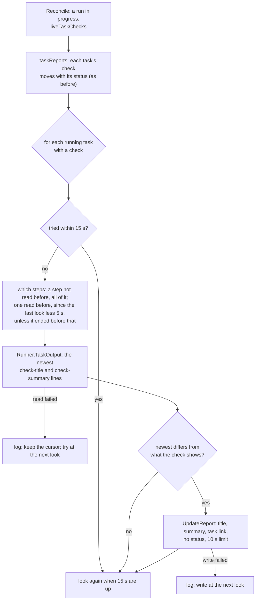

# Live task checks

A running task can tell its own check how it is going: a long test suite shows its counts and its first failures
while it runs, not only when it ends. The task prints a line to its log, and the leader, which already reads tenant
pods' logs for failed steps, writes the text to that task's check. Nothing new is granted: no credential, endpoint or
cluster permission. Linear: [ENG-206](https://linear.app/arikkfir/issue/ENG-206), and
[ENG-205](https://linear.app/arikkfir/issue/ENG-205) for the token it makes unnecessary; pull request:
[#60](https://github.com/arikkfir-org/octomaton/pull/60).

## Context

- A task check (`taskChecks: true`) said "Running" from its task's start to its end. The reporter wrote it only when
  its status moved; it read results only from a finished task, and Tekton records a result only when its step exits.
  A suite that runs for most of an hour, as one long step, showed nothing for most of an hour.
- The way around it was a token that writes checks, handed to the task with its check's ID. Such a token can rewrite
  every check the App wrote on the repository, required ones included, and Octomaton granted one even to definitions
  read at the commit under test. [ENG-205](https://linear.app/arikkfir/issue/ENG-205) refuses that now; this design is
  what such a task does instead.

## Design

```mermaid
sequenceDiagram
  participant S as Step (task e2e)
  participant K as Kubernetes (pods/log)
  participant L as Leader (services/reports)
  participant G as GitHub (check "ci / e2e")
  S->>K: stdout: octomaton:check-title MyBvZiA0MA==
  S->>K: stdout: octomaton:check-summary KipGYWlsaW5nOioq…
  loop at most every 15 s while e2e runs
    L->>K: each started step's log since the last look, less 5 s
    K-->>L: lines; L keeps the newest of each name, decoded and redacted
    alt the title or summary changed
      L->>G: PATCH output (title, summary + task link): no status
    end
  end
  Note over S,G: e2e ends
  L->>G: completed, with check-title / check-summary results or the default text
```

One look at one running task, from `Reconcile` of a run in progress:



- **The line.** `octomaton:<name> <base64>` on a line of its own, from any step, to stdout or stderr. `name` is
  `check-title` or `check-summary`, as the results that end the check; the value is standard base64, so a multi-line
  Markdown summary fits on one line. A line longer than 128 KiB (a summary GitHub would cut anyway), a value that
  isn't base64 or UTF-8 text, an empty value, and a last line without its newline (the runtime may still be writing
  it) are skipped. `ci.OutputPrefix` and `ci.OutputRead` are the vocabulary; `scanOutput` in
  `internal/adapters/tekton/output.go` reads it.
- **The opt-in.** `liveTaskChecks: true`, which needs `taskChecks: true`, sets the run's annotation
  `octomaton.dev/live-task-checks`. Without it, Octomaton reads no log while a task runs.
- **The look.** `liveTaskReports` in `internal/services/reports/live.go`, after `taskReports`, for each running
  task with a check: at most once per 15 seconds, it asks `Runner.TaskOutput` for what the task's started steps
  printed. A step it hasn't read before is read whole: it started since, or this replica never looked (a new leader).
  A step it read before is read since the last look less 5 seconds, which covers clocks that disagree; one that ended
  before then is not read again. The newest line wins, and a title or summary stays until another replaces it.
- **The write.** Only when the newest title or summary differs from what the check shows: title (or "Running"),
  summary and the link to the task, through the same `UpdateReport` as every report, so the summary is cut to fit and
  ends with the trigger's marker, which stays the last and so the one Re-run reads. It sets no status: a write that
  lands after the task's check concluded can't reopen it.
- **The end.** Unchanged: when the task ends, `taskReports` concludes its check with its `check-title` and
  `check-summary` results, or the default text, replacing whatever it printed.
- **Redaction.** `TaskOutput` reads the run's Secrets as `Details` does and redacts the decoded values. When a Secret
  can't be read it reads nothing, and the check keeps its text.
- **State.** In the leader's memory: per task, when it was last tried and read, which steps it had, the newest text
  and the written text. A new leader starts with none, reads each step whole once and writes the newest text. States
  of tasks that ended, of runs that finished or were deleted, and those not tried for 10 minutes are dropped.

## Decisions

| Decision | Why | Rejected |
| --- | --- | --- |
| A line in the task's own log | The leader already reads `pods/log` in tenant namespaces; a task reaches only its own check, since only its own log is read; nothing to mint, refresh or leak | An in-cluster endpoint a task posts to: a port every tenant namespace reaches, and a proof of which run calls (a per-run secret, or TokenReview), all new attack surface. A file the reporter re-reads: `pods/exec` in every tenant namespace, which runs anything in any CI pod, or an injected sidecar. A result written mid-run: Tekton records a step's results only when it exits. A token that writes checks: it can rewrite every check of the App on the repository |
| Opt-in per pipeline | Reading logs every 15 seconds costs API calls and node reads only where someone wants them | Reading every task check's log |
| `liveTaskChecks`, needing `taskChecks` | Live text goes to a task's own check; without task checks there is none | A field that also turns task checks on: two meanings in one field |
| Task checks only | A task's check is the task's; a pipeline's check sums up several tasks and already shows its task table | The pipeline's own check for a run of one task: no one needs it yet |
| 15 seconds, only when changed | Fresh enough for people; one write per running task every 15 s at most stays well within GitHub's rate limits for a few concurrent tasks | 10 s; writing on every look |
| No status in a live write, a 10 s limit, failures only logged | A late write can't reopen a concluded check, and a slow or rate-limited GitHub can't hold the reports of other runs, which share the leader's workers | Returning the error, which retries the whole reconcile |
| Read since the last look less a slack; a new step whole | Bounded reads that survive clock skew, a new leader, and a step Tekton marked started late | A stateless window (re-reads a verbose log every time); log timestamps (`timestamps=true` splits lines the runtime wrote in parts) |
| State in memory, not on the PipelineRun | Recording it would update the run every 15 s, which wakes the watch again; a new leader just reads and writes once more | Annotations |
| The end unchanged | One rule for what a finished task's check says, live or not | Keeping the last live text when a task leaves no results |

## Risks

- **Rate limits.** Each running live task writes at most every 15 seconds, so 240 writes an hour. Many concurrent live
  tasks on one installation add up against its rate limits, which Octomaton's other calls share. A write that hits a
  limit waits at most 10 seconds and is dropped, and the next look writes the newest text.
- **Log volume.** Each look streams what a step printed since the last; the kubelet scans the container's current
  log file to find that point. A very verbose step costs node reads every 15 seconds.
- **What a step prints is public.** The text reaches the check after the same redaction as results, which catches
  only the run's Secrets and well-known credential formats.

The contract is the README's [pipeline settings](https://github.com/arikkfir-org/octomaton#pipeline-settings) and
[check runs](https://github.com/arikkfir-org/octomaton#check-runs).
