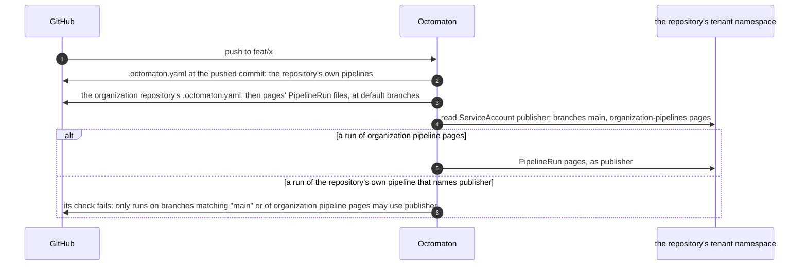

# Organization pipelines on restricted ServiceAccounts

**Decision**: a tenant ServiceAccount may list, in a third annotation, `octomaton.dev/organization-pipelines`, the
organization pipelines that may use it whatever their run's branch or tag. Like `octomaton.dev/branches` and
`octomaton.dev/tags`, it is an allow-list on the identity, set by the cluster's owner: a ServiceAccount carrying any of
the three is restricted, and a run that names it goes through when one of them admits it. A repository's own pipeline
never matches it. Linear: [ENG-211](https://linear.app/arikkfir/issue/ENG-211).

## Context

`octomaton.dev/branches: main` keeps an account that publishes or deploys to runs of `main`, because a branch's run
may run that branch's own pipeline files. An organization pipeline's run never does: its settings are read at the
organization repository's default branch, and its PipelineRun and the files it inlines at the default branch of the
repository its `pipelineRun` names, on every event, the organization repository's own branches included
([README](https://github.com/arikkfir-org/octomaton#security)). So a pipeline that publishes what a branch holds
before it merges (a preview of the branch's docs, say) can't run on that branch's push today, though nothing the
branch holds changes what runs: the branch brings only data.

## Design

| Piece | Where | What |
| --- | --- | --- |
| Annotation | A tenant ServiceAccount, set by the cluster's owner | `octomaton.dev/organization-pipelines`: comma-separated organization pipeline names. Beside `branches` and `tags` it admits more runs; alone, it restricts the account to those pipelines. Empty, it admits none |
| Run | `services/ci` (`RunSpec.Organization`), set by `services/runs` | Whether the run is an organization pipeline's, taken from the configuration, which marks the pipelines it adds from the organization repository's default branch |
| Check | `adapters/tekton/serviceaccounts.go` | A run goes through when a branch glob matches its branch, a tag glob its tag, or it is a run of an organization pipeline the account lists. A refusal names each annotation, what it admits, and the run's branch or tag and pipeline |
| Triggers | `.octomaton.yaml`, unchanged | `on.push.branches: ["**"]` matches every branch and no tag. A new branch's first push has no earlier commit to compare with, so its path filters count every path as changed |

## Decisions

| Decision | Why | Rejected |
| --- | --- | --- |
| An allow-list on the identity | The account's owner decides which code may run as it, where no repository can change it, as for branches and tags | A setting in the organization repository's `.octomaton.yaml`: its default branch would grant itself any tenant's account |
| Organization pipelines only, by name | Only an organization pipeline is read whole at default branches; no repository pipeline can take an organization pipeline's name or check name, and the mark comes from the configuration, not from the name | A repository pipeline whose `pipelineRun` names another repository: its params, secrets and token still come from the branch's `.octomaton.yaml` |
| Whatever the event, branch or tag | The definition is the same on every event, read at the same default branches | Pushes only: a pull request's run of the same pipeline runs the same definition at the same commit |
| Alone, it restricts | Any of the annotations makes the account restricted, so `organization-pipelines: pages` alone means only `pages`, the narrowest grant | Only widening `branches`: alone, it would leave the account open to every run |
| No run on a branch's deletion | A deleted ref has no commit to run at or to report a check on. A pull request's closing runs the pipelines that list `closed` ([pull request endings](pull-request-endings.md)) | A run at the default branch's head: its check would land on a commit the branch never had |

## Risks

- **Unreviewed data.** A listed pipeline handles, as the account, what any branch brings: the repository at the
  commit, and the run's context (the branch's name, commit messages, a pull request's title). Its params reach its
  steps through `env`, never substituted into a `script`: Tekton pastes `$(params.…)` into the script's text, and a
  branch may be called `a$(curl…|sh)`. It runs nothing of the repository under test (no build, plugin, hook or tool
  configuration it holds), and restores no cache a branch's run can write.
- **Who starts it.** Anyone who can push a branch to a repository whose tenant lists the pipeline starts it, as often
  as they push. The account's grants stay the narrowest the pipeline needs, and its concurrency group bounds a
  repository's runs.

## Rollout and testing

- A release, then a host's pin to it; the cluster's owner annotates the accounts, and the organization repository
  widens the pipeline's triggers.
- Unit tests cover the annotation alone and beside the others, a listed and an unlisted organization pipeline, a
  repository pipeline with a listed name, empty and invalid annotations, and a branch of the organization repository
  that rewrites the pipeline, which runs its default branch's definition. An end-to-end test runs an organization
  pipeline on a pull request's branch as a `main`-only account and refuses the repository's own pipeline there.

The contract is the README's [security](https://github.com/arikkfir-org/octomaton#security).
