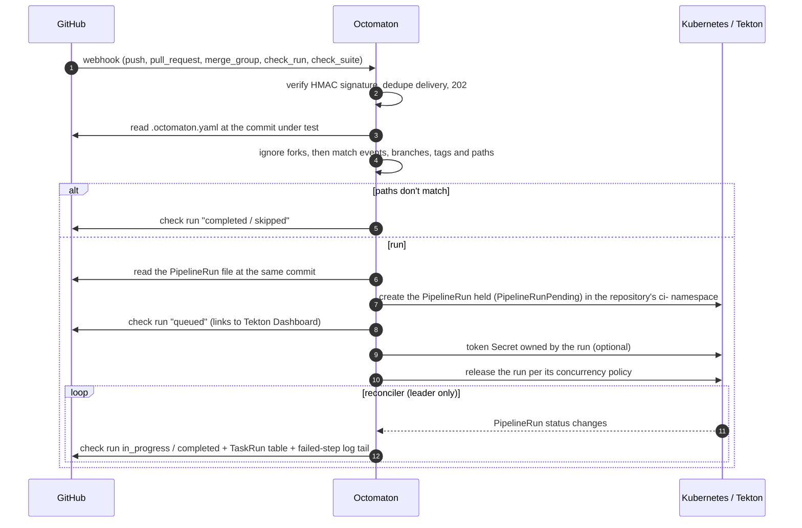
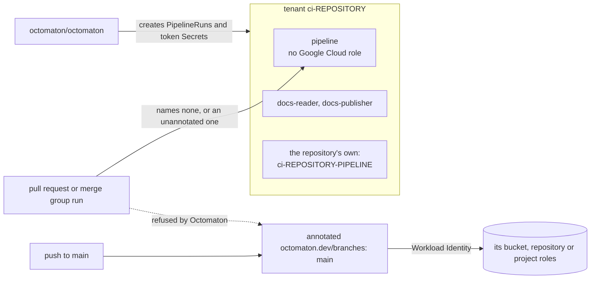
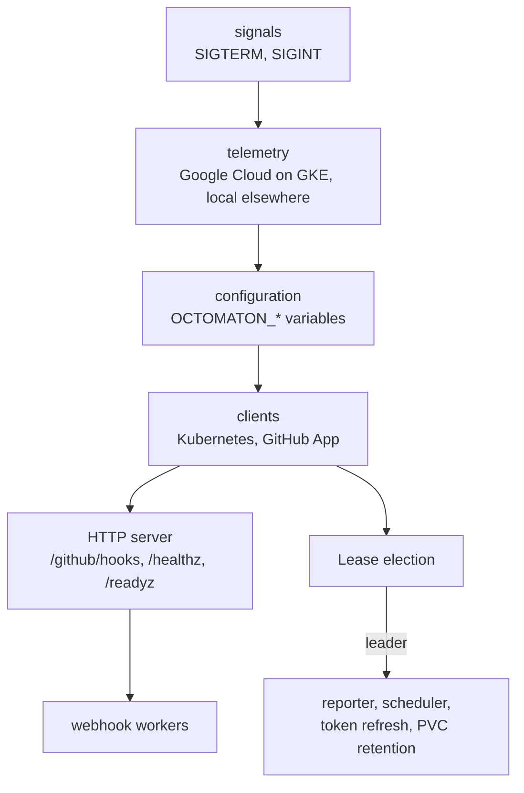
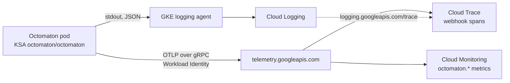

# Phase 2: Octomaton

**Goal**: replace GitHub Actions. A GitHub App delivers webhooks to Octomaton in GKE; Octomaton runs the Tekton
`PipelineRun`s that the repository's root `.octomaton.yaml` maps to those events and reports each one as a GitHub
check run. Code: [arikkfir-org/octomaton](https://github.com/arikkfir-org/octomaton). Names and wiring:
[deployment](deployment.md). The GitHub App, domain, webhook host and Go module path: [octomaton.dev](octomaton-dev.md).

## Principles

1. **Application-agnostic.** Octomaton knows nothing about what a repository builds, its language, layout, CI or CD.
2. **One file.** The only repository file Octomaton reads is the root `.octomaton.yaml`, plus the `PipelineRun`
   files it points to. There are no conventional directories and no configuration in Tekton labels or annotations.
3. **Plain Tekton.** `PipelineRun` files are ordinary Tekton YAML. Octomaton injects event context only through
   `params` (Go templates over a documented context) and an optional token workspace.

Octomaton is derived from an earlier, application-aware implementation; these principles are what changed.

## Flow



## Configuration

```yaml
apiVersion: octomaton.dev/v1
pipelines:
  - name: ci                          # the pipeline's ID
    displayName: Continuous Integration # the check's name on GitHub
    pipelineRun: .tekton/ci.yaml      # any path; Octomaton assumes no layout
    on:
      pull_request: {branches: [main]}
      merge_group: {}
      push: {branches: [main], tags: ["v*"], paths: ["src/**"]}
    params:
      repo-url: "{{ .Repository.CloneURL }}"
      revision: "{{ .Revision }}"
    githubToken: {workspace: github-token}
    timeout: 1h
    concurrency: {group: "pr-{{ .PullRequest.Number }}", policy: supersede}
```

The full schema and template context are in the
[README](https://github.com/arikkfir-org/octomaton#repository-configuration-octomatonyaml).

## Behaviour

| Situation | Behaviour |
| --- | --- |
| No `.octomaton.yaml` | Nothing happens |
| Invalid `.octomaton.yaml` | One failed check run named `octomaton` explaining the error |
| Event matches, paths don't | Check run reported as `skipped`, which satisfies required checks |
| Changed files can't be determined | Treated as matching (runs rather than silently skipping) |
| Pull request from a fork (whoever opened it), or any event from a repository that is a fork | Ignored: no check run and no run; comment commands on it get no reaction or reply, and its stored reports are never re-run |
| Repository namespace missing | Failed check: "repository not onboarded" |
| Newer commit on the same pull request or branch | Concurrency groups decide: `supersede` cancels older runs (the default for pull requests), `queue` runs one at a time, `latest` keeps only the newest waiting run |
| `/command` comment on a pull request | Pipelines with a matching `on.comment.pattern` run (definitions from the default branch, code from the pull request); the commenter must be in the command's `allow` list, as a user or through a team; the built-in `/rerun` re-runs the failed or named checks ([comment commands](comment-commands.md)); 👀 when started, a reply with the result when done |
| Cron schedule | Pipelines with `on.schedule` run at the default branch head, once per slot |
| Long run | The installation token is refreshed while the run lives; a live task table and per-task checks (`taskChecks`) show progress |
| Octomaton restarts mid-dispatch | Runs are created held (`PipelineRunPending`) and released only once their check and token exist; held runs are resumed |
| Merge group destroyed | Its runs are cancelled |
| "Re-run" in GitHub | The pipeline re-runs with the original context, stored in the check run itself, so it works after pruning |

## Tenancy and identity

**Decision**: each repository runs in a namespace of its own, `ci-<repository>`. Tekton's default ServiceAccount there, `pipeline`, holds no Google Cloud role. A pipeline that needs Google Cloud names a ServiceAccount of its own, whose Workload Identity principal holds the roles, and one that publishes is annotated `octomaton.dev/branches: main`, which Octomaton enforces: no other branch's run may use it (and `octomaton.dev/tags: v*` where it also releases versions, [versioned releases](releases.md)). The annotations sit on the identity, in `delivery`, where a pull request can't change them, and they are the only Octomaton settings outside `.octomaton.yaml`.



- `delivery` creates each tenant (`platform/ci-tenants`): the namespace, `pipeline`, `docs-reader` and `docs-publisher` for the docs site, the reviewer's objects, the repository's own ServiceAccounts, and RoleBinding `octomaton` to ClusterRole `octomaton-tenant`. `infra` grants the roles. Onboarding a repository is a change to both.
- Octomaton's own identity creates `PipelineRun`s and token Secrets only in tenant namespaces, and watches runs cluster-wide.
- Tekton's default pod template schedules runs onto node pool `ci`.

### ServiceAccounts

| Tenant | ServiceAccount | `octomaton.dev/branches` | `octomaton.dev/tags` | Google Cloud | Named by |
| --- | --- | --- | --- | --- | --- |
| every | `pipeline` | none | none | nothing | every run that names no other |
| every | `docs-reader` | none | none | lists bucket `arikkfir-docs` | the organization pipeline `docs` (check `Docs`) |
| every | `docs-publisher` | `main` | none | writes its repository's layer of `arikkfir-docs` | the organization pipeline `docs-publish` |
| every | `reviewer` | none | none | nothing, and it mounts no token | the organization pipeline `review` ([pull request reviewers](pr-reviewer.md)) |
| `ci-tooling` | `ci-tooling-publish` | `main` | none | writes bucket `arikkfir-claude` and repository `images` | tooling's `publish` and `reviewer-image` |
| `ci-octomaton` | `ci-octomaton-release` | `main` | `v*` | writes repository `octomaton` | this repository's `main` and `tag` ([versioned releases](releases.md)) |
| `ci-fin` | `ci-fin-release` | `main` | none | writes repository `images` and Fin's CI cache | fin's `release` |
| `ci-fin` | `ci-fin-preview` | none | none | writes repository `previews`, reads the CI cache | fin's `preview` |
| `ci-fin` | `ci-fin-ci` | none | none | creates reports under `reports/fin/` of `arikkfir-tests`, reads client `fin-e2e`'s secret and the CI cache | fin's `ci` and `e2e` |
| `ci-infra` | `ci-infra-plan` | none | reads the project, the state and the plan's credentials | infra's `ci` |
| `ci-infra` | `ci-infra-apply` | `main` | administers what `terraform/gcp` manages | infra's `apply` ([Terraform plan and apply](../../infra/designs/terraform-plan-apply.md)) |

Fin's `ci-fin-preview` and `ci-fin-ci` carry no annotation, since pull requests' runs need them: what they write reaches only pull requests' environments and the tests site, behind the hub's sign-in. Every grant: `infra`'s [IAM](../../infra/terraform/gcp.md#iam); what Octomaton may do in a tenant: ClusterRole [`octomaton-tenant`](deployment.md#rbac).

### ServiceAccount branches

| Item | Value |
| --- | --- |
| Annotation | `octomaton.dev/branches` on a ServiceAccount in a tenant namespace: comma-separated branch globs, as in `on.push.branches`. Without it, every branch may use the ServiceAccount; an empty or invalid one lets none. `octomaton.dev/tags` does the same for tag pushes, added with [versioned releases](releases.md) |
| Check | Before creating a run, Octomaton reads each ServiceAccount its PipelineRun names: `spec.taskRunTemplate.serviceAccountName` and `spec.taskRunSpecs[].serviceAccountName`, the only fields that name one in a `tekton.dev/v1` PipelineRun, the one version Octomaton accepts. When one carries the annotation and the run's branch matches none of its globs, the run is refused: no PipelineRun, and its check fails with the reason |
| Fails closed | A named ServiceAccount Octomaton can't read (a missing permission, an API error), an empty or invalid annotation, and a name that isn't a string refuse the run the same way. A run goes through only when every named ServiceAccount was read and is unannotated or matches |
| Run's branch | The branch whose code runs: the pushed branch (`push`); the head branch (`pull_request`, `comment`, `review_request`); the merge group's branch, `gh-readonly-queue/…` (`merge_group`); the default branch (`schedule`). A tag push has no branch: it matches a glob of `octomaton.dev/tags` or nothing |
| Not checked | A PipelineRun that names no ServiceAccount: it runs as Tekton's default, which must never carry the annotation or a role. A ServiceAccount that doesn't exist: Tekton fails the run |
| Permission | ClusterRole `octomaton-tenant` gets `get` on `serviceaccounts` |

Octomaton checks every ServiceAccount a PipelineRun file names, whether or not a task that uses it runs, so an annotated ServiceAccount must not appear in any file a pull request runs: tooling keeps `publish` in a file of its own, `.tekton/publish.yaml`, apart from `.tekton/ci.yaml`.

### Why

A run's PipelineRun file comes from the commit under test, so a pull request's run can name any ServiceAccount in its namespace, and a run that names none runs as `pipeline`. A GKE identity says only which namespace and ServiceAccount a pod runs as, never which branch: only Octomaton knows the branch. Before this, `pipeline` held each tenant's write roles, open to every branch, Dependabot's included, whose dependency code runs in CI (forks never run):

| Tenant | `pipeline` could | Worst case |
| --- | --- | --- |
| `ci-tooling` | write bucket `arikkfir-claude` | replace `setup.sh`, which Claude Code web sessions pipe to `bash` |
| `ci-octomaton` | push to repository `images` | overwrite the tag Octomaton runs from, so a restart runs that code with the GitHub App's private key |
| `ci-docs` | write bucket `arikkfir-docs` | rewrite the docs site |

ENG-50 moved those roles to the ServiceAccounts above; `ci-docs`'s went with ENG-49, when the docs site moved its publishing to `docs-publisher`.

## Process

`cmd/octomaton` is a launcher: it starts the parts in dependency order and stops them in reverse; the logic lives in
the packages under `internal/`. Every replica serves webhooks; only the leader writes to GitHub from the reporter.



| On SIGTERM, in order | Bound |
| --- | --- |
| `/readyz` fails; the HTTP server stops accepting connections and finishes the requests in flight. Meanwhile the leader's jobs stop and it releases the Lease | 10 s |
| Queued deliveries are processed and relayed | 15 s |
| Telemetry exporters flush | 5 s |

Telemetry follows where the process runs. On GKE (a pod with a GCP metadata server), everything goes to Google Cloud,
linked by trace ID; anywhere else, logs are text and nothing is exported. Variables:
[server configuration](https://github.com/arikkfir-org/octomaton#server-configuration); the hub's values and grants:
[deployment](deployment.md#endpoints-and-telemetry).



## Decisions

| Decision | Why | Rejected |
| --- | --- | --- |
| Check runs (Checks API) rather than commit statuses | Rich output, re-run buttons, required-check integration | Commit statuses |
| A check is named by its pipeline's `displayName` (`Continuous Integration`); `name` (`ci`) stays the pipeline's ID | GitHub shows the check name, and a two-letter link is hard to click; run names, labels and concurrency groups keep the short ID | Renaming the pipelines (spaces are not valid in run names or labels) |
| Ignore forks entirely, even members' | The repositories are public: anyone can fork one and open a pull request, and its code must never run in the cluster, nor be one click away from it | An "Approve and run" button for fork pull requests; trusting forks of owners, members and collaborators |
| Params and a token workspace instead of templating inside PipelineRun files | Files stay valid Tekton; no templating collisions with scripts | Pipelines-as-Code style `{{ }}` substitution in YAML |
| Runs are created held, then released | The check run and token Secret exist before anything executes; a restart mid-dispatch is resumed; concurrency queues need held runs anyway | Creating Secrets first, `generateName` |
| Deterministic run names with attempts (`<repo>-<pipeline>-<sha7>-<n>`) | Redeliveries and duplicate events find the existing run; re-runs are new attempts | Random names (duplicates on redelivery) |
| Skipped checks for path-filtered pipelines | Required checks can't deadlock on unrelated changes | Not reporting (blocks merges) |
| Namespace per repository | Isolation of credentials and permissions | Shared CI namespace |
| No Google Cloud role on `pipeline` | A run that names no ServiceAccount runs as `pipeline`, which Octomaton never checks | Annotating `pipeline`, which would refuse every pull request's run |
| The branch restriction on the ServiceAccount, in `delivery` | Only Octomaton knows a run's branch, and a pull request can't change `delivery` | A list in `.octomaton.yaml` (a pull request edits it); a branch condition on the principal (GKE identities carry none); a namespace for runs from `main` (a repository has one namespace) |
| A ServiceAccount per publishing pipeline, `ci-<repository>-<pipeline>`; pipelines of one repository that need the same role on the same resource share one | Roles stay per pipeline. Artifact Registry grants per repository, so two pipelines that push to the same one would each hold the same role on it | One shared name in every tenant; an account per pipeline whatever its role |
| Unstructured objects + dynamic client | Avoids the heavy Tekton Go module; only a few status fields are read | Tekton typed clients |
| Leader election for the reconciler only | Any replica can take webhooks; one writer updates check runs | Single replica without election |
| Configuration from environment variables only (`envconfig`) | One mechanism for settings and secrets: the ConfigMap and the Secret map straight to variables, nothing is mounted, and every problem is reported at startup | A YAML file with mounted secret files; flags |
| Telemetry to Google Cloud on GKE: logs through stdout to Cloud Logging, metrics and traces over OTLP to the Telemetry API; nothing exported elsewhere | One place for logs, metrics and traces, linked by trace ID. OTLP is Google's recommended path (its own Cloud Monitoring and Cloud Trace exporters are deprecated) and needs no collector | A Prometheus endpoint; an OpenTelemetry Collector; Google's deprecated exporters |
| The linter is its own command, `octomaton-lint` | The server takes no arguments; the linter is what people install | Subcommands of one binary |

## Security

- Webhooks are verified (HMAC-SHA256) before anything else; the webhook route is the only public path.
- Forks are never acted on: pull requests from them, comment commands on those, re-runs of their reports and every
  event from a repository that is a fork are ignored, without a check run or a reply.
- Installation tokens are minted per run with least permissions (contents read), expire within an hour and are
  garbage-collected with the run.
- Pull requests can change their own pipeline files, so they can name any ServiceAccount in their namespace. Namespaces
  separate repositories, and within a namespace a ServiceAccount annotated `octomaton.dev/branches` is refused to every
  other branch ([ServiceAccount branches](#serviceaccount-branches)). A new ServiceAccount, annotated or not, has no
  role until `infra` grants one, since roles bind to named principals.

## Rollout

1. Create the GitHub App (permissions and events in the [README](https://github.com/arikkfir-org/octomaton#github-app)); store its ID, key
   and webhook secret in Secret Manager.
2. Build the first image locally with `ko` (see the [bootstrap runbook](../../infra/runbooks/bootstrap.md)); afterwards
   Octomaton builds itself: every push to `main` publishes an image tagged with the commit's short SHA.
3. Argo CD deploys every commit on `main` with its own image ([deployment](deployment.md)).
4. Apply the GitHub rulesets once `Continuous Integration` checks appear on pull requests.
