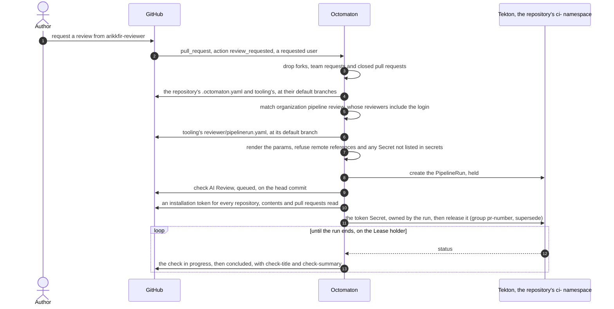
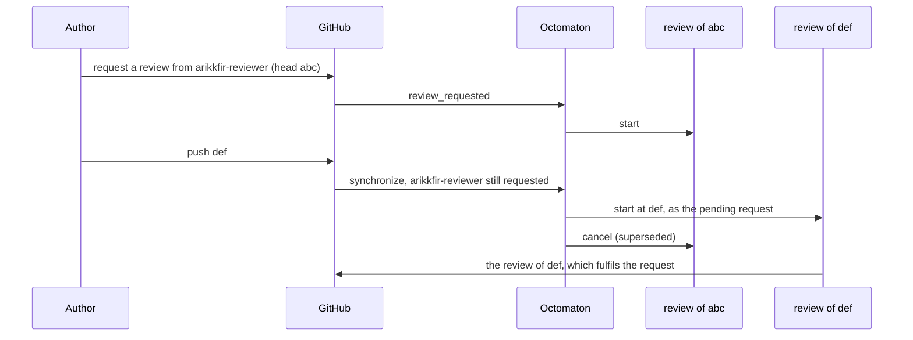
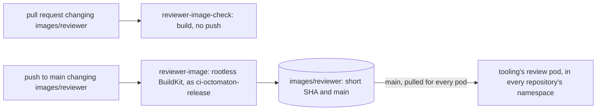

# Pull request reviewer

**Decision**: Octomaton runs the [pull request reviewer](../../tooling/designs/pr-reviewer.md) as an ordinary pipeline, through settings that name no repository and no reviewer: the `review_request` trigger; organization pipelines, which the organization repository (server setting `OCTOMATON_ORGANIZATION_REPOSITORY`, `tooling` in the hub) declares once for every repository; `secrets` and `githubToken.repositories: all`, only for pipelines whose every trigger reads its definitions from the default branch; and the refusal of remote Tekton references, so that the Secret guard sees every definition. This repository also builds the reviewer's image from `images/reviewer/` and moves its `main` tag, which every review pulls. The reviewer itself (its pipeline, prompt, scripts and review process) is `tooling`'s. Names and wiring: [`tooling`'s design](../../tooling/designs/pr-reviewer.md); schema: [`.octomaton.yaml`](https://github.com/arikkfir-org/octomaton#repository-configuration-octomatonyaml).

## Context

The reviewer is a pipeline that every repository runs when a review is requested from the GitHub user `arikkfir-reviewer`: it reads the pull request and the rest of the organization with a token, runs a model with an API key, and posts the review with `arikkfir-reviewer`'s own token ([how it works](../../tooling/designs/pr-reviewer.md#how-it-works)). It needs from its CI:

| Need | Octomaton's answer |
| --- | --- |
| A trigger for "review requested from this user" | `on.review_request` |
| One definition for every repository, which no pull request can change | Organization pipelines, read at the organization repository's default branch, and their PipelineRun with them |
| Two Secrets, the model's key and the reviewer's token, that no other pipeline can mount | `secrets`, only for pipelines whose every trigger reads its definitions from the default branch; remote Tekton references refused |
| A token that reads every repository, internal ones included | `githubToken.repositories: all`, under the same rule as `secrets` |
| An image with the model's tools | `images/reviewer/`, published by pipeline `reviewer-image` |

Each answer is a setting of `.octomaton.yaml` or of the server, and the PipelineRun stays plain Tekton, so Octomaton's [principles](phase-2-octomaton.md) hold: nothing in the code names `tooling`, `arikkfir-reviewer` or the reviewer.

## Design

| Behaviour | Detail |
| --- | --- |
| Trigger `review_request` | A `pull_request` delivery with action `review_requested` and a requested user (not a team) among `reviewers` (case-insensitive), on an open pull request into `branches` (optional globs), drafts included. `.Event` is `review_request`, `.Action` `review_requested`, `.ReviewRequest.Reviewer` the requested login as GitHub sent it, `.Revision` the head commit. `review_requested` is not a `pull_request` type |
| One run per request | A request is its own run, keyed by its webhook delivery and its reviewer, as a comment command is by its comment. Requesting again at the same commit reviews again (the next attempt, `<repository>-review-<sha7>-<n>`); a redelivery finds its run |
| A pending request follows the head | New commits (`synchronize`) while a user's review is still requested run that request's pipelines again at the new head, read at the default branch, as that request (`.Action` stays `review_requested`; its check names the trigger "Review still requested from @… on pull request #…, after new commits"), and supersede the older commit's run |
| Definitions from the default branch | As for comment commands: `.octomaton.yaml` from the repository's default branch, the run at the pull request's head commit |
| Default concurrency | As for pull requests: group `pr-<number>` per pipeline, policy `supersede`. A newer request or head cancels the older run, whose check concludes `skipped` ("Superseded") |
| Configuration errors | An invalid configuration isn't reported on review requests: most requests are for people, and each would add a failed `octomaton` check. A configuration GitHub wouldn't serve is reported, on `octomaton` |
| Organization pipelines | `organization.pipelines` in the organization repository's `.octomaton.yaml`, read at its default branch, even for its own pull requests, join every repository's pipelines, the organization repository's included. Their runs are the repository's: its namespace, checks, template context and token. A repository pipeline with the name or check name of one is a configuration error of that repository. No `schedule` triggers |
| `pipelineRun` | In an organization pipeline, a plain path names a file of the organization repository, read at its default branch: the hub's `review` names `reviewer/pipelinerun.yaml`. `{repository, path}` reads a file of another repository of the same owner, also at its default branch; `octomaton-lint` checks such a pipeline's templates but can't render its run |
| `secrets` | Names the Secrets in the run's namespace that its runs may mount besides the token: `reviewer-deepseek-api-key` and `reviewer-github-pat` for `review`. Allowed only when every trigger is `comment`, `review_request` or `schedule` |
| `githubToken.repositories: all` | Mints the run's token for every repository the App is installed on in the owner, with the pipeline's `permissions` (`contents: read`, `pull_requests: read` for `review`), and keeps that scope on every refresh. Allowed only under the same rule as `secrets` |
| Remote references refused | A PipelineRun with a `pipelineRef`, a `taskRef`, a step's `ref`, a `resolver` or a `bundle` is refused, so the Secret guard sees every definition |

### A pending request

GitHub sends no new `review_requested` while a review is still requested from a user, and the reviewer refuses to post the review of a commit that is no longer the head. So when the author pushes during a review, the request itself follows the head:

Once the review is posted, the request is fulfilled: a later push runs nothing until the author requests the review again.

### The reviewer image

| Item | Value |
| --- | --- |
| Source | `images/reviewer/Dockerfile`: `ghcr.io/anomalyco/opencode:1.18.33`, pinned by digest, plus Alpine 3.24's `bash`, `coreutils`, `curl`, `diffutils`, `file`, `findutils`, `gawk`, `git`, `grep`, `gzip`, `jq`, `less`, `make`, `patch`, `python3`, `sed`, `tar`, `tree`, `unzip`, `wget`, `xz` and `yq-go` |
| Image | `me-west1-docker.pkg.dev/arikkfir/images/reviewer`, tagged with the commit's short SHA and `main` ([Artifact Registry](../../infra/terraform/gcp.md#artifact-registry)) |
| Publication | Pipeline `reviewer-image` (`.tekton/reviewer-image.yaml`), on pushes to `main` that change `images/reviewer/**` or the file itself; only the newest waiting one runs (`latest`); as `ci-octomaton-release`, which only `main` may use; the task retries twice (a lost node kills the build, and pushing the same tags again is harmless) |
| Check | Pipeline `reviewer-image-check` (check `Reviewer Image`, `.tekton/reviewer-image-check.yaml`), on pull requests that change the image: builds it without pushing, as `pipeline` |
| Build | Rootless BuildKit (`moby/buildkit:v0.33.1-rootless`) with `--oci-worker-no-process-sandbox`, as UID 1000, its step unconfined by seccomp and AppArmor, its state on an `emptyDir` |
| Consumer | `tooling`'s `reviewer/pipelinerun.yaml` runs the `main` tag in every step and its sidecar, with `imagePullPolicy: Always`: a merge here that changes the image reaches the next review in every repository |

## Decisions

| Decision | Why | Rejected |
| --- | --- | --- |
| Review requests are a trigger of their own, read at the default branch | A pull request can't rewrite its reviewer, its prompt or the Secrets it mounts, as for comment commands | `review_requested` as a `pull_request` type, whose definitions come from the head commit |
| Each request is its own run | Requesting a review again after changes is GitHub's own loop, and a request at the same commit asks for a new review | Keying the run by its head commit, as for `pull_request` (a re-request at the same commit would find the old run and do nothing) |
| New commits while the review is still requested review the new head | The reviewer refuses to post the review of a commit that is no longer the head, and GitHub sends no new request while one is pending, so a re-request did nothing: the review was lost until someone removed and re-added the reviewer (5 times on 2026-10-02 and 03, [octomaton#21](https://github.com/arikkfir-org/octomaton/pull/21)) | Posting the older commit's review (it would approve code that isn't the head); the reviewer removing and re-adding the request; reviewing every push, requested or not (cost, noise) |
| Configuration errors aren't reported on review requests | Most requests are for people, not pipelines: each would add a failed `octomaton` check while the configuration is broken, which the repository's own events report anyway | Reporting them on every request |
| Organization pipelines, declared once in the organization repository | Nothing about `review` differs between repositories; every repository, new ones included, gets it without a change | An identical entry in each repository's `.octomaton.yaml` |
| The organization repository is a server setting | Octomaton stays free of repository names; the hub sets `tooling`, since Claude Code can't clone `.github` (its name starts with a dot) | A fixed `.github` in the code (the first version, [octomaton#13](https://github.com/arikkfir-org/octomaton/pull/13)), or `tooling` |
| A repository can't redefine an organization pipeline | No repository can skip the reviewer or point `review` at another definition | Repository pipelines overriding organization ones by name |
| A pipeline may mount the Secrets it declares, only if every trigger reads definitions from the default branch | Head-commit definitions still can't name a Secret, so a pull request can't reach the reviewer's token | A server-wide allowlist (any pull request's CI could mount the token) |
| Remote Tekton references are refused (`pipelineRef`, resolvers, bundles) | The guard only sees inline definitions; a remote one would slip past it. No repository uses them | Resolving them first (Octomaton would fetch and trust what Tekton fetches) |
| `githubToken.repositories: all`, under the rule of `secrets` | Octomaton already mints and refreshes run tokens, and widening their scope is one option, which no pull request's own definitions get | A second fine-grained personal access token (a manual yearly renewal, and a Secret every namespace holds) |
| The reviewer image is built here, and `tooling` runs its `main` tag, pulled for every pod | `ci-octomaton-release` already pushes to `images`, only from `main`; every merge to `images/reviewer` reaches the next review, with no bump in `tooling` to forget | A digest pinned in `tooling`, bumped by hand after every publish; building it in `tooling` (a second identity that writes `images`) |
| `reviewer-image` has a `paths` filter, unlike `release` | The image changes only with `images/reviewer`, and each publication moves the `main` tag that every review pulls. `release` runs on every push because Argo CD deploys every commit's images | Publishing on every push |
| Rootless BuildKit with `--oci-worker-no-process-sandbox`, its step unconfined by seccomp and AppArmor | A plain Dockerfile, built without a privileged container. Kubernetes can't unmask `/proc` as BuildKit's process sandbox needs, and BuildKit's own Kubernetes examples run it so | kaniko (Google archived it); a privileged BuildKit |

## Security and failure modes

- A review request is only as trusted as whoever made it: requesting a review takes triage or write access, and the pull request must come from the repository's own branches, since Octomaton ignores forks. Only new commits on such a branch, which take write access, run a pending request again.
- Every definition a review runs (the repository's `.octomaton.yaml`, the organization pipelines and the PipelineRun) is read at a default branch, so no pull request, not even one to `tooling`, changes what its own review runs or mounts. A change to the reviewer takes effect once merged.
- A run may mount the token Octomaton binds and the Secrets its pipeline lists, nothing else: volumes, workspaces, projected sources, `env` and `envFrom` are checked, and remote references are refused so that nothing escapes the check. Which of the run's containers mount what is the PipelineRun's to decide ([the `review` task](../../tooling/designs/pr-reviewer.md#the-review-task)).
- The token of `review` reads every repository the App is installed on, internal ones (`fin`) included. Octomaton mints it only for pipelines read from a default branch, with the permissions they list, and it lives an hour at most, refreshed while the run lives.
- The review runs as ServiceAccount `reviewer`, which carries no `octomaton.dev/branches` annotation: it holds no role, so any branch's run may use it.
- Failed steps' logs, `check-title`, `check-summary` and task messages lose every value of every Secret the run references, the DeepSeek key, `arikkfir-reviewer`'s token and the installation token included, before they reach GitHub ([redaction](check-run-redaction.md)).
- A broken `review` definition, or a broken `.octomaton.yaml` in the repository, shows on a review request as no `AI Review` check at all, with a warning in Octomaton's log; the repository's own pull request events report its configuration on `octomaton`. GitHub failing to serve a configuration is reported on `octomaton`, and Octomaton retries GitHub's calls and forgets a delivery that left work undone, so a redelivery runs it again ([GitHub outages](github-retries.md)).
- A new request for the same pull request supersedes the running review, and so do new commits while the review is still requested.
- The `main` tag of the reviewer image moves with every merge that changes it, so a broken image breaks the next review in every repository. `reviewer-image-check` builds it on pull requests but runs no review. Revert to roll back: the revert publishes the old image as `main`. A failed publication leaves `main` where it was.
- The image's build step runs unconfined by seccomp and AppArmor, as a non-root user without privileges, and publishes only from `main`.

## Open questions

- The App already receives review events (`pull_request_review`, `pull_request_review_comment`, `pull_request_review_thread`), which Octomaton ignores. An author's reply to a finding could start a new round without a re-request.
