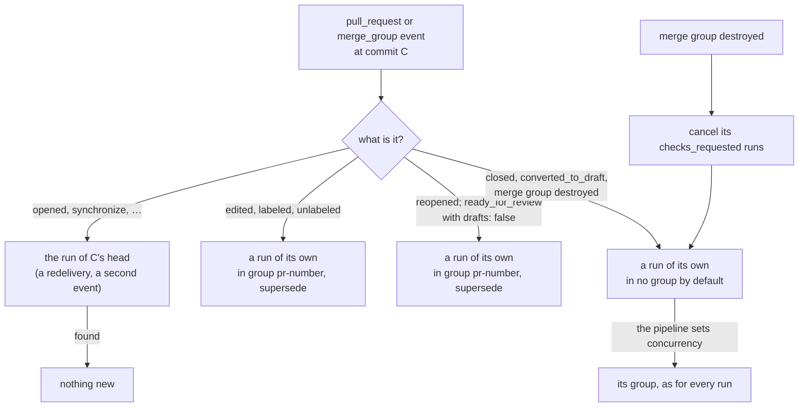

# Pull request endings

A pipeline can run when a pull request is closed or becomes a draft, and when a merge group leaves the queue: the
moments a pull request's environment, or a queue entry's, is torn down. A pull request that comes back (reopened, or
ready again for a pipeline that skips drafts) runs its pipelines again at the same commit, so whatever the teardown
removed comes back too. Templates can tell a merge from an abandonment, why a merge group was destroyed, and which
pull request it was for. Linear: [ENG-190](https://linear.app/arikkfir/issue/ENG-190); pull request:
[#59](https://github.com/arikkfir-org/octomaton/pull/59).

## Context

- `pull_request.types` accepted every GitHub action, `closed` and `converted_to_draft` included, but ran them as
  commit runs: one run per pipeline, commit and head branch. A pull request that became a draft and was then closed
  at the same commit ran its teardown once; the second event found the first's run.
- Those runs joined the pull request's default `supersede` group, `pr-<number>`. One teardown cancelled another, and
  a teardown for `converted_to_draft` stood itself down if a commit landed before it started.
- `merge_group` ran on `checks_requested` only. A destroyed merge group just cancelled its runs.
- `reopened` and `ready_for_review` at an unchanged commit found the pipeline's earlier run there and started
  nothing. So an environment torn down on an ending never came back.
- Templates could not tell a merge from an abandonment, why a merge group was destroyed, or which pull request a merge
  group tested (its branch is `gh-readonly-queue/<base>/pr-<number>-<sha>`).

## Design

| Event | Run | Default concurrency | `drafts: false` |
| --- | --- | --- | --- |
| `opened`, `synchronize` | The commit's: a redelivery or a second event for the same commit and head finds it | `pr-<number>`, `supersede` | Skips drafts |
| `edited`, `labeled`, `unlabeled` | Its own, keyed by its delivery; on an open pull request only ([the Linear check](linear-check.md)) | `pr-<number>`, `supersede` | Skips drafts |
| `reopened` | Its own, keyed by its delivery: the pull request was closed, which every pipeline missed | `pr-<number>`, `supersede` | Skips drafts |
| `ready_for_review` | Its own for a pipeline with `drafts: false`, which skipped the draft; the commit's otherwise | `pr-<number>`, `supersede` | — |
| `closed`, `converted_to_draft` | Its own, keyed by its delivery, at the head commit as it was when the event fired | None | Never skips them |
| merge group `destroyed` | Its own, keyed by its delivery, at the group's head; its `checks_requested` runs are cancelled first | None (as every merge group run) | — |

A commit's event never takes an ending's run for its own, so a push at a commit an ending ran still runs.

- **Explicit concurrency.** A pipeline that sets `concurrency` gets it for its endings too. Two pipelines that name
  the same group share it, so a teardown in the group of the pipeline that deploys, with policy `latest`, waits for
  a deployment in flight. It replaces a deployment still waiting, a reopen's deployment replaces a teardown still
  waiting, and nothing cancels a running one.
- **`merge_group.types`.** `checks_requested` (the default, so every existing configuration means what it did) and
  `destroyed`.
- **Template context.**
  - `.PullRequest.Merged` is true on `closed` when the pull request was merged.
  - `.MergeGroup.Reason` is `merged`, `invalidated` or `dequeued` on `destroyed`.
  - `.MergeGroup.PullRequestNumber` is the pull request whose queue entry the group is, read from its branch's name
    (`0` when the name holds none).
- **Checks.** An ending's run reports like any other, on the commit it ran at. For a closed pull request, that is
  its head. For a destroyed merge group, it is the group's head, which for a merged group is the base branch's new
  commit, where the group's CI checks already are. Re-run works as on any check.
- **Configuration problems.** An invalid configuration is not reported on an ending, as on a change. The commit's
  own checks already reported it.

Code:

- `ci.Trigger.Ends` and `OwnRun` and `pipelines.Pipeline.Resumes` say what a trigger is. `sameRun` in
  `internal/services/runs/start.go` keys the runs of its own by their delivery.
- `Pipeline.Match` and `ConcurrencyFor` apply `drafts` and the default group.
- `Service.Handle` and `CancelMergeGroup` in `internal/services/runs` cancel a destroyed group's checks, then run
  its pipelines.
- `queuedPullRequest` in `internal/adapters/github/events.go` reads the number from the branch's name.

The contract is the README's [triggers](https://github.com/arikkfir-org/octomaton#triggers) and
[template context](https://github.com/arikkfir-org/octomaton#template-context).

## Decisions

| Decision | Why | Rejected |
| --- | --- | --- |
| Endings leave only the *default* group | Nothing newer is left to supersede a closed pull request's run, and one teardown must not cancel another. But an explicit group must still hold them, or a teardown could not wait for the deployment it undoes | Exempting endings from every group, which leaves a teardown racing a deployment; keeping them in `pr-<number>` |
| Each ending is a run of its own | Two endings at one commit (draft, then closed) each need their pipeline; a redelivery still finds its run | One run per commit, as before |
| Closing a pull request cancels none of its runs | A cancelled deployment can leave a lock or half its resources; a pipeline that must not race a teardown shares its group instead. A destroyed merge group's checks guard nothing and still go | Cancelling a closed pull request's runs, as a destroyed merge group's |
| `reopened` runs again; `ready_for_review` only with `drafts: false` | An ending may have undone what a pipeline did; a pipeline that skips drafts saw nothing of the draft, and every pipeline missed the closed time. A `drafts: true` pipeline ran on the draft, so its run at the commit stands | Every `ready_for_review`, which runs CI again at commits it already passed; running again only after an ending ran, which ties pipelines together through runs a pruner deletes; a setting |
| `drafts: false` never skips an ending | It means "do no work for a draft", and undoing work is not work for one | Skipping them, which leaves a draft's environment up |
| `.MergeGroup.PullRequestNumber` from the branch's name, in the GitHub adapter | GitHub sends no pull request with the event, and the name's shape is GitHub's: it stays in the adapter, beside the other payload shapes | Template functions (sprig's `regexFind`) for each pipeline to parse it |
| Every run reports a check | Re-run, and the trigger it replays, live in the check; a teardown's failure shows beside the commit's checks | A `checks: false` setting |

## Security

- An ending reads its definitions at the commit under test, as every pull request and merge group event does. So a
  pipeline with an ending trigger is still refused Secrets and an all-repository token unless it is an organization
  pipeline.
- Forks stay ignored, endings included.
- Endings start runs only for the pipelines that list them.

## Failure modes

| Failure | Effect |
| --- | --- |
| GitHub would not serve an `invalidated` or `dequeued` group's head, which no branch holds any more | Answering "not found" for `.octomaton.yaml` reads as no configuration: nothing runs, and nothing says so. Any other error fails check `octomaton`, and a refused report fails the run's start; Re-run tries again. GitHub serves a closed pull request's head through its pull request ref |
| A deployment still running when the pull request closes, with no shared group | Both run; whatever they race over is the pipelines' |
| A lost delivery | No run; the pipeline's own backstop (a periodic sweep) covers it |

## Rollout

- Nothing changes for a pipeline that doesn't list an ending, except that **a pull request reopened at an unchanged
  commit runs its pipelines again**. This is org-wide: every repository's pipelines on the default types run on
  `reopened`.
- `ready_for_review` runs again only for pipelines with `drafts: false`; none in the hub has it.
- The hub gets this with the next release and its pin bump in `delivery`.

## Open questions

- Whether GitHub serves files and accepts checks at the head of an `invalidated` or `dequeued` group. The first
  pipeline that lists `destroyed` will show it.
