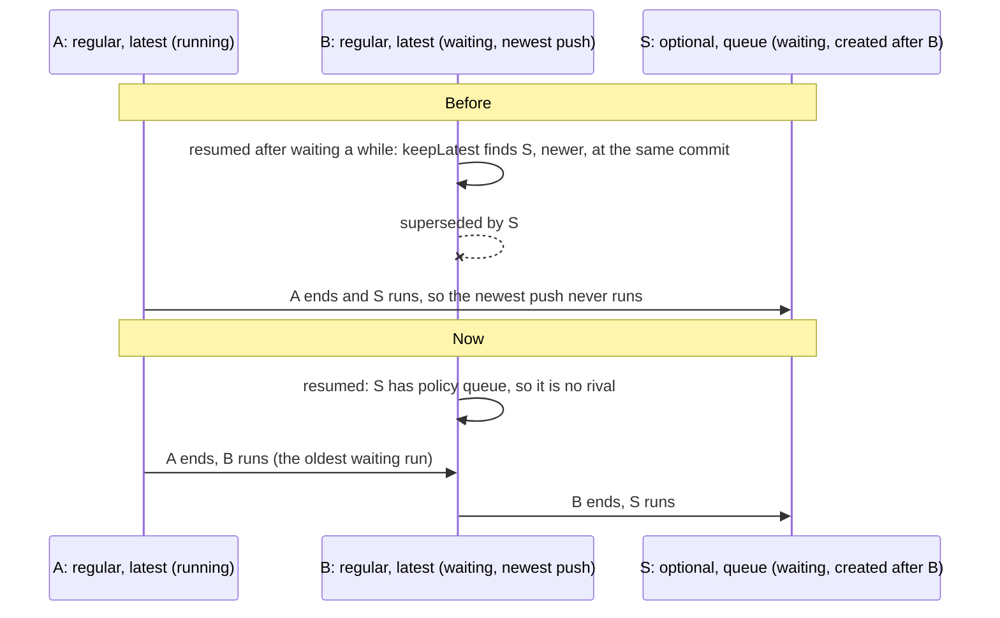

# Pull request labels as a switch

A pull request label can switch an optional pipeline on: adding it runs the pipeline once, and while it is on, the pull request's regular pipeline does the extra work on every push. Three changes make that expressible, each useful alone: a `labels` filter on the `pull_request` trigger, the pull request's labels in the template context, and a `latest` policy that leaves waiting `queue` runs of its group alone.

## Context

- `types: [labeled]` matched every label anyone added, and a run could not tell which label started it.
- A pipeline could not read the labels a pull request carries, so it could not decide per run whether to do optional work.
- Two pipelines may share a concurrency group with different policies. `keepLatest` compared a `latest` run with every waiting run of the group, whatever its policy, and so lost a push:



## Design

| Change | Rule |
| --- | --- |
| `on.pull_request.labels` | With `labels` set, a `labeled` or `unlabeled` event matches only when the label it added or removed is listed, by its exact name, case-sensitive, no globs. Any other label starts no run and creates no check. Other actions are not filtered |
| Its validation | `labels` without `labeled` or `unlabeled` in `types` is a configuration error, as is an empty name: the filter could never apply |
| `.PullRequest.Labels` | The names of the labels the pull request carried when the event fired, on every event that sets `.PullRequest`; an empty list when it has none. From the webhook's payload: the pull request's labels, or the issue's for a comment |
| The stored trigger | It gains the pull request's labels and the event's label, with no new version: a trigger stored before reads as a pull request without labels, so the release before's runs and reports still resume and re-run |
| `latest` | It counts only waiting runs whose policy is `latest`: a waiting `queue` run is never stood down by a `latest` run, and is never the newer run a `latest` run stands itself down for. Waiting runs still start oldest first |

A regular pipeline reads the switch per run:

```yaml
params:
  extra-checks: '{{ $on := "false" }}{{ range .PullRequest.Labels }}{{ if eq . "run-extra-checks" }}{{ $on = "true" }}{{ end }}{{ end }}{{ $on }}'
```

## Decisions

| Decision | Why | Instead of |
| --- | --- | --- |
| No new trigger version | Both fields are optional and their absence means what an old trigger meant, so nothing has to be migrated, and a replica of the release before reads a new trigger too | A version 2 that every reader would have to accept beside version 1 |
| The event's label is stored, not shown to templates | A re-run evaluates the stored trigger again, so it needs the label to match `labels`; the request for the context was the pull request's labels only | Adding a second context field nobody asked for |
| Exact names | A label's name is what a person types; a glob would start pipelines on labels nobody listed | Globs, as for branches |
| `latest` ignores `queue` runs, in both directions | A `queue` run asks for its turn, whatever arrives after it; cancelling it, or cancelling for it, breaks the policy of one of the two pipelines | Ranking every waiting run of the group together |

## Consequences

- A re-run of a `labeled` or `unlabeled` run that the release before created knows no label: it matches a pipeline without `labels` as before, and no pipeline that has since gained `labels`.
- Labels are as the event's payload had them. A label added after a push is seen by the next event, not by the push's run.
- `supersede` is unchanged: it still stands down every other live run of its group, whatever its policy.
