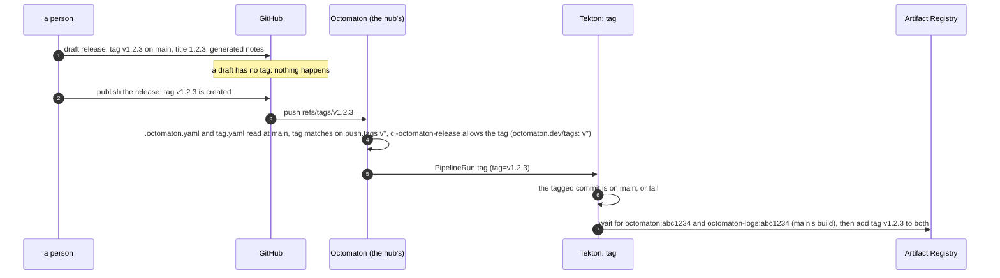

# Versioned releases

**Decision**: besides the release of every commit on `main`, which pipeline `main` publishes tagged with the commit's
short SHA, Octomaton has versions: a [GitHub release](https://github.com/arikkfir-org/octomaton/releases) with tag
`v<version>` on a commit of `main`, titled `<version>`, whose notes list the pull requests since the previous version
by kind, with their authors, and link the [installation guide](../installation.md) at that tag. Publishing the release
pushes the tag; pipeline `tag` adds the version to the tagged commit's images, rebuilding nothing: a version is the
image `main` ran. A draft release has no tag, so it does nothing. `ci-octomaton-release` admits version tags
through a second annotation, `octomaton.dev/tags`, which Octomaton checks as it checks `octomaton.dev/branches`. A
person drafts the release on GitHub, with its generated notes, and publishes it. Linear: [ENG-181](https://linear.app/arikkfir/issue/ENG-181).

## Context

Octomaton became a product other clusters host ([host-agnostic Octomaton](host-agnostic.md)). A host that follows
`main` gets every commit; a host that pins wants a name to pin, a list of what changed since the name it runs, and a
page that says how to install and upgrade. Until now the only names were short SHAs, the list was `git log`, and the
installation guide was the README's contract table, which says what a host provides but not in which order or with
which commands. The reviewer image's `main` tag and the hub's own Argo CD Applications keep following `main`: nothing
here changes how the hub deploys Octomaton.

## Design

| Piece | Where | What |
| --- | --- | --- |
| Pipelines | `.octomaton.yaml` | `release` becomes `main` (`on.push.branches: [main]`, `.tekton/main.yaml`: build and push, unchanged otherwise); new `tag` (`on.push.tags: ["v*"]`, `.tekton/tag.yaml` with its Task in `tag.task.yaml`, param `tag` is `{{ .Tag }}`). Both name `ci-octomaton-release` |
| Version | `.tekton/tag.yaml`, its task in `tag.task.yaml` | Refuse anything but `vX.Y.Z`; fetch the commit and `main`, refuse a commit that is not an ancestor of `main`; wait up to 15 minutes for the commit's images under its short SHA (`main` may still be building them), then `gcloud artifacts docker tags add` the version to both. The floating `main` image tag is gone: a host pins a commit or a version |
| Identity | `delivery`, `ci-octomaton-release` | `octomaton.dev/tags: v*` beside `octomaton.dev/branches: main` ([CI tenants](../../delivery/platform.md#ci-tenants)) |
| Definitions | `adapters/github/events.go` | A tag push reads `.octomaton.yaml` and the PipelineRun at the default branch, like a comment command or a schedule, and runs the tagged commit. So a tag runs only reviewed definitions, in every repository |
| Check | `adapters/tekton/serviceaccounts.go` | A ServiceAccount with either annotation is restricted: a branch's run must match a branch glob, a tag push a tag glob. Branches alone still refuse every tag push, as before; tags alone refuse every branch's run |
| Release | GitHub releases | Tag `v<version>`, title `<version>`, GitHub's generated notes (the pull requests since the previous version, with their authors, and the compare link) plus a line linking the installation guide at the tag |
| Guide | [`installation.md`](../installation.md) | From nothing to a first check: the App, the Secret and ConfigMap, `deploy/` at a version, the route, tenants, a first pipeline, the step logs server, upgrading |

## Decisions

| Decision | Why | Rejected |
| --- | --- | --- |
| The tag push triggers the build, not the release event | Octomaton has `push` with `tags`; GitHub creates a release's tag only when the release is published, so a draft builds nothing by construction, and a tag pushed by hand releases too | A `release` trigger: a new event, a new permission on the App, and a draft that has to be filtered out |
| A version retags the commit's images instead of rebuilding | The version is the exact image `main` published and the hub ran, with no second build to diverge; it costs seconds, not a Go build. The binaries report the short SHA, which GitHub and the registry map to the version | Rebuilding at the tag with `VERSION=v1.2.3`, so the binaries report the version |
| The version tag is the image tag, `v1.2.3` | One string names the release in Git and in the registry; `v` tells a version from a short SHA at a glance | `1.2.3` as the image tag: a second spelling of the same release |
| `tag` refuses a tag whose commit is not on `main` | Pushing a tag takes write access, merging into `main` a review; a version must be the latter's. The check costs a fetch of `main` | A tag ruleset that limits who creates `v*` tags: it would still let a maintainer release an unreviewed commit |
| A tag push reads its definitions at the default branch | The ancestry check is the `check` step of `tag.task.yaml`; read at the tagged commit, a tag could carry a `tag.task.yaml` without it, or an `.octomaton.yaml` that leaves `tag` empty, and still receive `ci-octomaton-release`. Read at `main`, the pipeline a tag runs is always a reviewed one, in every repository Octomaton serves | The check in Octomaton itself (ancestry of the default branch before creating a tag's run): a policy about one repository's releases in an application-agnostic server |
| A second annotation, not a tag syntax inside `octomaton.dev/branches` | Branch and tag globs are different namespaces (`on.push` keeps them apart too), and a ServiceAccount restricted to `main` must keep refusing every tag push, which a shared annotation could not promise | `octomaton.dev/branches: main, refs/tags/v*` |
| The notes are GitHub's generated release notes, and the version is the person's call | A Claude Code session may not create GitHub releases, so a skill that drafted them had no one to run it (it existed briefly, arikkfir-org/tooling#53, and went with arikkfir-org/tooling#56); GitHub lists the pull requests and their authors itself; the product is the tag, the images and the guide, which the notes only point at | A release-notes command in `cmd/`; a skill in `tooling` generating the version and notes from conventional commits |
| A draft first, published by a person | Publishing is the step that tags images and cannot be undone; the person reads the notes and the version before it | Publishing at once |

## Security and failure modes

- A version is released by whoever can push a `v*` tag, which is anyone with write access, and only for a commit
  of `main`: `tag`, whose definition comes from `main` whatever the tag names, refuses any other, and
  `ci-octomaton-release` refuses any ref but `main` and `v*`.
- A tag push in any repository now runs the default branch's definitions, not the tagged commit's; a repository
  whose tags carried their own `.octomaton.yaml` sees the default branch's instead.
- A tag pushed twice at a different commit (deleted and recreated) moves the version's image tags to the other
  commit's images. Don't; cut the next version instead.
- A tag pushed before `main` has published the commit's images waits for them, up to 15 minutes; if `main` failed,
  `tag` fails too and the GitHub release stands with no images: re-run `main`, then `tag`, from GitHub.
- A release is created by a person on GitHub; its author is that person.

## Rollout

1. This pull request: the check, pipelines `main` and `tag`, the guide and this page (`octomaton`).
2. `delivery`: `octomaton.dev/tags: v*` on `ci-octomaton-release`. Until it merges, a `v*` tag's run is refused,
   and nothing is built.
3. The first version is drafted on GitHub with generated notes, read, then published.
