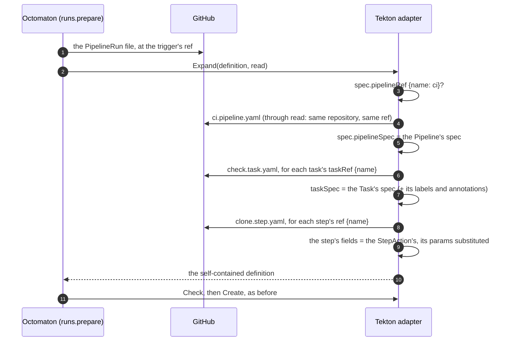

# A PipelineRun's pipeline, tasks and steps in files beside it

**Decision**: Octomaton resolves Tekton's own references by name (`spec.pipelineRef`, a task's `taskRef`, a step's `ref`) to files in the PipelineRun file's directory (`<name>.pipeline.yaml`, `<name>.task.yaml`, `<name>.step.yaml`), read at the commit the PipelineRun file was read at, and inlines them before it checks the run. Every file stays valid against Tekton's schemas, and Tekton gets the same self-contained PipelineRun it gets today, so every check (Secrets, ServiceAccounts, remote references) runs on the expanded run unchanged. Linear: [ENG-176](https://linear.app/arikkfir/issue/ENG-176). Contract: [README](https://github.com/arikkfir-org/octomaton#pipeline-task-and-stepaction-files).

## Context

Octomaton vets a run only as it sees it, so it refuses every definition fetched from elsewhere: `pipelineRef`, `taskRef`, a step's `ref`, resolvers and bundles. Every task had to be an inline `taskSpec`, and a pipeline of six tasks was one long file whose only reuse was YAML anchors (weesp-ai/delivery#1 asked to split `.tekton/ci.yaml` and `.tekton/apply.yaml` into a file per task). A syntax of Octomaton's own (`taskRef: {path: …}`) would have made the files invalid Tekton; Tekton's references by name are already what a pipeline uses to point at a predefined Task or StepAction, and a naming convention turns each name into a file.

## Design

| Part | Behaviour |
| --- | --- |
| Where | `Runner.Expand`, called by `runs.prepare` between reading the PipelineRun file and `Runner.Check`; `octomaton-lint` calls the Tekton renderer's `Expand` with files from disk, so `-render` prints the expanded run. Services pass a `FileReader` closure over `Installation.ReadFile` at the definition's repository and ref; the Tekton adapter owns the Tekton knowledge (kinds, embedding, param substitution) |
| Resolution | `<dir of the PipelineRun file>/<name><suffix>`; a name matches `[a-z0-9]([a-z0-9.-]*[a-z0-9])?`, so it can't leave the directory. A reference holding any key but `name` is refused; one without `name` (a resolver, a bundle) is left for the remote-reference check, whose message stays the same |
| Order | The pipeline, then the tasks and finally tasks of the (inlined or inline) pipeline, then the steps of every (inlined or inline) task: Pipeline → Task → StepAction, so there is no cycle and no depth to bound |
| Task | `taskSpec` = the Task's `spec`, plus `metadata: {labels, annotations}` from the file's metadata, which Tekton puts on the TaskRun as it would for a referenced Task. Each use gets its own copy |
| StepAction | The step keeps its own fields (`name`, `onError`, `computeResources`, `workspaces`, …), drops `ref` and `params`, and takes the StepAction's (`image`, `command`, `args`, `script`, `env`, `workingDir`, `securityContext`, `volumeMounts`, `results`); a field both set is refused. `$(params.<name>)`, `$(params['<name>'])` and `$(params["<name>"])` in the StepAction's fields are replaced by the step's `params`, then the StepAction's defaults (which may reference other params), the way Tekton resolves a `ref`. Array and object params, and a param the StepAction doesn't declare or gets no value for, are refused |
| Bound | At most 20 files per PipelineRun, each read once (a Task used by three tasks is one read) |
| Errors | A reference's or a file's problem is a refusal (the run's check fails and says why), a file that does not exist too (`… whose file .tekton/check.task.yaml does not exist at abc1234.`); a file GitHub would not serve is a refusal with a cause, so the delivery is forgotten and a redelivery tries again, as for the PipelineRun file ([GitHub outages](github-retries.md)) |
| Unchanged runs | A definition that references nothing is returned byte for byte, so every existing PipelineRun is handled exactly as before |

## Decisions

| Decision | Why | Rejected |
| --- | --- | --- |
| Tekton's references by name, resolved by a naming convention | The PipelineRun and every file stay valid Tekton; a reader, an editor's schema and Tekton's own tooling understand them | `taskRef: {path: tasks/check.yaml}`, Octomaton's own key, invalid against the CRD schema |
| Files beside the PipelineRun file, named `<name>.<kind>.yaml` | One directory holds a pipeline and everything it runs; the kind in the name says what a file is without opening it; the convention needs no configuration | A `tasks/` directory (a layout assumption, which Octomaton avoids); resolving in the repository root (files of unrelated pipelines would collide) |
| Inline before the checks, in the Tekton adapter | The checks (Secrets, ServiceAccounts, remote references, task names) see the whole run and change nothing; services stay free of Tekton's shapes, reading files through the same port as the PipelineRun file | Resolving in Tekton (a git resolver fetches what Octomaton can't check, and needs credentials); inlining in the services (they would parse Tekton YAML) |
| Same repository, same commit | The file is trusted exactly as the PipelineRun file is: a pull request's head for its own runs, the default branch for comment commands, review requests, schedules and other-repository definitions | References into other repositories or refs (a new trust boundary) |
| StepAction params substituted by Octomaton, string only | Tekton substitutes them when it resolves a `ref`; inlined, `$(params.x)` would mean the Task's param instead. Strings cover the shared steps a pipeline has (a clone step takes a URL and a revision); arrays and objects expand differently per field | Leaving `$(params.x)` to Tekton (wrong param); implementing Tekton's array and object expansion |
| A bound of 20 files | Each file is a contents API call during the webhook job; a pipeline has a handful of tasks | No bound |

## Security and failure modes

- Nothing new is trusted: a referenced file comes from the same repository and commit as the PipelineRun file, through the same read, so a pull request can change what its own run does (as it can the PipelineRun file) and nothing else; definitions read at a default branch stay there.
- The expanded run goes through every existing check: a Secret, a ServiceAccount, a resolver or a bundle in a referenced file is refused as if written inline. A file referencing anything but the next kind down (a Task with a `taskRef`, a StepAction with a `ref`) isn't valid Tekton and is refused by the remote-reference check.
- A missing or invalid file fails the run's check with the reference that named it; a file GitHub would not serve forgets the delivery, so a redelivery runs it again.
- A StepAction's `script` with a substituted param is inlined as a plain step script, which Tekton allows for inline steps but not for StepActions (it keeps params out of scripts to avoid shell injection): a value from an untrusted source (a comment's arguments) in a script is the pipeline author's risk, as it is for an inline step.
