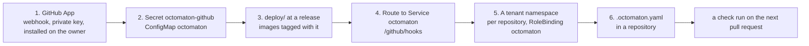

# Installing Octomaton

Octomaton is a GitHub App that runs Tekton pipelines, hosted in a Kubernetes cluster of your own. This page installs
it from nothing to a first green check, in the order the pieces depend on each other. The contract behind each step,
every setting and every permission: the [README](https://github.com/arikkfir-org/octomaton#hosting-octomaton). A
worked example, with Argo CD: the hub's [hosting Octomaton](../delivery/designs/octomaton.md).



## Before you start

| You need | Why |
| --- | --- |
| A Kubernetes cluster, with `kubectl` and `kustomize` (or Argo CD) against it | Octomaton runs there, in namespace `octomaton`, which `deploy/` creates |
| [Tekton Pipelines](https://tekton.dev/docs/pipelines/) serving `tekton.dev/v1`, and optionally the Tekton Dashboard | Octomaton creates `PipelineRun`s; check runs link to the Dashboard when it has one |
| An HTTPS address that reaches the cluster | GitHub sends the App's webhooks to `https://<host>/github/hooks` |
| An owner (a GitHub user or organization) and admin rights on it | The App is installed on it; only its repositories are served |
| A way to make Kubernetes Secrets | The App's credentials never go in Git: an ExternalSecret, a sealed Secret or `kubectl create secret` |

## Pick a release

Every [GitHub release](https://github.com/arikkfir-org/octomaton/releases) is a version `X.Y.Z`: its tag `vX.Y.Z` is
the commit to apply `deploy/` from, and its images are `me-west1-docker.pkg.dev/arikkfir/octomaton/octomaton:vX.Y.Z`
and `…/octomaton-logs:vX.Y.Z`, in a public repository that needs no credentials to pull from. Its notes list what
changed since the previous version. A host that would rather follow `main` applies `deploy/` at a commit of `main` and
tags the images with that commit's short SHA, which every push to `main` publishes
([releases](https://github.com/arikkfir-org/octomaton#releases)). The steps below use a version; `vX.Y.Z` stands for
the one you picked.

## 1. Create the GitHub App

In the owner's settings (Developer settings → GitHub Apps → New GitHub App), or at
`https://github.com/organizations/<owner>/settings/apps/new`:

| Setting | Value |
| --- | --- |
| Webhook URL | `https://<host>/github/hooks`, the address step 4 routes |
| Webhook secret | A random string; keep it for the Secret below |
| Repository permissions | Checks: read and write. Contents: read. Metadata: read. Pull requests: read and write. Merge queues: read |
| Subscribe to events | `push`, `pull_request`, `issue_comment`, `check_suite`, `check_run`, `merge_group` |
| Where can this App be installed | Only on this account, unless it serves several owners |

Then generate a private key (Private keys → Generate), keep the downloaded PEM file, note the App ID at the top of
the App's page, and install the App (Install App) on the owner, for all repositories or the ones it should serve.
Octomaton identifies the App by its ID, never by its name, so name it as you like.

## 2. Give Octomaton its credentials and settings

Both live in namespace `octomaton`, which `deploy/` creates in step 3; create the namespace first if you create these
by hand (`kubectl create namespace octomaton`). The Secret holds the App's three credentials, under these exact keys:

```bash
kubectl -n octomaton create secret generic octomaton-github \
  --from-literal=app-id=<App ID> \
  --from-file=private-key=<the PEM file> \
  --from-literal=webhook-secret=<the webhook secret>
```

The ConfigMap holds the server's settings as environment variables
([all of them](https://github.com/arikkfir-org/octomaton#server-configuration)). One is required: the owners whose
installations are served. The others below are the ones most installations set:

```yaml
apiVersion: v1
kind: ConfigMap
metadata:
  name: octomaton
  namespace: octomaton
data:
  OCTOMATON_GITHUB_ALLOWED_OWNERS: <owner>                # comma-separated; installations elsewhere are ignored
  OCTOMATON_TEKTON_DASHBOARD_URL: https://tekton.<host>   # optional: check runs link to each run there
  OCTOMATON_ORGANIZATION_REPOSITORY: tooling              # optional: the repository whose .octomaton.yaml may declare
                                                          # pipelines every repository runs
```

A missing ConfigMap or Secret holds the pod in `CreateContainerConfigError` until it exists; an empty
`OCTOMATON_GITHUB_ALLOWED_OWNERS` exits the server at startup, with the reason in its log.

## 3. Apply `deploy/`

`deploy/` is applied as written, at the release's tag, with the image tagged the same. With kustomize, an overlay of
your own holds the tag, and anything you add (labels, node placement, the annotation of a cloud identity):

```yaml
# octomaton/kustomization.yaml
apiVersion: kustomize.config.k8s.io/v1beta1
kind: Kustomization
resources:
  - https://github.com/arikkfir-org/octomaton//deploy?ref=vX.Y.Z
images:
  - name: me-west1-docker.pkg.dev/arikkfir/octomaton/octomaton
    newTag: vX.Y.Z
```

```bash
kubectl apply -k octomaton/
kubectl -n octomaton rollout status deployment/octomaton
```

With Argo CD, an Application whose source is `deploy` of `https://github.com/arikkfir-org/octomaton` at
`targetRevision: vX.Y.Z`, with `kustomize.images` setting the same tag and `kustomize.patches` for your additions,
as the hub's [Application `octomaton`](../delivery/designs/octomaton.md) does. Either way, never edit `deploy/`'s
objects themselves: a host adds to them, so that the next release applies cleanly.

What you get: Namespace `octomaton` (the restricted Pod Security Standard enforced), ServiceAccount `octomaton` and its
RBAC, Deployment `octomaton` (two replicas, a PodDisruptionBudget) and Service `octomaton` on port 80. Both replicas
serve webhooks; the one holding Lease `octomaton` reports runs. `GET /readyz` on a pod answers once the Kubernetes API
is reachable.

## 4. Route the webhook

Route `https://<host>/github/hooks` to Service `octomaton`, port 80, with whatever fronts your cluster: an HTTPRoute
on a Gateway, an Ingress, a load balancer. If the cluster enforces NetworkPolicies, admit the proxy's pods to the pods
labelled `app.kubernetes.io/name: octomaton` on port 8080, in namespace `octomaton`. Then, on the App's page
(Advanced → Recent Deliveries), redeliver the `ping` GitHub sent when the App was created: Octomaton answers it `202`.

## 5. Create a tenant namespace per repository

Octomaton creates a repository's runs in its own namespace, `ci-<repository>` by default
(`OCTOMATON_NAMESPACE_TEMPLATE` and `OCTOMATON_NAMESPACE_OVERRIDES` change the rule). The namespace is yours to
create, and a repository without one is reported as not onboarded on its checks. In each, bind ClusterRole
`octomaton-tenant`, which `deploy/` created, to Octomaton's ServiceAccount:

```yaml
apiVersion: v1
kind: Namespace
metadata:
  name: ci-<repository>
---
apiVersion: rbac.authorization.k8s.io/v1
kind: RoleBinding
metadata:
  name: octomaton
  namespace: ci-<repository>
roleRef:
  apiGroup: rbac.authorization.k8s.io
  kind: ClusterRole
  name: octomaton-tenant
subjects:
  - kind: ServiceAccount
    name: octomaton
    namespace: octomaton
```

Runs execute as Tekton's default ServiceAccount of the namespace unless their PipelineRun names another. The
namespace is the isolation boundary: give its ServiceAccounts only what that repository's pipelines need, and
annotate one that publishes or deploys with `octomaton.dev/branches: main` (and `octomaton.dev/tags: v*` for a
pipeline that releases from version tags), so that no other branch's run can use it
([security](https://github.com/arikkfir-org/octomaton#security)). Secrets a pipeline mounts live in this namespace too.

## 6. Declare a pipeline

In the repository's root, `.octomaton.yaml` maps events to PipelineRun files
([schema](https://github.com/arikkfir-org/octomaton#repository-configuration-octomatonyaml)). The smallest useful one
runs a check on every pull request and merge group:

```yaml
# .octomaton.yaml
apiVersion: octomaton.dev/v1
pipelines:
  - name: ci
    displayName: Continuous Integration
    pipelineRun: .tekton/ci.yaml
    on:
      pull_request: {}
      merge_group: {}
    params:
      repo-url: "{{ .Repository.CloneURL }}"
      revision: "{{ .Revision }}"
```

```yaml
# .tekton/ci.yaml: plain Tekton, with the params Octomaton sets
apiVersion: tekton.dev/v1
kind: PipelineRun
metadata:
  generateName: ci-
spec:
  params:
    - {name: repo-url, value: ""}
    - {name: revision, value: ""}
  pipelineSpec:
    params:
      - {name: repo-url, type: string}
      - {name: revision, type: string}
    tasks:
      - name: test
        params:
          - {name: repo-url, value: $(params.repo-url)}
          - {name: revision, value: $(params.revision)}
        taskSpec:
          params:
            - {name: repo-url, type: string}
            - {name: revision, type: string}
          steps:
            - name: clone-and-test
              image: alpine/git:2.54.0
              env:
                - {name: REPO_URL, value: $(params.repo-url)}
                - {name: REVISION, value: $(params.revision)}
              script: |
                #!/bin/sh
                set -eu
                git clone --quiet "$REPO_URL" . && git checkout --quiet "$REVISION"
                echo "run your tests here"
```

Validate both before pushing, in your repository's checkout, with `octomaton-lint .` (installed with
`go install octomaton.dev/cmd/octomaton-lint@vX.Y.Z`, or run as `go run octomaton.dev/cmd/octomaton-lint@vX.Y.Z .`),
then open a pull request: a check named `Continuous Integration` appears on it, queued, then in progress with a table of
the run's tasks, then concluded, with the logs of any failed step. Make it a required check of the branch's protection
or ruleset once it passes.

## 7. Optionally, archived step logs (GKE)

On GKE, the Tekton Dashboard loses a step's log when the autoscaler deletes the node its pod ran on. `deploy/logs/`
adds `octomaton-logs`, a server that reads those logs from Cloud Logging
([README](https://github.com/arikkfir-org/octomaton#archived-step-logs-octomaton-logs)). Apply it the same way as
`deploy/` (`https://github.com/arikkfir-org/octomaton//deploy/logs?ref=vX.Y.Z`, the image `…/octomaton-logs:vX.Y.Z`),
with ConfigMap `octomaton-logs` (`OCTOMATON_LOGS_VIEW`, `OCTOMATON_LOGS_CLUSTER`, `OCTOMATON_LOGS_LOCATION`), a
Workload Identity binding of ServiceAccount `octomaton/octomaton-logs` to an identity with `roles/logging.viewAccessor`
on the view, network admission from the Dashboard's pods, and the Dashboard's external logs URL set to
`http://octomaton-logs.octomaton.svc.cluster.local/logs`. Elsewhere, skip it.

## Upgrading

Move the `ref` and the image tags to the new version together, after reading its
[release notes](https://github.com/arikkfir-org/octomaton/releases): a release that changes an object a host patches,
or a setting, says so there. The Deployments roll out by surging, so a replica of the new version is ready before one
of the old stops; running webhooks are not lost, since every replica serves them and GitHub redelivers a failed one.
Rolling back is the same move, to the previous version.

## Troubleshooting

| Symptom | Where to look |
| --- | --- |
| The pod is in `CreateContainerConfigError` | ConfigMap `octomaton` or Secret `octomaton-github` is missing, or a key is misspelled |
| The pod restarts at startup | Its log lists every configuration problem, `OCTOMATON_GITHUB_ALLOWED_OWNERS` included |
| GitHub shows the delivery failed | The route or the NetworkPolicy of step 4; `GET /readyz` on a pod says whether the server is up |
| The delivery was answered `202` but no check appears | The App is not installed on the repository, the owner is not in `OCTOMATON_GITHUB_ALLOWED_OWNERS`, or the repository is a fork, which Octomaton never serves |
| The check says the repository is not onboarded | The tenant namespace of step 5 is missing |
| The check is refused | Its text says why: a Secret the pipeline may not mount, a ServiceAccount restricted to other branches, a remote reference |
