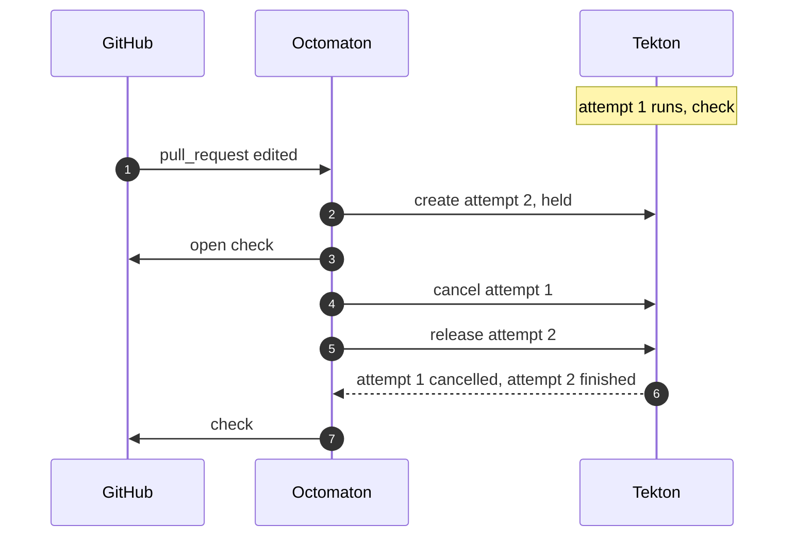
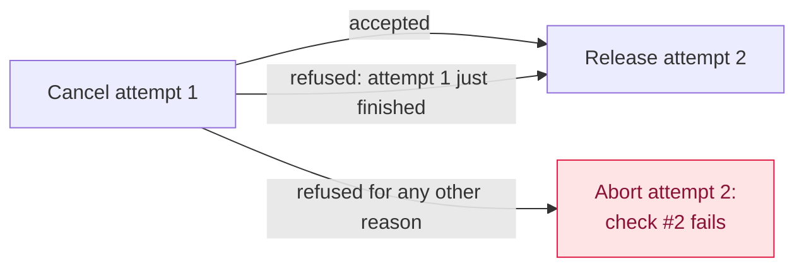

# A pull request's check goes red when the pull request is edited while the check runs

**Status**: 🟡 fixed on `main` ([octomaton#58](https://github.com/arikkfir-org/octomaton/pull/58)), not released yet · **Seen in**: Octomaton v0.0.1, check `Linear`, at another installation (weesp-ai's); the hub's check `Docs` on 2026-10-24 · **Since**: v0.0.1 and before · **Issue**: [ENG-188](https://linear.app/arikkfir/issue/ENG-188)

## 🎯 TL;DR

When a newer run supersedes an older one and the cluster refuses to cancel the older one, Octomaton fails the newer run's check, which is the one GitHub shows and branch protection reads. At one installation, editing a pull request while `Linear` ran left the pull request blocked until someone commented `/rerun` or pushed again.

## 🧭 How it's meant to work

An edit, a label or new commits start a new run of each pipeline that lists the event ([the Linear check](../designs/linear-check.md)). Under `supersede`, the default for pull requests, the newer run cancels the older one and runs; its check is the newest of its name, so it's the one that counts.



## 💥 Root cause

`supersede` and `keepLatest` in Octomaton's [`internal/services/runs/concurrency.go`](https://github.com/arikkfir-org/octomaton/blob/b3e7ec7/internal/services/runs/concurrency.go) return the error of step 4, cancelling the older run, and `start` takes it as its own failure: it aborts the new run, cancels it and fails check #2 with "The run could not be started". The older run, which nobody could stop, finishes on check #1, which GitHub no longer shows. [ENG-178](https://linear.app/arikkfir/issue/ENG-178) (octomaton#47) tolerates one refusal, a rival that has just finished, and no other.



## 🔍 Evidence

| Claim                                                                                         | Evidence                                                                                                                                                                                                                          | Status                      |
|-----------------------------------------------------------------------------------------------|-----------------------------------------------------------------------------------------------------------------------------------------------------------------------------------------------------------------------------------|-----------------------------|
| At the other installation, Tekton's admission webhook refused to cancel a running PipelineRun | Its report: "Once the PipelineRun has started, only status updates are allowed", after an `edited` delivery while `Linear` ran                                                                                                    | ❓ we have not seen its logs |
| A refused cancel fails the newer run's check                                                  | A test on `main`: a running rival whose cancel is refused, then an `edited` delivery. Attempt 2 ends cancelled ("could not be started"), check #2 concludes `failure`, "The run could not be started", and attempt 1 runs on      | ✅                           |
| The hub hit the same path once                                                                | 2026-10-24 14:32:00Z: `octomaton-docs-1b39d79-1` aborted while superseding `octomaton-docs-58fab1c-1`, which Tekton refused because that run had just completed; ENG-178 fixed that case                                          | ✅                           |
| A plain Tekton accepts the cancel of a running run                                            | Tekton v1.12's defaulting and validation, run over the hub's `linear` PipelineRun with the hub's defaults: create, record, release, record and cancel while running all pass; the cancel is refused only once the run is complete | ✅                           |
| The hub does not hit the "has started" refusal                                                | 75 same-commit supersessions of `linear` runs (an edit or a label while a run was live) in the hub's logs from 2026-10-15 to 2026-10-25, none refused; the only refusal in October is the "complete" case above                   | ✅                           |
| What refuses the cancel at the other installation                                             | Not found. Something changes the run's spec on update there: another webhook that mutates PipelineRuns, or Tekton's defaults changed while the run ran                                                                            | ❓                           |

<details>
<summary>🔎 The hub's log lines, 2026-10-24</summary>

```text
14:32:00.801 INFO  Superseding run  run=ci-octomaton/octomaton-docs-58fab1c-1 supersededBy=octomaton-docs-1b39d79-1
14:32:00.843 ERROR Could not start the run; cancelling it  run=ci-octomaton/octomaton-docs-1b39d79-1
  error="superseding ci-octomaton/octomaton-docs-58fab1c-1: patching PipelineRun ci-octomaton/octomaton-docs-58fab1c-1:
  admission webhook \"validation.webhook.pipeline.tekton.dev\" denied the request: validation failed: invalid value:
  Once the PipelineRun is complete, no updates are allowed: spec"
14:32:00.947 INFO  Run finished  run=ci-octomaton/octomaton-docs-58fab1c-1 conclusion=success
14:32:01.597 INFO  Run finished  run=ci-octomaton/octomaton-docs-1b39d79-1 conclusion=cancelled
```

</details>

<details>
<summary>🔎 Tekton's webhooks, emulated over the hub's linear PipelineRun</summary>

Each step decodes the stored PipelineRun, applies Octomaton's JSON merge patch, defaults it within an update and validates it against the stored object, as Tekton's two webhooks do. Defaults: `default-service-account: pipeline` and the hub's default pod template.

```text
create: <nil>
record while held: <nil>
release: <nil>
record while running: <nil>
cancel while running: <nil>
cancel once complete: invalid value: Once the PipelineRun is complete, no updates are allowed: spec
record once complete: <nil>
```

</details>

## 🌍 Blast radius

Every host, on any pipeline under `supersede` or `latest`, whenever the cluster refuses to cancel the older run. Short checks that run again on edits and labels, such as `Linear`, meet it most. At the other installation: two pull requests on 2026-10-25. On the hub: once in ten days, check `Docs` after a push.

## 🩺 Still on `main`?

🟡 Fixed on `main` by [octomaton#58](https://github.com/arikkfir-org/octomaton/pull/58), not released yet: v0.0.1, which every host runs, and `main` before it (`b3e7ec7`) abort the newer run.

## 📊 Confidence

High for Octomaton's part: the failure reproduces on `main` and the fix's tests cover it. Medium for the trigger at the other installation: a plain Tekton accepts the cancel, and we have not seen that cluster.

## 🏁 Outcome

[ENG-188](https://linear.app/arikkfir/issue/ENG-188) and [octomaton#58](https://github.com/arikkfir-org/octomaton/pull/58): a rival Octomaton can't cancel is left as it is, and its check, no longer the newest of its name, doesn't count. Under `supersede` the newer run goes on beside the running rival, its check concluding with its own outcome. Under `latest` the rival is a waiting run: it keeps its turn, and the newer run waits for it, its check queued until then. It reaches a host with the next release and that host's pin bump. Until the other installation finds what changes a running PipelineRun's spec on update, its superseded runs there run to their end instead of being cancelled.
